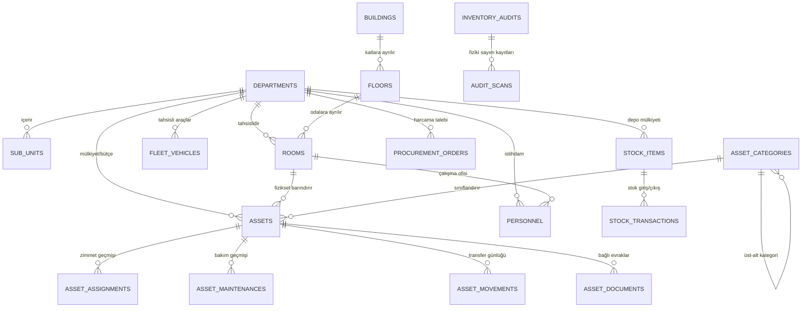
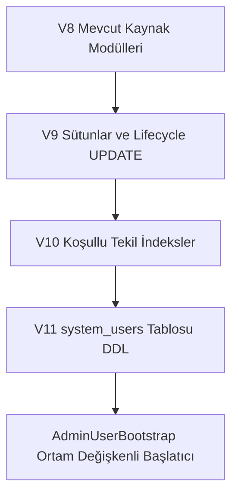
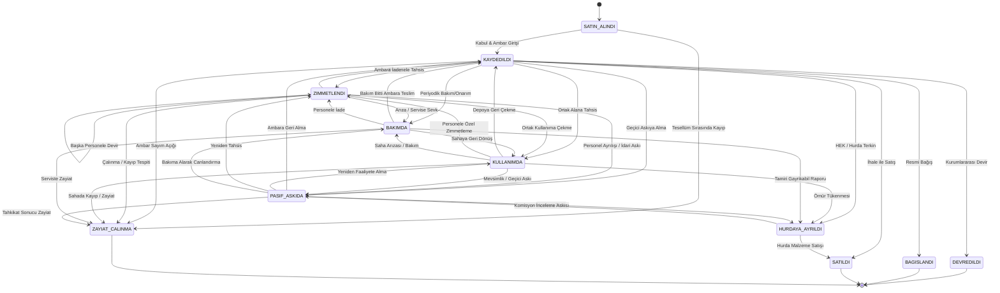

# Gebze Belediyesi Kurumsal Varlık ve Kaynak Yönetim Sistemi (GEBZE-EKYS)
## Genişletme ve Mimari Yol Haritası Planı (Revizyon 11)

Bu belge, Gebze Belediyesi Varlık Yönetimi uygulamasının (Java 25 LTS, Spring Boot 4.1.2, Oracle Database 23ai, Flyway, React 18 + TypeScript SPA) veri bütünlüğünü ve çalışan özelliklerini koruyarak tam ölçekli bir **Belediye Kurumsal Kaynak & Varlık Yönetim Sistemi (ERP / Enterprise Asset Management)** düzeyine taşınması için hazırlanan mimari analiz, karar matrisi ve fazlama planıdır.

### Tamamlanan Fazlar Özeti:
- **Faz 1A:** V9 Temel Şema, V10 Koşullu İndeksler, V11 Kullanıcı Tablosu *(TAMAMLANDI)*
- **Faz 1B-1:** Spring Security, SPA CSRF, Roller, Kapatılamayan Şifre Değiştirme Modalı *(TAMAMLANDI)*
- **Faz 1B-2:** Müdürlük ve STAFF Veri İzolasyonu, `TenantQueryScope` ve 12/12 Gap Testi *(TAMAMLANDI)*
- **Faz 1C:** 11 Durumlu Varlık Yaşam Döngüsü Durum Makinesi, V13 Bakım Öncesi Durum ve Kilitler *(TAMAMLANDI)*
- **Faz 1D:** Excel ile Toplu Varlık İçe Aktarımı (Bulk Import Engine) *(TAMAMLANDI)*
- **Faz 1E-1:** Kullanıcı Yönetimi (`/api/users`), Şifre Politikası, 5 Hatalı Denemede Hesap Kilitleme, 30 Dk Zaman Aşımı *(TAMAMLANDI)*
- **Faz 1E-2:** Güvenlik Sertleştirmesi (V15 Denetim Günlüğü Immutability Trigger'ı, CSP/HSTS Güvenlik Başlıkları, Çerez Sertleştirmesi, Actuator Kısıtlaması, İşletim Rehberi `docs/operations.md`) *(TAMAMLANDI - Commit: `529c39c`)*
- **Frontend Dönüşümü (R1–R5):** Vanilla HTML/JS'ten React 18 + Vite + TypeScript + Tailwind SPA mimarisine geçiş, 23 menü ekranı, modallar, SPA Fallback, 51/51 Playwright E2E duman testleri *(TAMAMLANDI - Tag: `vanilla-ui-final`, Commit: `d15d43e`)*
- **Faz 1F-1:** Sunucu Tarafı Sayfalama (Varlıklar & Personel), Türkçe Arama (`NLS_COMP=LINGUISTIC`, `NLS_SORT=TURKISH_AI`), V16 İndeksleri, Asenkron Seçici Modalları *(TAMAMLANDI)*
- **Faz 1F-2:** Kalan Liste Uç Noktaları Sayfalama, Keyset İmleç Mimarisi (`/api/audit-logs`, `/api/movements`, `/api/stock/transactions`), OFFSET Sayfalama (`/api/assignments`, `/api/maintenances`, `/api/stock`, `/api/fleet`, `/api/procurement`, `/api/documents`) ve Sunucu Tarafı UTF-8 BOM Streaming CSV Dışa Aktarımı (`/api/assets/export`) *(TAMAMLANDI)*

---

## BÖLÜM 1: Mevcut Durum Analizi (Gerçek Flyway V1–V8 Veritabanı Şeması)

### 1.1 Gerçek Tablo Envanteri ve Sütun Listeleri (V1–V8 DDL Analizi)

Flyway migrasyon dosyaları (`V1` – `V8`) taranarak elde edilen 20 adet gerçek tablonun şeması ve kısıtları aşağıdadır:



#### Gerçek Tablo Listesi ve Tam Sütun Tanımları:

1. **`departments`** *(V3)*:
   - `id`: NUMBER(19) PK (Identity)
   - `code`: VARCHAR2(32 CHAR) NOT NULL UNIQUE (`uk_departments_code`)
   - `name`: VARCHAR2(180 CHAR) NOT NULL UNIQUE (`uk_departments_name`)
   - `manager_name`: VARCHAR2(180 CHAR)
   - `phone`: VARCHAR2(64 CHAR)
   - `email`: VARCHAR2(120 CHAR)
   - `display_order`: NUMBER(5) DEFAULT 0 NOT NULL
   - `is_active`: NUMBER(1) DEFAULT 1 NOT NULL
   - `created_at`: TIMESTAMP WITH TIME ZONE DEFAULT CURRENT_TIMESTAMP NOT NULL

2. **`sub_units`** *(V3)*:
   - `id`: NUMBER(19) PK (Identity)
   - `department_id`: NUMBER(19) NOT NULL FK ➔ `departments(id)` ON DELETE CASCADE
   - `parent_unit_id`: NUMBER(19) FK ➔ `sub_units(id)` ON DELETE SET NULL
   - `code`: VARCHAR2(48 CHAR) NOT NULL UNIQUE (`uk_subunits_code`)
   - `name`: VARCHAR2(180 CHAR) NOT NULL
   - `unit_type`: VARCHAR2(64 CHAR) DEFAULT 'Birim' NOT NULL
   - `manager_name`: VARCHAR2(180 CHAR)
   - `phone`: VARCHAR2(64 CHAR)
   - `description`: VARCHAR2(500 CHAR)
   - `is_active`: NUMBER(1) DEFAULT 1 NOT NULL
   - `created_at`: TIMESTAMP WITH TIME ZONE DEFAULT CURRENT_TIMESTAMP NOT NULL

3. **`buildings`** *(V3)*:
   - `id`: NUMBER(19) PK (Identity)
   - `code`: VARCHAR2(32 CHAR) NOT NULL UNIQUE (`uk_buildings_code`)
   - `name`: VARCHAR2(180 CHAR) NOT NULL UNIQUE (`uk_buildings_name`)
   - `building_type`: VARCHAR2(64 CHAR) DEFAULT 'Hizmet Binası' NOT NULL
   - `address`: VARCHAR2(255 CHAR)
   - `phone`: VARCHAR2(64 CHAR)
   - `total_floors`: NUMBER(3) DEFAULT 1 NOT NULL
   - `description`: VARCHAR2(500 CHAR)
   - `is_active`: NUMBER(1) DEFAULT 1 NOT NULL
   - `created_at`: TIMESTAMP WITH TIME ZONE DEFAULT CURRENT_TIMESTAMP NOT NULL

4. **`floors`** *(V3)*:
   - `id`: NUMBER(19) PK (Identity)
   - `building_id`: NUMBER(19) NOT NULL FK ➔ `buildings(id)` ON DELETE CASCADE
   - `floor_code`: VARCHAR2(32 CHAR) NOT NULL
   - `floor_name`: VARCHAR2(120 CHAR) NOT NULL
   - `floor_order`: NUMBER(3) DEFAULT 0 NOT NULL
   - `description`: VARCHAR2(500 CHAR)
   - `is_active`: NUMBER(1) DEFAULT 1 NOT NULL
   - *Constraint:* UNIQUE (`building_id`, `floor_code`) (`uk_floors_bld_code`)

5. **`rooms`** *(V3)*:
   - `id`: NUMBER(19) PK (Identity)
   - `building_id`: NUMBER(19) NOT NULL FK ➔ `buildings(id)` ON DELETE CASCADE
   - `floor_id`: NUMBER(19) NOT NULL FK ➔ `floors(id)` ON DELETE CASCADE
   - `room_number`: VARCHAR2(32 CHAR) NOT NULL
   - `name`: VARCHAR2(180 CHAR) NOT NULL
   - `room_type`: VARCHAR2(64 CHAR) DEFAULT 'Personel Ofisi' NOT NULL
   - `department_id`: NUMBER(19) FK ➔ `departments(id)` ON DELETE SET NULL
   - `sub_unit_id`: NUMBER(19) FK ➔ `sub_units(id)` ON DELETE SET NULL
   - `responsible_person`: VARCHAR2(180 CHAR)
   - `capacity`: NUMBER(5) DEFAULT 4 NOT NULL
   - `qr_code`: VARCHAR2(120 CHAR) NOT NULL UNIQUE (`uk_rooms_qr`)
   - `description`: VARCHAR2(500 CHAR)
   - `is_active`: NUMBER(1) DEFAULT 1 NOT NULL
   - `created_at`: TIMESTAMP WITH TIME ZONE DEFAULT CURRENT_TIMESTAMP NOT NULL

6. **`asset_categories`** *(V3 & V4)*:
   - `id`: NUMBER(19) PK (Identity)
   - `parent_id`: NUMBER(19) FK ➔ `asset_categories(id)` ON DELETE CASCADE
   - `code`: VARCHAR2(32 CHAR) NOT NULL UNIQUE (`uk_categories_code`)
   - `name`: VARCHAR2(120 CHAR) NOT NULL UNIQUE (`uk_categories_name`)
   - `icon`: VARCHAR2(64 CHAR)
   - `description`: VARCHAR2(500 CHAR)
   - `is_active`: NUMBER(1) DEFAULT 1 NOT NULL

7. **`personnel`** *(V7)*:
   - `id`: NUMBER(19) PK (Identity)
   - `registration_number`: VARCHAR2(32 CHAR) NOT NULL UNIQUE (`uk_personnel_reg`)
   - `first_name`: VARCHAR2(80 CHAR) NOT NULL
   - `last_name`: VARCHAR2(80 CHAR) NOT NULL
   - `full_name`: VARCHAR2(160 CHAR) NOT NULL
   - `title`: VARCHAR2(100 CHAR) NOT NULL
   - `department_id`: NUMBER(19) FK ➔ `departments(id)` ON DELETE SET NULL
   - `sub_unit_id`: NUMBER(19) FK ➔ `sub_units(id)` ON DELETE SET NULL
   - `room_id`: NUMBER(19) FK ➔ `rooms(id)` ON DELETE SET NULL
   - `phone`: VARCHAR2(64 CHAR)
   - `email`: VARCHAR2(120 CHAR)
   - `is_active`: NUMBER(1) DEFAULT 1 NOT NULL
   - `created_at`: TIMESTAMP WITH TIME ZONE DEFAULT CURRENT_TIMESTAMP NOT NULL

8. **`assets`** *(V1 & V3)*:
   - `id`: NUMBER(19) PK (Identity)
   - `code`: VARCHAR2(64 CHAR) NOT NULL UNIQUE (`uk_assets_code`)
   - `tif_code`: VARCHAR2(64 CHAR)
   - `barcode`: VARCHAR2(64 CHAR)
   - `name`: VARCHAR2(255 CHAR) NOT NULL
   - `category`: VARCHAR2(120 CHAR) NOT NULL
   - `brand_model`: VARCHAR2(180 CHAR)
   - `serial_number`: VARCHAR2(120 CHAR)
   - `unit_name`: VARCHAR2(180 CHAR) NOT NULL
   - `location_info`: VARCHAR2(255 CHAR) NOT NULL
   - `assignee_name`: VARCHAR2(180 CHAR)
   - `status`: VARCHAR2(40 CHAR) NOT NULL
   - `condition_status`: VARCHAR2(40 CHAR) DEFAULT 'Çok İyi' NOT NULL
   - `acquisition_date`: DATE
   - `warranty_end_date`: DATE
   - `estimated_value`: NUMBER(15, 2) DEFAULT 0
   - `supplier`: VARCHAR2(180 CHAR)
   - `notes`: VARCHAR2(1000 CHAR)
   - `updated_at`: TIMESTAMP WITH TIME ZONE DEFAULT CURRENT_TIMESTAMP NOT NULL
   - *(V3 ekleri):*
     - `department_id`: NUMBER(19) FK ➔ `departments(id)` ON DELETE SET NULL
     - `sub_unit_id`: NUMBER(19) FK ➔ `sub_units(id)` ON DELETE SET NULL
     - `building_id`: NUMBER(19) FK ➔ `buildings(id)` ON DELETE SET NULL
     - `floor_id`: NUMBER(19) FK ➔ `floors(id)` ON DELETE SET NULL
     - `room_id`: NUMBER(19) FK ➔ `rooms(id)` ON DELETE SET NULL
     - `category_id`: NUMBER(19) FK ➔ `asset_categories(id)` ON DELETE SET NULL
     - `is_active`: NUMBER(1) DEFAULT 1 NOT NULL

9. **`asset_assignments`** *(V1)*:
   - `id`: NUMBER(19) PK (Identity)
   - `document_no`: VARCHAR2(64 CHAR) NOT NULL UNIQUE (`uk_assignments_doc`)
   - `asset_id`: NUMBER(19) NOT NULL FK ➔ `assets(id)`
   - `assignee_name`: VARCHAR2(180 CHAR) NOT NULL
   - `assignee_title`: VARCHAR2(180 CHAR)
   - `unit_name`: VARCHAR2(180 CHAR) NOT NULL
   - `location_info`: VARCHAR2(255 CHAR) NOT NULL
   - `status`: VARCHAR2(32 CHAR) NOT NULL
   - `assigned_by`: VARCHAR2(180 CHAR) NOT NULL
   - `assigned_at`: TIMESTAMP WITH TIME ZONE DEFAULT CURRENT_TIMESTAMP NOT NULL
   - `returned_at`: TIMESTAMP WITH TIME ZONE
   - `return_note`: VARCHAR2(500 CHAR)
   - `note`: VARCHAR2(500 CHAR)

10. **`asset_maintenances`** *(V1)*:
    - `id`: NUMBER(19) PK (Identity)
    - `order_no`: VARCHAR2(64 CHAR) NOT NULL UNIQUE (`uk_maintenances_order`)
    - `asset_id`: NUMBER(19) NOT NULL FK ➔ `assets(id)`
    - `maintenance_type`: VARCHAR2(120 CHAR) NOT NULL
    - `priority`: VARCHAR2(32 CHAR) NOT NULL
    - `vendor_or_technician`: VARCHAR2(180 CHAR)
    - `issue_description`: VARCHAR2(500 CHAR) NOT NULL
    - `resolution_note`: VARCHAR2(500 CHAR)
    - `cost`: NUMBER(15, 2) DEFAULT 0
    - `status`: VARCHAR2(32 CHAR) NOT NULL
    - `started_at`: TIMESTAMP WITH TIME ZONE DEFAULT CURRENT_TIMESTAMP NOT NULL
    - `completed_at`: TIMESTAMP WITH TIME ZONE
    - `created_by`: VARCHAR2(180 CHAR) NOT NULL

11. **`asset_movements`** *(V1 & V3)*:
    - `id`: NUMBER(19) PK (Identity)
    - `asset_id`: NUMBER(19) NOT NULL
    - `asset_code`: VARCHAR2(64 CHAR) NOT NULL
    - `asset_name`: VARCHAR2(255 CHAR) NOT NULL
    - `movement_type`: VARCHAR2(48 CHAR) NOT NULL
    - `type_label`: VARCHAR2(120 CHAR) NOT NULL
    - `from_unit`: VARCHAR2(180 CHAR)
    - `from_location`: VARCHAR2(255 CHAR)
    - `to_unit`: VARCHAR2(180 CHAR)
    - `to_location`: VARCHAR2(255 CHAR)
    - `performed_by`: VARCHAR2(180 CHAR) NOT NULL
    - `note`: VARCHAR2(500 CHAR)
    - `created_at`: TIMESTAMP WITH TIME ZONE DEFAULT CURRENT_TIMESTAMP NOT NULL
    - `from_building_id`: NUMBER(19), `from_floor_id`: NUMBER(19), `from_room_id`: NUMBER(19)
    - `to_building_id`: NUMBER(19), `to_floor_id`: NUMBER(19), `to_room_id`: NUMBER(19)

12. **`stock_items`** *(V8)*:
    - `id`: NUMBER(19) PK (Identity)
    - `item_code`: VARCHAR2(64 CHAR) NOT NULL UNIQUE (`uk_stock_items_code`)
    - `item_name`: VARCHAR2(255 CHAR) NOT NULL
    - `category`: VARCHAR2(100 CHAR) NOT NULL
    - `warehouse_name`: VARCHAR2(180 CHAR) NOT NULL
    - `building_id`: NUMBER(19) FK ➔ `buildings(id)`
    - `department_id`: NUMBER(19) FK ➔ `departments(id)`
    - `current_quantity`: NUMBER(12, 2) DEFAULT 0 NOT NULL
    - `min_threshold`: NUMBER(12, 2) DEFAULT 10 NOT NULL
    - `unit`: VARCHAR2(32 CHAR) DEFAULT 'Adet' NOT NULL
    - `unit_price`: NUMBER(15, 2) DEFAULT 0 NOT NULL
    - `status`: VARCHAR2(32 CHAR) DEFAULT 'NORMAL' NOT NULL
    - `last_restocked_at`: TIMESTAMP WITH TIME ZONE DEFAULT CURRENT_TIMESTAMP NOT NULL

13. **`stock_transactions`** *(V8)*:
    - `id`: NUMBER(19) PK (Identity)
    - `transaction_code`: VARCHAR2(64 CHAR) NOT NULL UNIQUE (`uk_stock_tx_code`)
    - `stock_item_id`: NUMBER(19) NOT NULL FK ➔ `stock_items(id)` ON DELETE CASCADE
    - `tx_type`: VARCHAR2(32 CHAR) NOT NULL ('GIRIS', 'CIKIS', 'SAYIM_DUZELTME')
    - `quantity`: NUMBER(12, 2) NOT NULL
    - `department_id`: NUMBER(19) FK ➔ `departments(id)`
    - `department_name`: VARCHAR2(180 CHAR)
    - `recipient_name`: VARCHAR2(180 CHAR)
    - `performed_by`: VARCHAR2(180 CHAR) NOT NULL
    - `notes`: VARCHAR2(500 CHAR)
    - `tx_date`: TIMESTAMP WITH TIME ZONE DEFAULT CURRENT_TIMESTAMP NOT NULL

14. **`fleet_vehicles`** *(V8)*:
    - `id`: NUMBER(19) PK (Identity)
    - `plate_number`: VARCHAR2(32 CHAR) NOT NULL UNIQUE (`uk_fleet_plate`)
    - `vehicle_code`: VARCHAR2(48 CHAR) NOT NULL UNIQUE (`uk_fleet_code`)
    - `vehicle_type`: VARCHAR2(64 CHAR) NOT NULL
    - `brand_model`: VARCHAR2(180 CHAR) NOT NULL
    - `model_year`: NUMBER(4) NOT NULL
    - `department_id`: NUMBER(19) FK ➔ `departments(id)`
    - `department_name`: VARCHAR2(180 CHAR) NOT NULL
    - `assigned_driver`: VARCHAR2(180 CHAR)
    - `current_km`: NUMBER(10) DEFAULT 0 NOT NULL
    - `fuel_type`: VARCHAR2(32 CHAR) DEFAULT 'Dizel' NOT NULL
    - `inspection_date`: DATE, `insurance_date`: DATE, `kasko_date`: DATE
    - `status`: VARCHAR2(40 CHAR) DEFAULT 'Görevde' NOT NULL
    - `notes`: VARCHAR2(500 CHAR)
    - `updated_at`: TIMESTAMP WITH TIME ZONE DEFAULT CURRENT_TIMESTAMP NOT NULL

15. **`procurement_orders`** *(V8)*:
    - `id`: NUMBER(19) PK (Identity)
    - `order_no`: VARCHAR2(64 CHAR) NOT NULL UNIQUE (`uk_proc_order_no`)
    - `title`: VARCHAR2(255 CHAR) NOT NULL
    - `department_id`: NUMBER(19) FK ➔ `departments(id)`
    - `department_name`: VARCHAR2(180 CHAR) NOT NULL
    - `procurement_type`: VARCHAR2(64 CHAR) NOT NULL
    - `supplier_name`: VARCHAR2(180 CHAR) NOT NULL
    - `estimated_budget`: NUMBER(15, 2) DEFAULT 0 NOT NULL
    - `final_amount`: NUMBER(15, 2)
    - `status`: VARCHAR2(40 CHAR) DEFAULT 'ONAYLANDI' NOT NULL
    - `requested_by`: VARCHAR2(180 CHAR) NOT NULL
    - `order_date`: DATE DEFAULT SYSDATE NOT NULL
    - `delivery_date`: DATE
    - `description`: VARCHAR2(1000 CHAR)

16. **`inventory_audits`** *(V8)*:
    - `id`: NUMBER(19) PK (Identity)
    - `audit_code`: VARCHAR2(64 CHAR) NOT NULL UNIQUE (`uk_audit_code`)
    - `title`: VARCHAR2(255 CHAR) NOT NULL
    - `building_id`: NUMBER(19) FK ➔ `buildings(id)`
    - `department_id`: NUMBER(19) FK ➔ `departments(id)`
    - `scope_description`: VARCHAR2(255 CHAR) NOT NULL
    - `total_expected`: NUMBER(8) DEFAULT 0 NOT NULL
    - `total_scanned`: NUMBER(8) DEFAULT 0 NOT NULL
    - `total_missing`: NUMBER(8) DEFAULT 0 NOT NULL
    - `total_excess`: NUMBER(8) DEFAULT 0 NOT NULL
    - `status`: VARCHAR2(32 CHAR) DEFAULT 'DEVAM_EDIYOR' NOT NULL
    - `started_at`: TIMESTAMP WITH TIME ZONE DEFAULT CURRENT_TIMESTAMP NOT NULL
    - `completed_at`: TIMESTAMP WITH TIME ZONE
    - `lead_auditor`: VARCHAR2(180 CHAR) NOT NULL
    - `notes`: VARCHAR2(500 CHAR)

17. **`audit_scans`** *(V8)*:
    - `id`: NUMBER(19) PK (Identity)
    - `audit_id`: NUMBER(19) NOT NULL FK ➔ `inventory_audits(id)` ON DELETE CASCADE
    - `asset_id`: NUMBER(19) FK ➔ `assets(id)`
    - `asset_code`: VARCHAR2(64 CHAR) NOT NULL
    - `asset_name`: VARCHAR2(255 CHAR) NOT NULL
    - `expected_location`: VARCHAR2(255 CHAR)
    - `scanned_location`: VARCHAR2(255 CHAR) NOT NULL
    - `match_status`: VARCHAR2(32 CHAR) DEFAULT 'DOGRU_KONUM' NOT NULL
    - `scanned_at`: TIMESTAMP WITH TIME ZONE DEFAULT CURRENT_TIMESTAMP NOT NULL
    - `scanned_by`: VARCHAR2(180 CHAR) NOT NULL
    - `notes`: VARCHAR2(255 CHAR)

18. **`asset_documents`** *(V8)*:
    - `id`: NUMBER(19) PK (Identity)
    - `doc_code`: VARCHAR2(64 CHAR) NOT NULL UNIQUE (`uk_docs_code`)
    - `asset_id`: NUMBER(19) FK ➔ `assets(id)`
    - `asset_name`: VARCHAR2(255 CHAR)
    - `document_type`: VARCHAR2(64 CHAR) NOT NULL
    - `title`: VARCHAR2(255 CHAR) NOT NULL
    - `document_no`: VARCHAR2(120 CHAR)
    - `file_name`: VARCHAR2(180 CHAR) NOT NULL
    - `file_size_kb`: NUMBER(8) DEFAULT 120 NOT NULL
    - `issued_by`: VARCHAR2(180 CHAR)
    - `valid_until`: DATE
    - `notes`: VARCHAR2(500 CHAR)
    - `created_at`: TIMESTAMP WITH TIME ZONE DEFAULT CURRENT_TIMESTAMP NOT NULL

19. **`system_audit_logs`** *(V8)*:
    - `id`: NUMBER(19) PK (Identity)
    - `action_type`: VARCHAR2(64 CHAR) NOT NULL
    - `entity_type`: VARCHAR2(64 CHAR) NOT NULL
    - `entity_id`: VARCHAR2(64 CHAR)
    - `actor_username`: VARCHAR2(80 CHAR) NOT NULL
    - `actor_name`: VARCHAR2(180 CHAR) NOT NULL
    - `ip_address`: VARCHAR2(64 CHAR) DEFAULT '127.0.0.1' NOT NULL
    - `description`: VARCHAR2(1000 CHAR) NOT NULL
    - `created_at`: TIMESTAMP WITH TIME ZONE DEFAULT CURRENT_TIMESTAMP NOT NULL

20. **`system_settings`** *(V8)*:
    - `param_key`: VARCHAR2(80 CHAR) PK
    - `param_value`: VARCHAR2(500 CHAR) NOT NULL
    - `param_group`: VARCHAR2(64 CHAR) NOT NULL
    - `description`: VARCHAR2(255 CHAR)
    - `updated_at`: TIMESTAMP WITH TIME ZONE DEFAULT CURRENT_TIMESTAMP NOT NULL

---

## BÖLÜM 2: Mimari Kararlar ve Teknik Uygulama Kuralları

### 2.1 Veritabanı Migrasyonlarının Bölünmesi (V9, V10, V11) ve Mükerrer Veri Raporu

Önceki monolitik V9 migrasyonu, operasyonel riskleri minimize etmek ve bağımsız test edilebilirliği sağlamak için 3 ayrı aşamalı migrasyona bölünmüştür:



#### 1. `V9__core_schema_and_lifecycle.sql` (Sütunlar ve Veri Dönüşümü):
- `assets` tablosuna `is_deleted`, `deleted_at`, `deleted_by`, `lifecycle_status`, `specifications (JSON)` eklenmesi.
- `personnel`, `fleet_vehicles`, `stock_items` tablolarına `is_deleted`, `deleted_at`, `deleted_by` eklenmesi.
- `system_audit_logs` tablosuna `old_value_json (JSON)` ve `new_value_json (JSON)` eklenmesi.
- **Mevcut 74 Varlığın `status` Alanından `lifecycle_status` Doldurulması:**
  ```sql
  UPDATE assets
  SET lifecycle_status = CASE 
      WHEN status IN ('Depoda', 'depoda') THEN 'KAYDEDILDI'
      WHEN status IN ('Zimmetli', 'zimmetli') THEN 'ZIMMETLENDI'
      WHEN status IN ('Aktif', 'aktif') THEN 'KULLANIMDA'
      WHEN status IN ('Bakımda', 'Bakimda', 'bakımda') THEN 'BAKIMDA'
      WHEN status IN ('Hurda', 'hurda') THEN 'HURDAYA_AYRILDI'
      WHEN status IN ('Pasif', 'pasif') THEN 'PASIF_ASKIDA'
      ELSE 'KULLANIMDA'
  END;
  ```

#### 2. `V10__conditional_unique_indexes.sql` (Koşullu Tekil İndeksler ve Arama İndeksleri):
- Hard constraint'lerin güvenle kaldırılması (`uk_assets_code`, `uk_personnel_reg`, `uk_fleet_plate`, `uk_fleet_code`, `uk_stock_items_code`).
- Oracle B-Tree `CASE WHEN is_deleted = 0 THEN ... ELSE NULL END` formülüne dayalı koşullu tekil indekslerin oluşturulması.
- **Düz (Koşulsuz) Arama İndeksleri:** Tekil kısıtlar kalktığında `WHERE code = :code` veya `WHERE barcode = :b` gibi doğrudan arama sorgularının tablo taramasına (Full Table Scan) düşmemesi için B-Tree arama indekslerinin eklenmesi:
  ```sql
  -- assets tablosu:
  ALTER TABLE assets DROP CONSTRAINT uk_assets_code;
  CREATE UNIQUE INDEX uk_assets_active_code ON assets (
      CASE WHEN is_deleted = 0 THEN code ELSE NULL END
  );
  CREATE UNIQUE INDEX uk_assets_active_barcode ON assets (
      CASE WHEN is_deleted = 0 AND barcode IS NOT NULL THEN barcode ELSE NULL END
  );
  -- Doğrudan arama sorguları için düz B-Tree indeksler:
  CREATE INDEX idx_assets_code ON assets (code);
  CREATE INDEX idx_assets_barcode ON assets (barcode);

  -- personnel tablosu:
  ALTER TABLE personnel DROP CONSTRAINT uk_personnel_reg;
  CREATE UNIQUE INDEX uk_personnel_active_reg ON personnel (
      CASE WHEN is_deleted = 0 THEN registration_number ELSE NULL END
  );
  CREATE INDEX idx_personnel_reg ON personnel (registration_number);

  -- fleet_vehicles tablosu:
  ALTER TABLE fleet_vehicles DROP CONSTRAINT uk_fleet_plate;
  CREATE UNIQUE INDEX uk_fleet_active_plate ON fleet_vehicles (
      CASE WHEN is_deleted = 0 THEN plate_number ELSE NULL END
  );
  ALTER TABLE fleet_vehicles DROP CONSTRAINT uk_fleet_code;
  CREATE UNIQUE INDEX uk_fleet_active_code ON fleet_vehicles (
      CASE WHEN is_deleted = 0 THEN vehicle_code ELSE NULL END
  );
  CREATE INDEX idx_fleet_plate ON fleet_vehicles (plate_number);

  -- stock_items tablosu:
  ALTER TABLE stock_items DROP CONSTRAINT uk_stock_items_code;
  CREATE UNIQUE INDEX uk_stock_items_active_code ON stock_items (
      CASE WHEN is_deleted = 0 THEN item_code ELSE NULL END
  );
  CREATE INDEX idx_stock_items_code ON stock_items (item_code);
  ```

#### 3. İndeks Öncesi Mükerrer Veri Kontrol Raporu (Empirik Doğrulama):
Oracle 23ai veritabanında çalıştırılan gerçek doğrulama sorgusu çıktısı aşağıdadır:

| Kontrol Edilen Alan | Tablo Adı | Toplam Kayıt | Tekrar Eden Sayı (HAVING COUNT > 1) | Durum |
|---------------------|-----------|--------------|-------------------------------------|-------|
| `code` | `assets` | 74 | **0** | ✅ Mükerrer Yok |
| `barcode` | `assets` | 74 | **0** | ✅ Mükerrer Yok |
| `registration_number` | `personnel` | 50 | **0** | ✅ Mükerrer Yok |
| `plate_number` | `fleet_vehicles` | 8 | **0** | ✅ Mükerrer Yok |
| `vehicle_code` | `fleet_vehicles` | 8 | **0** | ✅ Mükerrer Yok |
| `item_code` | `stock_items` | 12 | **0** | ✅ Mükerrer Yok |

*Rapor Sonucu:* Sistemde hiçbir mükerrer kayıt bulunmamaktadır. `V10` indeksleri veri temizliğine gerek kalmadan doğrudan ve güvenle uygulanabilir.

#### 4. `V11__create_system_users.sql` (Kullanıcı Tablosu DDL):
```sql
CREATE TABLE system_users (
    id                   NUMBER(19) GENERATED BY DEFAULT AS IDENTITY PRIMARY KEY,
    username             VARCHAR2(64 CHAR)  NOT NULL CONSTRAINT uk_users_username UNIQUE,
    password_hash        VARCHAR2(255 CHAR) NOT NULL,
    full_name            VARCHAR2(160 CHAR) NOT NULL,
    email                VARCHAR2(120 CHAR),
    role                 VARCHAR2(32 CHAR)  NOT NULL,
    department_id        NUMBER(19)         CONSTRAINT fk_users_dept REFERENCES departments(id) ON DELETE SET NULL,
    personnel_id         NUMBER(19)         CONSTRAINT fk_users_personnel REFERENCES personnel(id) ON DELETE SET NULL,
    must_change_password NUMBER(1)          DEFAULT 0 NOT NULL,
    is_active            NUMBER(1)          DEFAULT 1 NOT NULL,
    created_at           TIMESTAMP WITH TIME ZONE DEFAULT CURRENT_TIMESTAMP NOT NULL
);
```
> [!IMPORTANT]
> `V11` SQL dosyası içerisine **asla statik admin kullanıcısı `INSERT` edilmeyecektir**. İlk admin kullanıcısı ortam değişkenleri ile tetiklenen güvenli bootstrap servisi tarafından dinamik oluşturulacaktır.

---

### 2.2 İlk Admin Kullanıcısı Bootstrap Mimarisi (`AdminUserBootstrap`)

Uygulamanın ilk kurulumunda veya temiz veri tabanında yönetici hesabı oluşturulması için `CommandLineRunner` / `ApplicationRunner` tabanlı **`AdminUserBootstrap`** servisi devreye alınacaktır:

1. **Konfigürasyon Parametreleri (`application.yml` / Ortam Değişkenleri):**
   - `APP_ADMIN_USERNAME` (varsayılan: `admin`)
   - `APP_ADMIN_PASSWORD` (**Varsayılan değer YOKTUR!** Güvenlik gereği Git'e şifre sızmasını önlemek için varsayılan atanmamıştır. Ortam değişkeni verilmemişse admin kullanıcısı oluşturulmaz, konsola ve loglara `[UYARI] APP_ADMIN_PASSWORD ortam değişkeni tanımlanmadığı için ilk yönetici hesabı oluşturulmadı.` uyarısı yazılarak uygulama normal şekilde çalışmaya devam eder).
   - `APP_ADMIN_EMAIL` (varsayılan: `admin@gebze.bel.tr`)

2. **Çalışma Protokolü:**
   - Spring Boot başlangıcında veritabanı taranır: `systemUserRepository.countByRole("ADMIN") == 0` kontrolü yapılır.
   - Eğer hiç admin yoksa:
     - `APP_ADMIN_PASSWORD` ortam değişkeni kontrol edilir. Değer `null` veya boşsa oluşturma yapılmaz, uyarı logu yazılır ve devam edilir.
     - Değer dolu ise şifre `BCryptPasswordEncoder(12)` ile hash'lenir.
     - `role = "ADMIN"`, `department_id = NULL` (Tüm belediye kapsamı), `personnel_id = NULL`.
     - `must_change_password = 1` olarak atanır.
     - `system_users` tablosuna kaydedilir.
     - `system_audit_logs` tablosuna `BOOTSTRAP_ADMIN_CREATED` denetim logu yazılır.
   - Eğer sistemde zaten bir yönetici mevcutsa bootstrap sessizce atlanır (idempotent).
   - **Frontend Etkisi:** `must_change_password = 1` olan kullanıcı giriş yaptığında arayüzde diğer tüm sayfalar kilitlenir; zorunlu şifre değiştirme modalı açılarak kullanıcının yeni bir güçlü şifre belirlemesi zorunlu kılınır.

---

### 2.3 Varlık Yaşam Döngüsü: Koddan Çıkarılan Geçişler ve 11 Durum Makinesi

#### 1. Mevcut Koddan Çıkarılan (Kaynak Durum ➔ Hedef Durum) Çiftleri:

Mevcut servis sınıfları doğrudan incelenerek kodun ürettiği tüm durum geçişleri analiz edilmiştir:

- **`AssignmentService`:**
  - `assignAsset`: Kaynak: `KAYDEDILDI` (Depoda) veya `KULLANIMDA` (Aktif) ➔ Hedef: `ZIMMETLENDI` (Zimmetli/Aktif)
  - Yeniden zimmetleme / devir: Kaynak: `ZIMMETLENDI` ➔ Hedef: `ZIMMETLENDI`
  - `returnAssignment`: Kaynak: `ZIMMETLENDI` ➔ Hedef: `KAYDEDILDI` (Depoda)
- **`MaintenanceService`:**
  - `createMaintenance`: Kaynak: `KULLANIMDA` / `ZIMMETLENDI` / `KAYDEDILDI` ➔ Hedef: `BAKIMDA`
  - `completeMaintenance`:
    - Kaynak: `BAKIMDA` ➔ Hedef: `KAYDEDILDI` (Depoda - atanmış personeli yoksa)
    - Kaynak: `BAKIMDA` ➔ Hedef: `KULLANIMDA` (Aktif - ortak alana dönüş)
    - Kaynak: `BAKIMDA` ➔ Hedef: `ZIMMETLENDI` (Zimmetli personeline iade)
- **`MovementService`:**
  - `TRANSFER`: Kaynak: `KULLANIMDA` / `KAYDEDILDI` / `ZIMMETLENDI` ➔ Hedef: Aynı durum (Lokasyon/Oda transferi)
  - `BAKIMA_GONDERIM`: Kaynak: `KULLANIMDA` / `ZIMMETLENDI` / `KAYDEDILDI` ➔ Hedef: `BAKIMDA`
  - `BAKIMDAN_DONUS`: Kaynak: `BAKIMDA` ➔ Hedef: `KAYDEDILDI` veya `KULLANIMDA` / `ZIMMETLENDI`
  - `DEPOYA_CEKME`: Kaynak: `KULLANIMDA` / `ZIMMETLENDI` / `BAKIMDA` ➔ Hedef: `KAYDEDILDI`
- **`AssetService`:**
  - `create`: Hedef: `SATIN_ALINDI` veya `KAYDEDILDI`
  - `updateOperationalState`: Doğrudan serbest durum yazımı (kaldırılacak, validator'a bağlanacak).
  - `delete`: Soft delete (`is_deleted = 1`, `is_active = 0`, `deleted_at = CURRENT_TIMESTAMP`, `deleted_by = :currentUser`; `lifecycle_status` DEĞİŞTİRİLMEZ, varlığın mevcut durumunda kalır).

#### 2. Tam Durum Makinesi Geçiş Matrisi (State Machine Matrix):

Sistemdeki 11 durum ve aralarındaki eksiksiz geçiş izinleri:



#### 3. 11 Durumun Tamamı İçin `lifecycle_status` ➔ `assets.status` Türetme Tablosu:

Mevcut kullanıcı arayüzünü ve API istemcilerini bozmamak için veritabanında `status` alanı, `lifecycle_status` üzerinden otomatik türetilmeye devam edecektir:

| # | `lifecycle_status` (Yeni Enum) | `status` (Mevcut Alan) | UI Rozet Rengi | Taşınır Mal Yönetmeliği & Operasyonel Açıklama |
|---|--------------------------------|------------------------|----------------|------------------------------------------------|
| 1 | `SATIN_ALINDI` | Depoda | Mavi / Nötr | 4734 sayılı kanunla alımı yapılmış, muayene kabul komisyonunda |
| 2 | `KAYDEDILDI` | Depoda | Mavi (`status-store`) | Taşınır İşlem Fişi (TİF) kesilmiş, ambar stoğunda bekleyen varlık |
| 3 | `ZIMMETLENDI` | Zimmetli | Yeşil (`status-aktif`) | Taşınır teslim belgesi ile personele/yetkiliye zimmetlenmiş |
| 4 | `KULLANIMDA` | Aktif | Yeşil (`status-aktif`) | Ortak kullanım alanında, bina veya tesiste fiilen faal olan varlık |
| 5 | `BAKIMDA` | Bakımda | Sarı (`status-maint`) | Arızalı, teknik servis, kalibrasyon veya garaj kademesinde |
| 6 | `PASIF_ASKIDA` | Pasif | Gri / Nötr | Mevsimlik durdurulmuş, tadilat altındaki veya idari tedbirli varlık |
| 7 | `HURDAYA_AYRILDI` | Hurda | Kırmızı (`status-hurda`) | Kayıttan düşme teklif ve onay tutanağı düzenlenmiş (HEK) varlık |
| 8 | `DEVREDILDI` | Pasif | Koyu Gri | Diğer kamu idarelerine bedelsiz devredilmiş taşınır |
| 9 | `BAGISLANDI` | Pasif | Koyu Gri | Kamu yararına dernek, vakıf veya okul/kurumlara bağışlanmış |
| 10 | `SATILDI` | Pasif | Koyu Gri | 2886 sayılı kanuna göre ihale ile tasfiye/satışı yapılmış varlık |
| 11 | `ZAYIAT_CALINMA` | Pasif | Çizgili Kırmızı | Yangın, deprem, hırsızlık veya sayım açığı sonucu zayi olmuş varlık |

---

### 2.4 Soft Delete (`is_deleted=0`) Okuma Sorguları ve `is_active` Anlamsal İlişkisi

Sistemde iki farklı durum bayrağı bulunmakta olup görevleri net biçimde ayrıştırılmıştır:

```
┌────────────────────────────────────────────────────────────────────────┐
│                          TÜM VERİTABANI KAYITLARI                      │
│                                                                        │
│   ┌──────────────────────────────────────────┐  ┌───────────────────┐  │
│   │           is_deleted = 0                 │  │   is_deleted = 1  │  │
│   │           (Sistemde Yaşayanlar)          │  │   (Silinenler)    │  │
│   │                                          │  │                   │  │
│   │  ┌────────────────────┐ ┌─────────────┐  │  │ Sadece Geri       │  │
│   │  │ is_active = 1      │ │is_active = 0│  │  │ Dönüşüm / Audit   │  │
│   │  │ (Operasyonel Faal) │ │(Askıda/Pasif│  │  │ ekranında görünür │  │
│   │  └────────────────────┘ └─────────────┘  │  └───────────────────┘  │
│   └──────────────────────────────────────────┘                         │
└────────────────────────────────────────────────────────────────────────┘
```

1. **`is_deleted` (Silinme Durumu):**
   - Tüm standart kullanıcı sorguları (`AssetRepository.findAll`, `findById`, `findByCode`, `HierarchyRepository`, `PersonnelRepository`, `EnterpriseRepository`) istisnasız `WHERE is_deleted = 0` filtresi içerecektir.
   - Silinen kayıtlar asla fiziksel olarak silinmez (`DELETE FROM`); soft delete yapılarak `is_deleted = 1`, `deleted_at = CURRENT_TIMESTAMP`, `deleted_by = :currentUser`, `is_active = 0` olarak güncellenir.
   - **Kritik İlke:** Soft delete işlemi `lifecycle_status` alanını **DEĞİŞTİRMEZ**; varlığın silinmeden önceki yaşam döngüsü durumu (`KAYDEDILDI`, `ZIMMETLENDI`, `KULLANIMDA`, `BAKIMDA` vb.) tarihsel ve operasyonel doğruluk için aynen korunur.
   - `uk_assets_active_code` gibi tekil indeksler `is_deleted = 0` şartı içerdiğinden, bir varlık silindikten sonra aynı kod veya barkod yeniden kullanılabilir hale gelir.

2. **`is_active` (Operasyonel Çalışma Durumu):**
   - Varlık silinmemiştir (`is_deleted = 0`); `is_active` alanı daima `lifecycle_status` üzerinden türetilir ve her durum geçişinde senkronize edilir:
     - **`is_active = 0` (Pasif / Hizmet Dışı - 6 Durum):** `PASIF_ASKIDA`, `HURDAYA_AYRILDI`, `DEVREDILDI`, `BAGISLANDI`, `SATILDI`, `ZAYIAT_CALINMA`.
     - **`is_active = 1` (Aktif / Operasyonel Faal - 5 Durum):** `SATIN_ALINDI`, `KAYDEDILDI`, `ZIMMETLENDI`, `KULLANIMDA`, `BAKIMDA`.
   - Listeleme ekranlarında "Pasifleri Göster" filtresi seçildiğinde `is_deleted = 0 AND is_active = 0` kayıtları filtrelenebilir.

---

### 2.5 Kısıt İhlali Hata Mesajı Eşleme Mimarisi (`GlobalExceptionHandler`)

Mevcut sistemde kısıt ihlalleri yakalanmamakta ve kullanıcıya 500 hatası dönmektedir. Yeni mimaride `GlobalExceptionHandler` sınıfına `DataIntegrityViolationException` ve `DuplicateKeyException` yakalayıcısı eklenecektir:

```java
@ExceptionHandler(DataIntegrityViolationException.class)
public ResponseEntity<Map<String, Object>> handleDataIntegrityViolation(DataIntegrityViolationException ex) {
    String errorMsg = resolveConstraintErrorMessage(ex);
    return ResponseEntity.status(HttpStatus.CONFLICT).body(Map.of(
        "error", errorMsg,
        "status", HttpStatus.CONFLICT.value(),
        "timestamp", Instant.now().toString()
    ));
}
```

#### Kısıt / İndeks Adı Eşleme Matrisi (Constraint Error Mapping Matrix):

| Veritabanı İndeks / Kısıt Adı | Tablo | Kullanıcıya Gösterilecek Türkçe Hata Mesajı |
|--------------------------------|-------|---------------------------------------------|
| `UK_ASSETS_ACTIVE_CODE` | `assets` | "Bu varlık kodu sistemde zaten aktif bir demirbaşta kullanılmaktadır." |
| `UK_ASSETS_ACTIVE_BARCODE` | `assets` | "Bu barkod numarası sistemde kayıtlı başka bir varlığa aittir." |
| `UK_PERSONNEL_ACTIVE_REG` | `personnel` | "Bu personel sicil numarası aktif bir personele aittir." |
| `UK_FLEET_ACTIVE_PLATE` | `fleet_vehicles` | "Bu araç plakası filoda zaten kayıtlıdır." |
| `UK_FLEET_ACTIVE_CODE` | `fleet_vehicles` | "Bu araç envanter kodu sistemde zaten mevcuttur." |
| `UK_STOCK_ITEMS_ACTIVE_CODE` | `stock_items` | "Bu stok malzeme kodu zaten kullanılmaktadır." |
| `UK_USERS_USERNAME` | `system_users` | "Bu kullanıcı adı sistemde zaten kullanılmaktadır." |
| `UK_DEPARTMENTS_CODE` | `departments` | "Bu müdürlük kodu sistemde zaten mevcuttur." |
| `UK_DEPARTMENTS_NAME` | `departments` | "Bu müdürlük adı sistemde zaten mevcuttur." |
| `UK_ROOMS_QR` | `rooms` | "Bu odaya ait QR kod başka bir fiziksel mekanda tanımlıdır." |
| *Varsayılan* | - | "Kayıt sırasında tekil alan kuralı ihlal edildi. Lütfen bilgilerinizi kontrol ediniz." |

---

### 2.6 Kimlik Doğrulama, Roller, Müdürlük ve STAFF İzolasyonu

#### 1. Rol Hiyerarşisi ve Yetki Matrisi:

Sistemde 5 kurumsal rol tanımlanmıştır: `ADMIN`, `DEPT_MANAGER`, `STAFF`, `AUDITOR`, `VIEWER`.

| Modül / İşlem | `ADMIN` (Merkez Yönetici) | `AUDITOR` (İç Denetçi) | `VIEWER` (Kurum İzleyici) | `DEPT_MANAGER` (Müdürlük Yön.) | `STAFF` (Müdürlük Personeli) |
|---------------|---------------------------|------------------------|---------------------------|--------------------------------|------------------------------|
| **Varlık Listesi** | Tüm Belediye (Okuma/Yazma) | Tüm Belediye (Salt Okunur) | Tüm Belediye (Salt Okunur) | Kendi Müdürlüğü (Okuma/Yazma) | Sadece Kendine Zimmetliler |
| **Zimmet İşlemleri** | Tüm Birimler (Tam Yetki) | Tüm Birimler (Salt Okunur) | Tüm Birimler (Salt Okunur) | Kendi Müdürlüğü (Ata/İade Al) | Kendi Zimmet Fişleri |
| **Bakım & Onarım** | Tüm Servisler (Tam Yetki) | Tüm Servisler (Salt Okunur) | Tüm Servisler (Salt Okunur) | Kendi Müdürlüğü Varlıkları | Kendi Zimmetine Talep Açma |
| **Depo & Stok** | Tüm Depolar (Giriş/Çıkış) | Tüm Depolar (Salt Okunur) | Tüm Depolar (Salt Okunur) | Kendi Depoları (Malzeme Çıkış) | Yetkisiz (403) |
| **Araç & Filo** | Tüm Araçlar (Tam Yetki) | Tüm Araçlar (Salt Okunur) | Tüm Araçlar (Salt Okunur) | Kendi Müdürlüğünün Taşıtları | Yetkisiz (403) |
| **Satın Alma** | Tüm Dosyalar (Tam Yetki) | Tüm Dosyalar (Salt Okunur) | Tüm Dosyalar (Salt Okunur) | Kendi Müdürlük Talepleri | Yetkisiz (403) |
| **Sayım & Kontrol** | Tüm Binalar (Tam Yetki) | Tüm Binalar (İzleme) | Tüm Binalar (İzleme) | Kendi Binaları (İzleme) | Yetkisiz (403) |
| **Audit Logları** | Tüm Değişiklikler | Tüm Değişiklikler | Yetkisiz (403) | Kendi Varlık Logları | Yetkisiz (403) |

> [!IMPORTANT]
> **Merkezi Salt Okunurluk Kuralı (Central Read-Only Enforcement):**
> `AUDITOR` ve `VIEWER` rolleri için GET dışındaki tüm HTTP isteklerinde (`POST`, `PUT`, `DELETE`, `PATCH`) Spring Security güvenlik katmanında tek merkezden `403 Forbidden` dönülür. Bu kural servis veya controller bazında tek tek değil, güvenlik filtre zincirinde (`SecurityFilterChain` / `AccessDecisionFilter`) global olarak işletilir. Frontend'de ise bu roller için tüm ekleme, düzenleme, silme ve durum değiştirme butonları gizlenir.

#### 2. Zorunlu Şifre Değiştirme (`must_change_password = 1`) Kuralı:
Kullanıcının `must_change_password = 1` bayrağı aktifken:
1. Yalnızca `/api/auth/change-password`, `/api/auth/me` ve `/api/auth/logout` uç noktalarına erişebilir.
2. Diğer tüm API isteklerinde (`GET /api/assets`, `GET /api/dashboard` dahil) backend `403 Forbidden` ("Şifrenizi güncellemeniz zorunludur") yanıtı döner.
3. Frontend tarafında kapatılamayan (non-dismissible) modal açılarak yeni güvenli şifre belirlenmesi zorunlu kılınır. Şifre başarıyla güncellendiğinde `must_change_password = 0` yapılır ve sistem normal akışına döner.

#### 3. Session Fixation ve Oturum Yönetimi:
Spring Security session fixation koruması aktif olacaktır:
```java
http.sessionManagement(session -> session
    .sessionFixation(SessionManagementConfigurer.SessionFixationConfigurer::changeSessionId)
    .maximumSessions(2)
);
```

#### 4. Geliştirme Ortamı Test Kullanıcıları (`DevUserSeeder`):
Yalnızca `dev` Spring profili aktif olduğunda (`@Profile("dev")`) çalışan `DevUserSeeder` bileşeni (kesinlikle Flyway migrasyonlarında değil):
- Üretim ortamında kesinlikle çalışmaz.
- Veritabanında eksikse şu test hesaplarını `must_change_password = 0` olarak açar:
  - `fen_isleri_mudur` (`role = 'DEPT_MANAGER'`, `department_id = Fen İşleri Müdürlüğü ID'si`)
  - `saha_personel` (`role = 'STAFF'`, gerçek bir `personnel.id` kaydına bağlı `personnel_id`, `department_id`)
  - `ic_denetci` (`role = 'AUDITOR'`, `department_id = NULL`)
  - `kurum_izleyici` (`role = 'VIEWER'`, `department_id = NULL`)
- Şifreler `dev` profil yapılandırmasından veya ortam değişkeninden alınır.

#### 5. Gerçek Veritabanı Telemetrisi ve İzolasyon Analizi (Oracle 23ai Sorguları):
Canlı veritabanından çalıştırılan doğrulama sorguları neticesinde aşağıdaki kesin sayılar tespit edilmiştir:

1. **`department_id IS NULL` Kayıt Sayıları:**
   - `assets`: **0**
   - `fleet_vehicles`: **0**
   - `stock_items`: **0**
   - `procurement_orders`: **0**
   - `inventory_audits`: **0**
   - *Sonuç:* Sistemde sahipsiz / NULL müdürlüklü kayıt bulunmamaktadır. Gelecekte eklenebilecek olası NULL kayıtlar yalnızca `ADMIN` ve `AUDITOR` tarafından görülür.

2. **`asset_assignments.status` Gerçek Değerleri:**
   - `AKTIF`: **1 adet** (Toplam 1 kayıt: `id=1`, `asset_id=1`).

3. **`asset_assignments.assignee_name` Eşleşme Analizi:**
   - `id=1` kaydında `assignee_name = 'Örnek Sorumlu 1 (Demo Kayıt)'` yer almaktadır. `personnel` tablosunda bu isimle bir kayıt bulunmadığından (`match_count = 0`), bu kaydın `personnel_id` değeri `NULL` olarak kalacaktır.

4. **`saha_personel` (`personnel_id = 22`, Fatih Koç) Zimmet Durumu:**
   - Fatih Koç personeline bağlı aktif zimmet sayısı: **0 adet**.
   - *Kritik Düzeltme:* STAFF izolasyon testinin "boş liste dönerek sahte başarılı" olmasını önlemek amacıyla, Fen İşleri Müdürlüğü'ne ait `GBZ-AST-035` (`id = 37`, Ağır Hizmet Kırıcı Delici Matkap Seti) varlığı Fatih Koç'a zimmetlenecektir. Böylece STAFF kullanıcısı giriş yaptığında tam olarak 1 adet varlık görecek ve test gerçek bir varlık üzerinden kesin olarak kanıtlanacaktır.

#### 6. STAFF Kullanıcıları İçin `personnel_id` Filtreleme Mimarisi (Faz 1B-2):
`STAFF` rolündeki bir kullanıcı sisteme giriş yaptığında, `system_users.personnel_id` değeri session içine yüklenir.
- **Kesin Kural:** Yalnızca `asset_assignments.personnel_id = :userPersonnelId AND asset_assignments.status = 'AKTIF'` olan varlıklar listelenir.
- **`OR department_id` Şartı KESİNLİKLE YASAKTIR.**
- `STAFF` kullanıcısı Depo, Filo, Satın Alma, Sayım, Audit Log, Hiyerarşi Ağacı ve Raporlar uç noktalarına erişmeye çalıştığında **HTTP 403 Forbidden** alır.

#### 7. VIEWER Rolü Kapsamı ve Mimari Karar:
- **Karar ve Gerekçe:** `VIEWER` rolünün kapsamı `system_users.department_id` sütununa dinamik olarak bağlanmıştır:
  - Eğer `system_users.department_id IS NULL` ise: Kurum geneli izleyici kabul edilir ve tüm belediye varlıklarını salt okunur görür (Örn: `kurum_izleyici`, Başkanlık Danışmanı, Teftiş Gözlemcisi).
  - Eğer `system_users.department_id IS NOT NULL` ise: Birim izleyicisi kabul edilir ve yalnızca bağlı olduğu müdürlüğün kayıtlarını salt okunur görür (Örn: Fen İşleri Stajyeri/İzleyicisi).
  - *Gerekçe:* Belediyelerde hem kurum genelini denetleyen bağımsız gözlemciler hem de yalnızca bir müdürlüğün işlemlerini takip etmesi gereken birim izleyicileri bulunur. Bu esnek tasarım sayesinde iki senaryo da tek bir rol ve sıfır kod değişikliği ile yönetilir.
- **Varsayılan Reddet Kuralı (Deny-by-Default):** `department_id = NULL` olduğunda global görme kuralı YALNIZCA `ADMIN`, `AUDITOR` ve `VIEWER` için geçerlidir. Eğer `DEPT_MANAGER` kullanıcısının `department_id` değeri `NULL` ise veya `STAFF` kullanıcısının `personnel_id` değeri `NULL` ise, sisteme hiçbir kayıt dönmez (`1=0` şartı uygulanır). Böylece profildeki eksik bir alan asla belediye kayıtlarının ifşasına yol açamaz.

#### 8. Yetkisiz Müdürlük Kaydı Erişiminde 403 vs 404 Kararı ve Liste Filtreleme Ayrımı:
- **Liste Uç Noktaları:** Liste uç noktalarında (`GET /api/assets`, `GET /api/fleet`, `GET /api/stock` vb.) kullanıcının yetkisiz olduğu kayıtlar hata üretmeksizin sessizce filtrelenir; kullanıcı sadece yetkili olduğu kayıt kümesini görür.
- **Tekil Erişim ve Yazma İşlemleri:** Tutarlı olarak **HTTP 403 Forbidden** dönülecektir. Bir müdürlük kullanıcısı yetkisiz bir varlık ID'sine doğrudan eriştiğinde (`GET /api/assets/{id}`) veya yetkisiz müdürlük ID'si ile ekleme/güncelleme/silme yaptığında 404 yerine `403 Forbidden` üretilir ve `SecurityAuditService` aracılığıyla `ACCESS_DENIED` olarak loglanır.

#### 9. Merkezi Veri İzolasyon Motoru (`TenantQueryScope`):
Repository'lerde her metoda elle `WHERE` yazmak yerine, merkezi bir `TenantQueryScope` bileşeni kurulur. Bu bileşen:
- `assets` tablosu için:
  - `ADMIN`, `AUDITOR`: `1=1`
  - `VIEWER (deptId == null)`: `1=1`
  - `VIEWER (deptId != null)`: `department_id = :deptId`
  - `DEPT_MANAGER (deptId != null)`: `department_id = :deptId`
  - `DEPT_MANAGER (deptId == null)`: `1=0` (Varsayılan Reddet)
  - `STAFF (persId != null)`: `id IN (SELECT asset_id FROM asset_assignments WHERE personnel_id = :persId AND status = 'AKTIF')`
  - `STAFF (persId == null)`: `1=0` (Varsayılan Reddet)
- Bağlı modüller için:
  - `asset_assignments`, `asset_maintenances`, `asset_movements`, `asset_documents`, `audit_scans` ➔ `JOIN assets a ON ...` üzerinden filtrelenir.
  - `stock_transactions` ➔ `JOIN stock_items si ON ...` üzerinden `si.department_id` ile filtrelenir.
  - `stock_items`, `fleet_vehicles`, `procurement_orders`, `inventory_audits` ➔ Kendi `department_id` sütunları üzerinden filtrelenir.
- Mutasyon Denetimi: `create`, `update`, `delete`, zimmet, bakım ve transfer işlemlerinde hedef müdürlük kullanıcının yetki alanında değilse doğrudan `403 Forbidden` üretilir.
- Toplu Uç Noktalar: Dashboard sayıları, hiyerarşi ağacı, raporlar ve dışa aktarımlar kullanıcının yetki kapsamına göre dinamik hesaplanır.

#### 10. Açık Madde: 9 Zimmetli Varlığın 8'inde Zimmet Fişi Bulunmaması (Veri Uyumsuzluğu):
Sistemde `status = 'Zimmetli'` (ve `lifecycle_status = 'ZIMMETLENDI'`) olan 9 adet varlık bulunmasına karşın, `asset_assignments` tablosunda yalnızca 1 adet kayıt (`ZMT-2026-0001`, `asset_id=1`, `assignee_name='Örnek Sorumlu 1'`) mevcuttur. Diğer 8 adet zimmetli varlığın ilişkili `asset_assignments` fiş kaydı mevcut değildir.
STAFF filtreleme kuralı doğrudan `asset_assignments.personnel_id` tablosuna baktığı için, belediyeye canlı teslimat öncesinde (Faz 1C / 1D veri temizliği aşamasında) bu 8 varlık için gerçek personel zimmet kayıtlarının oluşturulması veya `assets.assignee_name` üzerinden eşleme yapılması gerekmektedir. Bu durum Faz 1B-2 kapsamı dışında tutulmuş, teslimat öncesi çözülecek **açık madde** olarak kaydedilmiştir.

---

### 2.7 Spring Security SPA CSRF Yapılandırması

Modern tek sayfa uygulamalarında (Vanilla JS SPA) CSRF token senkronizasyonunun kusursuz çalışması için Spring Security 6/7 resmi SPA desenine (`SpaCsrfTokenRequestHandler` + `CsrfCookieFilter`) uygun mimari uygulanacaktır:

1. **SPA Token İşleyici (`SpaCsrfTokenRequestHandler`):**
   ```java
   final class SpaCsrfTokenRequestHandler extends CsrfTokenRequestAttributeHandler {
       private final CsrfTokenRequestHandler delegate = new XorCsrfTokenRequestAttributeHandler();

       @Override
       public void handle(HttpServletRequest request, HttpServletResponse response, Supplier<CsrfToken> csrfToken) {
           this.delegate.handle(request, response, csrfToken);
       }

       @Override
       public String resolveCsrfTokenValue(HttpServletRequest request, CsrfToken csrfToken) {
           String headerValue = request.getHeader(csrfToken.getHeaderName());
           return (StringUtils.hasText(headerValue)) ? super.resolveCsrfTokenValue(request, csrfToken) : this.delegate.resolveCsrfTokenValue(request, csrfToken);
       }
   }
   ```

2. **Çerez Filtresi (`CsrfCookieFilter` - OncePerRequestFilter):**
   Her istekte token'ın `DeferredCsrfToken` mekanizması tarafından çözülmesini ve `XSRF-TOKEN` çerezi olarak tarayıcıya yazılmasını sağlayan filtre:
   ```java
   public class CsrfCookieFilter extends OncePerRequestFilter {
       @Override
       protected void doFilterInternal(HttpServletRequest request, HttpServletResponse response, FilterChain filterChain)
               throws ServletException, IOException {
           CsrfToken csrfToken = (CsrfToken) request.getAttribute(CsrfToken.class.getName());
           if (csrfToken != null) {
               csrfToken.getToken(); // Token'ı tetikler ve Cookie'ye yazılmasını sağlar
           }
           filterChain.doFilter(request, response);
       }
   }
   ```

3. **Security Filter Chain Yapılandırması:**
   - Giriş uç noktası `/api/auth/login` CSRF muaf tutulur (anonim giriş).
   - Çıkış uç noktası `/api/auth/logout` **CSRF korumalı** olur (`POST /api/auth/logout`).
   - `CsrfCookieFilter`, `BasicAuthenticationFilter` sonrasına eklenir.

4. **Frontend (`app.js`) Otomatik Başlık Ekleme:**
   `apiRequest` fonksiyonunda çerezden okunan token tüm güvenli olmayan isteklere (POST, PUT, DELETE, PATCH) otomatik iliştirilir:
   ```javascript
   function getCsrfToken() {
       var matches = document.cookie.match(new RegExp('(?:^|; )XSRF-TOKEN=([^;]*)'));
       return matches ? decodeURIComponent(matches[1]) : null;
   }
   if (method !== 'GET' && method !== 'HEAD') {
       headers['X-XSRF-TOKEN'] = getCsrfToken();
   }
   ```

---

### 2.8 Audit Log Transaction Stratejisi

- **Varsayılan Davranış:** `AuditService.logChange(...)` metodu `@Transactional` olarak çağrılır ve ana iş akışının transaction'ı içinde yer alır. Eğer iş akışı herhangi bir sebeple hata alır ve rollback olursa, denetim kaydı da geri alınır.
- **`REQUIRES_NEW` Güvenlik Olayları:** Başarısız giriş denemeleri (`FAILED_LOGIN_ATTEMPT`), yetkisiz erişim teşebbüsleri (`ACCESS_DENIED`) ve hesap kilitlenmeleri ana transaction'dan izole edilerek `@Transactional(propagation = Propagation.REQUIRES_NEW)` ile yazılır; işlem düşse veya 403/401 dönse bile güvenlik kaydı veritabanında kalıcı kalır.
- **Başarılı Giriş ve Çıkış:** `LOGIN_SUCCESS` ve `LOGOUT` olayları da denetim günlüğüne (`system_audit_logs`) kaydedilir.

---

## BÖLÜM 3: Faz 1 Alt Adımları ve Faz 0 Durumu

### FAZ 0: UI Hazırlığı — Kurumsal Sol Menü (Sidebar) & %100 Tablo Sığdırma
*(TAMAMLANDI - Commit: `b9c5f21`)*

---

### FAZ 1A: Veritabanı Migrasyonları (V9, V10, V11) & Admin Bootstrap
*(TAMAMLANDI - Commit: `e929795` / `f0b7415`)*
- V9, V10, V11 başarıyla uygulandı (`success = 1`).
- 74 varlık için pre-migration snapshot karşılaştırmasında **0 fark** doğrulandı.
- Admin bootstrap ortam değişkeni ile oluşturuldu (`must_change_password = 1`).

---

### FAZ 1B-1: Kimlik Doğrulama, SPA CSRF, Roller, Güvenlik Filtreleri ve Frontend Güvenlik Entegrasyonu
*(TAMAMLANDI - Commit: `68ab2d5` / `14e5cfb`)*
1. **Spring Security Yapılandırması:**
   - `spring-boot-starter-security` entegrasyonu.
   - Session authentication, `SessionFixationConfigurer::changeSessionId`.
   - `/api/auth/login`, `/api/auth/logout` (CSRF korumalı POST), `/api/auth/me`, `/api/auth/change-password`.
   - `system_users` üzerinden BCrypt doğrulama (`CustomUserDetailsService`).
2. **Rol & Yetki Filtresi (Central Enforcement):**
   - `AUDITOR` ve `VIEWER` rolleri için GET dışındaki tüm HTTP isteklerinde (POST, PUT, DELETE, PATCH) `403 Forbidden` dönülmesi.
   - `must_change_password = 1` durumunda `/api/auth/change-password`, `/api/auth/me`, `/api/auth/logout` haricindeki tüm API'lere `403 Forbidden` dönülmesi.
3. **Audit Güvenlik Loglaması:**
   - Başarısız giriş denemesi (`FAILED_LOGIN_ATTEMPT`) ve yetkisiz erişim (`ACCESS_DENIED`) olaylarının `REQUIRES_NEW` ile kaydedilmesi.
   - Başarılı giriş (`LOGIN_SUCCESS`) ve çıkış (`LOGOUT`) kayıtlarının audit loguna eklenmesi.
4. **DevUserSeeder:**
   - `@Profile("dev")` altında Fen İşleri Müdürü (`DEPT_MANAGER`), Saha Personeli (`STAFF`), İç Denetçi (`AUDITOR`) ve Kurum İzleyici (`VIEWER`) test hesaplarının `must_change_password=0` ile açılması.
5. **Frontend Güvenlik Entegrasyonu:**
   - Giriş ekranı (Login View / Modal), çıkış butonu.
   - Üst bilgi çubuğunda giriş yapan kullanıcının adı, soyadı ve rol etiketi.
   - `must_change_password = 1` kullanıcılar için zorunlu şifre değiştirme modalı.
   - `AUDITOR` ve `VIEWER` rollerinde ekleme, düzenleme ve silme butonlarının arayüzde gizlenmesi.
   - `apiRequest` fonksiyonuna `X-XSRF-TOKEN` çerez başlığı entegrasyonu.

---

### FAZ 1B-2: Kurumsal İzolasyon (TenantQueryScope), STAFF Filtresi ve Bağlı Modül Sahipliği
*(TAMAMLANDI - Commit: `5063363` / `4526017`)*
1. **Flyway `V12__add_personnel_fk_to_assignments.sql`:**
   - `asset_assignments` tablosuna `personnel_id NUMBER(19) REFERENCES personnel(id)` eklenmesi.
   - İndeks: `idx_assignments_personnel`.
   - Mevcut 1 kaydın (`Örnek Sorumlu 1`) personel eşleşmesi olmaması nedeniyle NULL bırakılması.
   - Yeni zimmet oluşturulurken `personnel_id` zorunlu tutulması.
2. **Merkezi İzolasyon Motoru (`TenantQueryScope`):**
   - Repository'lerde doğrudan WHERE şartı yazılmasını engelleyen merkezi kapsam sağlayıcı.
   - Sahiplik Kuralı: `assets.department_id` sahibidir. Alt tablolar (`asset_assignments`, `asset_maintenances`, `asset_movements`, `asset_documents`, `audit_scans`) `JOIN assets` üzerinden filtrelenir.
   - `stock_transactions` tablosu `stock_items` üzerinden (`si.department_id`) filtrelenir.
   - `procurement_orders`, `inventory_audits`, `fleet_vehicles` kendi `department_id`'leri üzerinden filtrelenir.
3. **STAFF ve Müdürlük İzolasyonu:**
   - `STAFF`: Sadece `asset_assignments.personnel_id = :userPersonnelId AND asset_assignments.status = 'AKTIF'` olan varlıkları görür. `OR department_id` şartı kaldırılmıştır.
   - `STAFF`: Depo, Filo, Satın Alma, Sayım, Audit Log, Hiyerarşi Ağacı ve Raporlar için `403 Forbidden` alır.
   - `DEPT_MANAGER`: Sadece kendi müdürlüğünü (`Fen İşleri Müdürlüğü` ➔ 5 varlık, 13.140.000 TL) görür. Başka müdürlüğün ID'si ile sorgulama veya işlem yapmaya çalıştığında `403 Forbidden` alır ve `ACCESS_DENIED` olarak loglanır.
   - `ADMIN` & `AUDITOR`: 74 varlığın tamamını görür.
   - `VIEWER`: `department_id` NULL ise tüm belediyeyi salt okunur, dolu ise ilgili müdürlüğü salt okunur görür.
4. **Toplu Uç Noktaların Güvenli İzolasyonu:**
   - Dashboard sayıları, hiyerarşi ağacı, raporlar, Excel/CSV dışa aktarım kullanıcının yetki alanındaki kayıtlardan hesaplanır.
5. **Kısıt Hata Eşlemesi (`GlobalExceptionHandler`):**
   - Veritabanı tekil kısıt ihlallerinde kullanıcıya anlamlı Türkçe hata mesajı döner.

---

#### Faz 1B-2 Doğrulama Boşlukları (Gap) Test Sonuçları (12/12 Kapalı - Commit: `8b10a0c`)

Revizyon 6 sonrasında talep edilen ek doğrulama kontrolleri `scripts/test_1b2_gaps.js` ile test edilmiş ve tüm güvenlik açıklarının kapalı olduğu doğrulanmıştır:

| # | Test Senaryosu | Beklenen | Gerçekleşen | Durum |
|---|----------------|----------|-------------|-------|
| 1 | DEPT_MANAGER ➔ Başka müdürlüğün varlığına PUT `/api/assets/1` | 403 Forbidden | 403 Forbidden | ✓ KAPALI |
| 2 | DEPT_MANAGER ➔ Başka müdürlüğün varlığına DELETE `/api/assets/1` | 403 Forbidden | 403 Forbidden | ✓ KAPALI |
| 3 | DEPT_MANAGER ➔ Başka müdürlüğün varlığına POST `/api/assignments` | 403 Forbidden | 403 Forbidden | ✓ KAPALI |
| 4 | DEPT_MANAGER ➔ Başka müdürlüğün varlığına POST `/api/maintenances` | 403 Forbidden | 403 Forbidden | ✓ KAPALI |
| 5 | DEPT_MANAGER ➔ Başka müdürlüğün varlığına POST `/api/movements` | 403 Forbidden | 403 Forbidden | ✓ KAPALI |
| 6 | DEPT_MANAGER ➔ Kendi varlığını başka müdürlüğe taşıma POST `/api/assets/37/transfer` | 403 Forbidden | 403 Forbidden | ✓ KAPALI |
| 7 | DEPT_MANAGER ➔ Kendi varlığının müdürlüğünü PUT ile değiştirme | 403 Forbidden | 403 Forbidden | ✓ KAPALI |
| 8 | ADMIN / DEPT_MANAGER / STAFF Alt Tablo Sayıları (`/api/assignments`: 1/0/0, `/api/maintenances`: 2/0/0, `/api/movements`: 3/0/0, `/api/documents`: 3/1/0, `/api/personnel`: 49/2/1) | Rol bazlı tam izolasyon | Tam eşleşti | ✓ KAPALI |
| 9 | ADMIN ➔ `/api/assets/lookup?term=DEMO-VRK-001` (Tam Kapsam) | 200 OK | 200 OK | ✓ KAPALI |
| 10 | DEPT_MANAGER ➔ `/api/assets/lookup?term=DEMO-VRK-001` (Başka Müdürlük) | 403 Forbidden | 403 Forbidden | ✓ KAPALI |
| 11 | DEPT_MANAGER ➔ `/api/assets/lookup?term=GBZ-AST-035` (Kendi Müdürlüğü) | 200 OK | 200 OK | ✓ KAPALI |
| 12 | STAFF ➔ `/api/assets/lookup?term=DEMO-VRK-001` (Zimmetli Değil) | 403 Forbidden | 403 Forbidden | ✓ KAPALI |

- **Diğer Modüller (Fen İşleri):** Stok: 3, Filo: 3, Satın Alma: 1, Sayım: 0, Amortisman Raporu: 5.
- **STAFF Sonuçları:** `/api/dashboard` (200 OK, `unitSummaries` sadece bağlı olunan Fen İşleri Müdürlüğü), `/api/personnel` (200 OK, 1 kayıt: Fatih Koç), diğer tüm modüller 403.

---

### FAZ 1C: Varlık Yaşam Döngüsü Servisi, 11 Durum Makinesi ve Doğrulayıcı
*(TAMAMLANDI - Commit: `5793d59` / `264ff8f`)*

1. **Temel Prensipler ve Durum Kuralları:**
   - **Soft Delete Bağımsızlığı:** Silme işlemi (`deleteAsset`) bir durum geçişi **değildir**. `lifecycle_status` alanına kesinlikle dokunulmaz. Yalnızca `is_deleted = 1, deleted_at = CURRENT_TIMESTAMP, deleted_by = :user, is_active = 0` güncellenir.
   - **is_active Türetim Kuralı:** `is_active` alanı daima `lifecycle_status` üzerinden türetilir:
     - `is_active = 0`: `PASIF_ASKIDA`, `HURDAYA_AYRILDI`, `DEVREDILDI`, `BAGISLANDI`, `SATILDI`, `ZAYIAT_CALINMA`
     - `is_active = 1`: `SATIN_ALINDI`, `KAYDEDILDI`, `ZIMMETLENDI`, `KULLANIMDA`, `BAKIMDA`
     - `assets.status` alanı da 11 durum tablosuna göre (`Depoda`, `Zimmetli`, `Aktif`, `Bakımda`, `Pasif`, `Hurda`) tek merkezden senkronize edilir.
   - **Aynı-Durum Operasyonları:** Konum/Oda transferleri (`MovementService.TRANSFER`) veya bir personelden diğerine doğrudan zimmet devri (`ZIMMETLENDI` ➔ `ZIMMETLENDI`), durum makinesi geçiş validator'ını çağırmaz. Bu işlemler operasyonel hareket ve audit kaydı olarak işlenir.
   - **V13 Flyway Migrasyonu (`previous_lifecycle_status`):**
     - `asset_maintenances` tablosuna `previous_lifecycle_status VARCHAR2(32 CHAR)` kolonu eklendi.
     - Varlık bakıma alınırken o anki `lifecycle_status` değeri (`ZIMMETLENDI`, `KULLANIMDA`, `KAYDEDILDI`) bu kolona yazılır.
     - Bakım tamamlandığında (`completeMaintenance`), varlık tam olarak bu önceki durumuna geri döner.
   - **Kötümser Satır Kilitleme (Pessimistic Row Locking):** `AssetLifecycleService.transitionState` içinde `SELECT ... FOR UPDATE` ile eşzamanlı çakışmalar engellenir.

---

### FAZ 1D: Excel ile Toplu Varlık İçe Aktarımı (Bulk Import Engine)
*(TAMAMLANDI - Commit: `0976ddb`)*

1. **Yetkilendirme ve Korumalar:**
   - `ADMIN` tüm belediyeye, `DEPT_MANAGER` yalnızca kendi müdürlüğüne aktarır. `STAFF`, `AUDITOR`, `VIEWER` 403 alır.
   - Dinamik şablon üretimi (`GET /api/assets/export-template`), POI Data Validation açılır listeleri.
   - Dry-Run doğrulama motoru (`POST /api/assets/import/validate`) ve atomik içe aktarım (`POST /api/assets/import/commit`).
   - Mükerrer kod ve barkod kontrolü, formül koruması, `system_audit_logs` entegrasyonu.

---

### FAZ 1E-1: Kullanıcı Yönetimi, Şifre Politikası ve Giriş Güvenliği: Kilitleme & Oturum Zaman Aşımı
*(TAMAMLANDI)*

#### 1E-1.1 Kullanıcı Yönetimi (`/api/users`):
- **Erişim Kısıtı:** Sadece `ADMIN` rolü erişebilir (SecurityFilterChain ve `@PreAuthorize("hasRole('ADMIN')")` ile çift katman koruma).
- **CRUD & Eylemler:**
  - Listeleme: `GET /api/users` (`role`, `department_id`, `is_active` filtreleriyle). Şifre hash'i asla döndürülmez.
  - Oluşturma: `POST /api/users` (`username`, `fullName`, `email`, `role`, `departmentId`, `personnelId`, `password`). Şifre boşsa sistem kurallara uygun rastgele geçici şifre üretir ve yanıtta tek seferlik döner (`must_change_password = 1`).
  - Güncelleme: `PUT /api/users/{id}` (`fullName`, `email`, `role`, `departmentId`, `personnelId`, `isActive`).
  - Pasife Alma: `POST /api/users/{id}/deactivate` veya `PUT /api/users/{id}` üzerinden `isActive = false`. Fiziksel silme yapılmaz.
  - Şifre Sıfırlama: `POST /api/users/{id}/reset-password`. Güvenli rastgele geçici şifre üretilir, hash'lenir, `must_change_password = 1` yapılır, arayüzde tek seferlik gösterilir.
- **İş Mantığı ve Doğrulama Kuralları:**
  - `DEPT_MANAGER`: `department_id` zorunlu.
  - `STAFF`: `personnel_id` zorunlu; seçilen personelin `department_id`'si kullanıcının müdürlüğüyle eşleşmeli.
  - `VIEWER`: `department_id` opsiyonel (boşsa tüm belediye, dolu ise birim izleyicisi).
  - `AUDITOR` ve `ADMIN`: `department_id = NULL` (tüm belediye).
  - **Son Aktif Admin Koruması:** Sistemdeki son aktif `ADMIN` hesabı pasife alınamaz veya rolü değiştirilemez.
  - **Kendi Hesabını Koruma:** Giriş yapan admin kendi hesabını pasife alamaz ve kendi rolünü düşüremez.
  - **Oturum Düşürme (Session Invalidation):** Kullanıcı pasife alındığında aktif oturumu anında geçersiz kılınır.
  - **Denetim İzi:** Tüm kullanıcı yönetim işlemleri `system_audit_logs` tablosuna yazılır (şifreler asla loglanmaz).

#### 1E-1.2 Kurumsal Şifre Politikası (`PasswordPolicyValidator`):
- En az 10 karakter uzunluk.
- En az 1 büyük harf, 1 küçük harf, 1 rakam, 1 özel karakter.
- Kullanıcı adını (büyük/küçük harf duyarsız) içeremez.
- En az 50 yaygın ve zayıf şifreyi reddetme sözlüğü (`123456`, `password`, `admin`, `Gebze`, `Gebze2026`, `qwerty` vb.).
- Detaylı ve anlaşılır Türkçe hata mesajları.
- Hem `/api/auth/change-password` hem de adminin kullanıcı oluşturma/sıfırlama akışında zorunlu.

#### 1E-1.3 Giriş Güvenliği, Hesap Kilitleme ve Zaman Aşımı:
- **Flyway V14:** `system_users` tablosuna `failed_attempts NUMBER(3) DEFAULT 0 NOT NULL` ve `locked_until TIMESTAMP` sütunları.
- **5 Hatalı Deneme Kuralı:** Üst üste 5 başarısız denemede hesap 15 dakika süreyle kilitlenir (`locked_until = SYSTIMESTAMP + 15 dakika`).
- **Kilitli Hesap Yanıtı:** "Hesabınız çok sayıda hatalı deneme nedeniyle kilitlenmiştir. Lütfen {X} dakika sonra tekrar deneyiniz."
- **Kalan Hak Bilgisi:** Hatalı şifrede: "Kullanıcı adı veya şifre hatalı. Kalan deneme hakkınız: {N}." (Kullanıcı yoksa da genel mesaj dönülerek kullanıcı varlığı sızdırılmaz).
- **Başarılı Girişte Sıfırlama:** Doğru kimlik doğrulamasında `failed_attempts = 0` ve `locked_until = NULL` yapılır.
- **REQUIRES_NEW Loglama:** Kilitlenme olayı `system_audit_logs` tablosuna bağımsız transaction ile kalıcı olarak yazılır.
- **Hareketsizlik Zaman Aşımı:** 30 dakika hareketsizlik sonrası oturum düşer; UI otomatik olarak giriş ekranına yönlendirir.

#### 1E-1.4 UI Sistem Yönetimi > Kullanıcılar Ekranı:
- Sistem Yönetimi menüsü altında "Kullanıcılar" sayfası.
- Kullanıcı tablosu: Kullanıcı adı, Ad Soyad, Rol etiketi, Müdürlük, Personel, Durum (Aktif/Pasif rozeti), Kilit durumu.
- Filtreler: Rol, Müdürlük, Durum arama çubuğu.
- "Yeni Kullanıcı Ekle" modalı (role göre dinamik form alanları).
- "Kullanıcı Düzenle" modalı.
- "Şifre Sıfırla" onay modalı ve tek seferlik geçici şifre gösterim ekranı.

---

### FAZ 1E-2: Güvenlik Sertleştirmesi ve İşletim Belgeleri
*(TAMAMLANDI - Commit: `529c39c`)*
- `system_audit_logs` tablosunun veritabanı seviyesinde değiştirilemezliği (Flyway `V15__audit_log_immutability_trigger.sql` ile `BEFORE UPDATE OR DELETE` ORA-20001 trigger'ı).
- Güvenlik yanıt başlıkları (CSP: default-src 'self' script-src 'self' style-src 'self' 'unsafe-inline' img-src 'self' data: frame-ancestors 'none' base-uri 'self' form-action 'self', HSTS, X-Content-Type-Options: nosniff, Referrer-Policy: strict-origin-when-cross-origin, Permissions-Policy: camera=(), microphone=(), geolocation=()).
- Çerez Güvenliği: `JSESSIONID` HttpOnly + SameSite=Lax (prod'da Secure); `XSRF-TOKEN` SameSite=Lax (prod'da Secure).
- Actuator Kısıtlaması: Yalnızca `/actuator/health` anonim erişime açık (`show-details: never`), diğer tüm `/actuator/**` uç noktaları `denyAll()`.
- İşletim Dokümantasyonu: `docs/operations.md` (Ortam değişkenleri, bootstrap, doğrulanmış soğuk yedekleme/geri yükleme adımları, ters vekil Nginx/Caddy şablonları, DB kullanıcı yetki ayrımı önerisi).

---

## BÖLÜM 4: Öncesi / Sonrası Karşılaştırmalı Bütünlük Doğrulama Yöntemi

V9 öncesinde `is_deleted` ve `lifecycle_status` kolonları henüz bulunmadığından, **öncesi snapshot sorguları yalnızca V1-V8 mevcut kolonlarını okuyacak şekilde çalıştırılır ve çıktısı dosyaya saklanır**. V9-V11 sonrasında aynı kolonlar karşılaştırılarak 0 fark olduğu kanıtlanır; `lifecycle_status` ise ayrıca doğrulanır.

```sql
-- =============================================================================
-- 1. V9 ÖNCESİ ÇALIŞTIRILACAK SNAPSHOT SORGULARI (PRE-MIGRATION SNAPSHOT)
-- (Bu sorgularda henüz var olmayan is_deleted veya lifecycle_status kolonları kullanılmaz)
-- =============================================================================

-- Öncesi Kontrol 1: Toplam Varlık Sayısı ve Finansal Değer
SELECT COUNT(*) AS total_count,
       NVL(SUM(estimated_value), 0) AS total_financial_value
FROM assets;
-- Çıktı: 74 adet, 48.298.300 TL

-- Öncesi Kontrol 2: 30 Müdürlük Bazında Varlık Dağılımı
SELECT d.id AS dept_id, d.code AS dept_code, COUNT(a.id) AS asset_count, NVL(SUM(a.estimated_value), 0) AS dept_val
FROM departments d
LEFT JOIN assets a ON a.department_id = d.id
GROUP BY d.id, d.code
ORDER BY d.id;

-- Öncesi Kontrol 3: 16 Kategori Bazında Varlık Dağılımı
SELECT c.id AS cat_id, c.code AS cat_code, COUNT(a.id) AS asset_count
FROM asset_categories c
LEFT JOIN assets a ON a.category_id = c.id
GROUP BY c.id, c.code
ORDER BY c.id;

-- Öncesi Kontrol 4: 74 Varlığın Birebir Kayıt Detayları (Snapshot Dosyasına Yazılır)
SELECT id, code, barcode, name, department_id, building_id, floor_id, room_id, status
FROM assets
ORDER BY id;


-- =============================================================================
-- 2. V9-V11 SONRASI ÇALIŞTIRILACAK KARŞILAŞTIRMA SORGULARI (POST-MIGRATION VERIFICATION)
-- =============================================================================

-- Sonrası Kontrol 1: V9 Öncesi Snapshot ile Birebir Karşılaştırma (Fark 0 Beklenir)
SELECT id, code, barcode, name, department_id, building_id, floor_id, room_id, status
FROM assets
ORDER BY id;
-- Öncesi JSON çıktısı ile karşılaştırılır (birebir eşleşmelidir).

-- Sonrası Kontrol 2: Yeni lifecycle_status Kolonunun 74 Varlık İçin Doğrulanması
SELECT id, code, status, lifecycle_status, is_deleted
FROM assets
ORDER BY id;
-- Depoda -> KAYDEDILDI, Zimmetli -> ZIMMETLENDI, Aktif -> KULLANIMDA, Bakımda -> BAKIMDA
-- Tüm kayıtlarda is_deleted = 0 olmalıdır.
```

---

## BÖLÜM 5: Faz 1F - Sunucu Tarafı Sayfalama, Keyset İmleç Mimarisi, Türkçe Arama ve Yüksek Ölçekli Performans Planı (Revizyon 11)

### 5.1. Ölçek Varsayımı ve Parametrik Hedefler (Varsayım Notu)
> [!NOTE]
> Aşağıdaki ölçek değerleri, Gebze Belediyesi'nin önümüzdeki 5-10 yıllık kurumsal büyüme projeksiyonu için hedeflenen **ölçek varsayımlarıdır (doğrulanmamış tasarım hedefi)**. Mimari ve test senaryoları bu parametrelere göre boyutlandırılmış olup parametrik tutulmuştur.

| Varlık / Kaynak Türü | Hedeflenen Kayıt Sayısı | Büyüme Hızı (Tahmini / Yıl) | Sayfalama Stratejisi |
|---|---|---|---|
| **Varlıklar (Assets)** | 250.000 | +15.000 | OFFSET / FETCH NEXT |
| **Zimmet Geçmişi (Assignments)** | 500.000 | +50.000 | OFFSET / FETCH NEXT |
| **Varlık Hareketleri (Movements)** | 1.000.000 | +120.000 | Keyset (Cursor: `created_at, id`) |
| **Stok Hareketleri (Stock Transactions)** | 1.000.000 | +150.000 | Keyset (Cursor: `tx_date, id`) |
| **Sistem Denetim Günlüğü (Audit Logs)** | 5.000.000 | +800.000 | Keyset (Cursor: `created_at, id`) |
| **Personel (Personnel)** | 10.000 | +500 | OFFSET / FETCH NEXT |
| **Bakım & Onarım (Maintenances)** | 200.000 | +30.000 | OFFSET / FETCH NEXT |
| **Depo & Stok Kalemleri (Stock Items)** | 50.000 | +3.000 | OFFSET / FETCH NEXT |
| **Araç & Filo (Fleet)** | 5.000 | +200 | OFFSET / FETCH NEXT |
| **Satın Alma Talepleri (Procurement)** | 50.000 | +5.000 | OFFSET / FETCH NEXT |
| **Sayımlar (Audits & Scans)** | 100.000 | +10.000 | OFFSET / FETCH NEXT |
| **Belgeler (Documents)** | 500.000 | +60.000 | OFFSET / FETCH NEXT |
| **Eşzamanlı Kullanıcı (Concurrent Users)** | **500 Aktif Kullanıcı** | - | Yük & Havuz Boyutlandırması |

---

### 5.2. Sayfalama Uygulanacak Uç Noktalar, Arayüz ve Seçici Envanteri

| Uç Nokta | Controller & Metot | Mevcut Yanıt | Arayüz Tüketicileri (Frontend Bileşenleri) | Seçici / Dropdown Kullanımı | Sayfalama Türü | Yetkilendirme Kuralı |
|---|---|---|---|---|---|---|
| **`/api/assets`** | `AssetController.listAssets` | `List<Asset>` (74 satır) | `AssetsView.tsx`, `CategoriesView.tsx`, `DepartmentsView.tsx`, `PersonnelView.tsx`, `QRCodesView.tsx`, `TreeView.tsx` | `AssignmentFormModal` (Varlık seçici), `MaintenanceFormModal` (Varlık seçici) | **OFFSET / FETCH** (Dinamik sıralama & filtre) | Tüm roller (TenantQueryScope) |
| **`/api/assignments`** | `AssignmentController.listAssignments` | `List<AssetAssignment>` | `AssignmentsView.tsx`, `AssetDetailModal.tsx` | - | **OFFSET / FETCH** | Tüm roller (TenantQueryScope) |
| **`/api/maintenances`** | `MaintenanceController.listMaintenances` | `List<MaintenanceRecord>` | `MaintenancesView.tsx`, `AssetDetailModal.tsx` | - | **OFFSET / FETCH** | Tüm roller (TenantQueryScope) |
| **`/api/movements`** | `MovementController.listMovements` | `List<AssetMovement>` | `MovementsView.tsx`, `AssetDetailModal.tsx` | - | **Keyset (Cursor)** | Tüm roller (TenantQueryScope) |
| **`/api/personnel`** | `PersonnelController.getAll` | `List<Personnel>` | `PersonnelView.tsx` | `AssetFormModal` (Zimmetli personel), `AssignmentFormModal` (Teslim alan), `UserFormModal` (STAFF eşleştirme) | **OFFSET / FETCH** | Tüm roller (TenantQueryScope) |
| **`/api/documents`** | `EnterpriseController.listDocuments` | `List<AssetDocument>` | `DocumentsView.tsx`, `AssetDetailModal.tsx` | - | **OFFSET / FETCH** | Tüm roller (TenantQueryScope) |
| **`/api/audit-logs`** | `EnterpriseController.listAuditLogs` | `List<SystemAuditLog>` (sabit 50) | `AuditLogsView.tsx` | - | **Keyset (Cursor)** | **Yalnızca ADMIN ve AUDITOR** (`DEPT_MANAGER`, `STAFF`, `VIEWER` 403 Forbidden) |
| **`/api/stock`** | `EnterpriseController.listStock` | `List<StockItem>` | `StockView.tsx` | `StockTransactionModal` (Stok kalemi seçici) | **OFFSET / FETCH** | ADMIN, DEPT_MANAGER, AUDITOR, VIEWER (STAFF 403) |
| **`/api/stock/transactions`**| `EnterpriseController.listStockTransactions` | `List<StockTransaction>` | `StockView.tsx` (Alt sekme) | - | **Keyset (Cursor)** | ADMIN, DEPT_MANAGER, AUDITOR, VIEWER (STAFF 403) |
| **`/api/fleet`** | `EnterpriseController.listFleet` | `List<FleetVehicle>` | `FleetView.tsx` | `FleetStatusModal` | **OFFSET / FETCH** | ADMIN, DEPT_MANAGER, AUDITOR, VIEWER (STAFF 403) |
| **`/api/procurement`** | `EnterpriseController.listProcurement` | `List<ProcurementOrder>` | `ProcurementView.tsx` | - | **OFFSET / FETCH** | ADMIN, DEPT_MANAGER, AUDITOR, VIEWER (STAFF 403) |
| **`/api/audits`** | `EnterpriseController.listAudits` | `List<InventoryAudit>` | `CountingView.tsx` | `CountingScanModal` (Seans seçimi) | **OFFSET / FETCH** | ADMIN, DEPT_MANAGER, AUDITOR, VIEWER (STAFF 403) |
| **`/api/audits/{id}/scans`** | `EnterpriseController.listAuditScans` | `List<AuditScan>` | `CountingView.tsx`, `CountingScanModal.tsx` | - | **OFFSET / FETCH** | ADMIN, DEPT_MANAGER, AUDITOR, VIEWER (STAFF 403) |
| **`/api/users`** | `UserController.listUsers` | `List<UserResponse>` | `UsersView.tsx` | - | **OFFSET / FETCH** | **Yalnızca ADMIN** |

#### Ertelenen / Sayfalanmayan Küçük Referans Tabloları (Kapsam Dışı):
- `/api/departments` (30 satır - hiyerarşik ağaç ve navigasyon için tüm liste gereklidir)
- `/api/sub-units` (57 satır)
- `/api/buildings` (12 satır)
- `/api/floors` (27 satır)
- `/api/rooms` (56 satır)
- `/api/categories` (16 satır)
- `/api/settings` (7 satır)
- `/api/alerts` (Dinamik hesaplanan operasyonel alarmlar)
- `/api/hierarchy/tree` (Kurumsal ağaç veri yapısı)
- `/api/dashboard` (Doğrudan SQL `COUNT`/`SUM` aggregations kullanır)

---

### 5.3. API Sözleşmesi (Contract Design) ve Güvenlik Kuralları

#### 5.3.1. OFFSET / FETCH Sözleşmesi (Standart Tablolar)
- **İstek Parametreleri:**
  - `page`: Sayfa indeksi (0-tabanlı; `0`, `1`, `2`...). Varsayılan: `0`.
  - `size`: Sayfa boyutu (`1` ile `200` arası tam sayı). Varsayılan: `20`.
  - `sort`: Sıralama ifadesi (`kolon,asc` veya `kolon,desc`).
  - `q`: Genel metin arama filtresi.
  - Uç noktaya özel filtreler: `departmentId`, `categoryId`, `lifecycleStatus` vb.
- **Varlık Listesi Durum Filtresi Kuralı:**
  `is_deleted = 0` her zaman zorunludur. `is_active` filtresi **yalnızca kullanıcı açıkça isterse** uygulanır; varsayılan durumda pasif ve hurdaya ayrılmış varlıklar listede yer almaya devam eder (mevcut davranış korunur).
- **Yanıt Yapısı (`PageResponse<T>`):**
  ```json
  {
    "items": [ ... ],
    "total": 74,
    "page": 0,
    "size": 20,
    "totalPages": 4,
    "hasNext": true,
    "hasPrevious": false
  }
  ```
- **Toplam Kayıt Sayısı Sınırlaması (10.000+ Sınırı):**
  - Sayım sorgusu maliyetini düşürmek amacıyla toplam kayıt sayısı yalnızca ilk sayfada (`page=0`) veya filtre değiştiğinde hesaplanır.
  - 10.000 kaydın üzerindeki sonuç kümelerinde `FETCH FIRST 10001 ROWS ONLY` ile sayım 10.001'de kesilir ve arayüze `10.000+` olarak sunulur.
  - Güvenlik sınırı: Derin sayfalama DoS saldırılarını önlemek için `page * size > 100000` durumunda sistem `400 Bad Request` ("Sayfalama derinlik sınırı aşıldı (maks 100.000)") fırlatır.

#### 5.3.2. Keyset (İmleç / Cursor) Sözleşmesi (Append-Only Hareket Tabloları)
- **Uygulanan Uç Noktalar:** Yalnızca `/api/audit-logs`, `/api/movements` ve `/api/stock/transactions`. (`/api/assignments` OFFSET / FETCH kullanacaktır).
- **Sıralama Davranışı:** Sıralama **sabit**tir (Yeni ➔ Eski / DESC). Bu uç noktalarda serbest `q` ve `sort` parametresi kabul edilmez; yalnızca uç noktaya özel ID filtreleri (`assetId`, `stockItemId`, `actionType` vb.) kabul edilir.
- **İmleç Hassasiyeti ve Katı Doğrulama:**
  - İmleç tam nanosaniye zaman damgası + tekil ID birleşiminden (veya doğrudan tekil `id` değerinden) oluşur.
  - İmleç Base64 ile kodlanır ve istemciye opak `nextCursor` olarak verilir.
  - **Katı Doğrulama:** Gönderilen imleç Base64 çözülemezse, sayısal ID veya geçerli ISO zaman damgası içermiyorsa sistem anında `HTTP 400 Bad Request` ("Geçersiz sayfalama imleci") fırlatır.
- **Yanıt Yapısı (`CursorResponse<T>`):**
  ```json
  {
    "items": [ ... ],
    "nextCursor": "MjAyNi0xMS0wNVQxMDozMDo0NS4xMjNaLDk5ODgyMQ==",
    "hasMore": true,
    "size": 20
  }
  ```

#### 5.3.3. SQL Injection Önleme ve Parametre Güvenliği
1. **Sabit İzin Listesi (Sort Whitelist):**
   Kullanıcıdan gelen `sort` parametresi **ASLA** doğrudan SQL `ORDER BY` cümlesine konmaz.
   Her uç nokta için Java `SortValidator` bileşeni izin listesi uygular:
   - `assets`: `id`, `code`, `name`, `estimatedValue`, `acquisitionDate`, `status`, `lifecycleStatus`
   - `personnel`: `id`, `registrationNumber`, `firstName`, `lastName`, `fullName`, `title`, `departmentId`
   İzin listesinde olmayan parametreler veya SQL enjeksiyon denemeleri (`sort=1;DROP TABLE`) anında `HTTP 400 Bad Request` ("Geçersiz sıralama alanı") ile reddedilir.
2. **Kararlı İkincil Sıralama (Tie-Breaker):**
   Her `ORDER BY` ifadesinin sonuna deterministik olarak `, a.id DESC` (veya `, p.id DESC`) eklenir.
3. **Parametre Doğrulama (Sanitization):**
   - `size > 200` ise ➔ `HTTP 400 ("Sayfa boyutu en fazla 200 olabilir.")`
   - `size <= 0` veya `page < 0` ise ➔ `HTTP 400 ("Geçersiz sayfalama parametresi.")`
   - `page * size > 100000` ise ➔ `HTTP 400 ("Sayfalama derinlik sınırı aşıldı.")`
4. **Tenant İzolasyonu ve Kapsam Aşımı Koruması:**
   Hem `COUNT(*)` sayım sorgusu hem de veri sorgusu `TenantQueryScope` tarafından üretilen filtre şartını (`getAssetFilterClause("a")`) zorunlu olarak uygular. `DEPT_MANAGER` başka bir müdürlüğün `departmentId`'sini filtre olarak gönderse dahi kendi kapsamını aşamaz (`403` veya kendi kapsamı ile kesişim).

---

### 5.4. Oracle'da Türkçe Arama Mimarisi (Tek ve Kesin Yaklaşım)

#### 5.4.1. Veritabanı Oturum Yapılandırması (Hikari connectionInitSql)
Oracle 23ai `AL32UTF8` karakter setinde Türkçe karakterlerin (ı/I, i/İ, ş/Ş, ğ/Ğ, ö/Ö, ü/Ü, ç/Ç) büyük/küçük harf ve aksan duyarsız tam eşleşmesi için **TEK VE NET YAKLAŞIM** benimsenmiştir:
HikariCP havuzu başlatılırken her bağlantıya oturum seviyesinde NLS ortamı enjekte edilir:
```sql
ALTER SESSION SET NLS_COMP=LINGUISTIC;
ALTER SESSION SET NLS_SORT=TURKISH_AI;
```
- **Sonuç:** Uygulama katmanında ayrıca `toUpperCase()` veya `toLowerCase()` normalizasyonuna ihtiyaç kalmaz; SQL sorgularında doğrudan `LIKE ?` veya `=` kullanıldığında Oracle motoru Türkçe harf duyarsızlığını şeffaf olarak çözer.

#### 5.4.2. Arama Alanları Stratejisi:
- **Kod, Barkod ve Seri No (`code`, `barcode`, `serial_number`):** Önek arama (`col LIKE ?%`) veya tam eşleşme (`col = ?`). B-Tree indeksleri doğrudan kullanılır.
- **Varlık ve Personel Adı (`name`, `full_name`):** İçerir arama (`col LIKE %?%`).
- **Performans Sınırı ve Oracle Text Değerlendirmesi:**
  - İçerir arama (`LIKE %?%`) süresi 150 ms üstüne çıkarsa Oracle Text (`CONTEXT` indeksi ve `CONTAINS()` operatörü) seçeneği değerlendirilecektir.
  - *Oracle Free Uyumluluk Notu:* Oracle Database 23ai Free sürümünde Oracle Text bileşeni tam lisanslı ve varsayılan olarak etkindir. 100k+ hacimlerde içerir arama 150 ms'yi aşarsa `CREATE INDEX ... INDEXTYPE IS CTXSYS.CONTEXT` mimarisine geçiş yapılabilecektir (bu aşamada uygulanmayacaktır).

#### 5.4.3. Doğrulanacak Türkçe Karakter Test Matrisi:
| Arama Girdisi | Eşleşmesi Gereken Veritabanı Değerleri | Beklenen Sonuç |
|---|---|---|
| `istanbul` | `İSTANBUL`, `İstanbul`, `istanbul` | Başarılı (i ➔ İ eşleşmesi) |
| `İSTANBUL` | `istanbul`, `İstanbul`, `İSTANBUL` | Başarılı (İ ➔ i eşleşmesi) |
| `isik` | `IŞIK`, `Işık`, `ışık`, `işik` | Başarılı (ı/i ve ş/s duyarsızlığı) |
| `agac` | `AĞAÇ`, `Ağaç`, `ağaç` | Başarılı (ğ/g ve ç/c duyarsızlığı) |
| `cop` | `ÇÖP`, `Çöp`, `çöp` | Başarılı (ö/o ve ç/c duyarsızlığı) |
| `kamyon` | `KAMYON`, `Kamyon`, `kamyon` | Başarılı |

---

### 5.5. İndeks Planı (Flyway V16 Migration)

Tüm sayfalanan sorguların yürütme planları (Execution Plans) incelenerek hazırlanan kapsamlı indeks şeması:

| Tablo | İndeks Adı | Sütunlar | Gerekçe |
|---|---|---|---|
| `assets` | `idx_assets_dept_scope` | `(department_id, is_deleted, id DESC)` | DEPT_MANAGER ve kurum bazlı sayfalama için Index Range Scan |
| `assets` | `idx_assets_lifecycle` | `(lifecycle_status, is_deleted)` | Yaşam döngüsü durum filtresi için |
| `assets` | `idx_assets_category_id` | `(category_id, is_deleted)` | Kategori bazlı filtreleme için |
| `personnel` | `idx_personnel_dept_del` | `(department_id, is_deleted, id DESC)` | Personel listesi departman filtresi ve sayfalama için FK indeksi |
| `asset_assignments` | `idx_assignments_asset_fk` | `(asset_id, status, id DESC)` | Varlık detayında zimmet geçmişi ve FK birleştirme performansı |
| `asset_maintenances` | `idx_maintenances_asset_stat`| `(asset_id, status, id DESC)` | Varlık bakım geçmişi ve FK performansı |
| `asset_documents` | `idx_documents_asset_fk` | `(asset_id, id DESC)` | Varlık evrakları alt listesi FK indeksi |
| `audit_scans` | `idx_audit_scans_audit_fk` | `(audit_id, id DESC)` | Sayım taramaları alt listesi FK indeksi |
| `stock_items` | `idx_stock_items_dept_fk` | `(department_id, id DESC)` | Depo kalemleri departman izolasyonu FK indeksi |
| `fleet_vehicles` | `idx_fleet_dept_fk` | `(department_id, id DESC)` | Araç filo departman izolasyonu FK indeksi |
| `procurement_orders`| `idx_procurement_dept_fk` | `(department_id, id DESC)` | Satın alma talepleri departman FK indeksi |
| `asset_movements` | `idx_movements_keyset` | `(asset_id, created_at DESC, id DESC)` | Varlık hareketleri keyset sayfalama |
| `stock_transactions`| `idx_stock_tx_keyset` | `(stock_item_id, tx_date DESC, id DESC)` | Stok hareketleri keyset imleç gezinmesi |
| `system_audit_logs` | `idx_syslog_keyset` | `(created_at DESC, id DESC)` | 5M denetim kaydında $O(1)$ keyset sayfalama |
| `system_audit_logs` | `idx_syslog_entity` | `(entity_type, entity_id, created_at DESC)` | Varlık ve işlem bazlı denetim geçmişi |
| `system_audit_logs` | `idx_syslog_actor` | `(actor_username, created_at DESC)` | Kullanıcı bazlı denetim izleme sorguları |

---

### 5.6. Yan Etkilerin Çözümü ve Seçici Mimarisi

1. **(a) Modal Seçiciler (Dropdown / Pickers):**
   - Modallar açıldığında tüm varlıklar/personeller artık çekilmeyecektir.
   - Yeni `AsyncSearchSelect.tsx` bileşeni geliştirilir (klavye yön tuşları, 2 karakter tetikleme, 300 ms debounce, ilk açılışta 10 popüler kayıt).
   - `AssignmentFormModal`: Varlık ve personel seçicisi `AsyncSearchSelect` bileşenine dönüştürülür.
   - `MaintenanceFormModal`: Varlık seçicisi dönüştürülür.
   - `AssetFormModal`: Personel seçicisi dönüştürülür.
   - `UserFormModal`: STAFF personel seçicisi dönüştürülür.
2. **(b) Varlık ve Personel Listesi Kullanan Diğer Ekranlar:**
   - `CategoriesView.tsx`, `DepartmentsView.tsx`, `TreeView.tsx`: Bu ekranlar tüm varlık listesine değil, sayfalama gerektirmeyen özel/küçük uç noktalara (`/api/hierarchy/tree`, `/api/departments/{id}/assets` veya filtrelenmiş hafif sorgulara) bağlanır.
   - `QRCodesView.tsx`: Sayfa bazlı etiket listeleme ve yazdırma modeline geçirilir.

---

### 5.7. Testlerin Güncellenmesi Stratejisi

Yeni `{items, total, page, size, totalPages}` API sözleşmesi devreye girdiğinde:
1. **Beklentiler Gevşetilmeyecektir:**
   - Testlerde beklenen 74 varlık, 5 Fen İşleri varlığı, 1 personel varlığı, 48.298.300 TL gibi tüm kurumsal denetim sayıları `response.json.total` veya `response.json.items.length` üzerinden **birebir aynı sıkılıkta** doğrulanacaktır.
2. **Güncellenecek Test Dosyaları:**
   - `scripts/test_menu_endpoints.js` (array kontrolü ➔ `{items, total}` kontrolü)
   - `scripts/test_faz1b1.js`
   - `scripts/test_faz1b2.js`
   - `scripts/test_1b2_gaps.js`
   - `scripts/test_faz1c.js`
   - `scripts/test_faz1d.js`
   - `scripts/test_faz1e1.js`
   - `scripts/verify_snapshot.js`
   - `frontend/e2e/*.spec.ts` (Playwright E2E duman testleri)

---

### 5.8. Faz 1F-1 Kapsamı (Tamamlandı)
- [x] Planın Revizyon 11 olarak güncellenmesi ve temizlenmesi
- [x] Ortak Backend Altyapısı: `PageRequest`, `PageResponse`, `CursorResponse`, `SortValidator`
- [x] HikariCP `connectionInitSql` ile Türkçe NLS (`NLS_COMP=LINGUISTIC; NLS_SORT=TURKISH_AI;`)
- [x] Flyway V16 İndeks Migrasyonu (`V16__performance_and_fk_indexes.sql`)
- [x] `/api/assets` ve `/api/personnel` uç noktalarının sayfalama, arama, filtre ve sıralamaya uyarlanması
- [x] `/api/assets/lookup` ve personel arama uç noktalarının hafifletilmesi
- [x] Frontend: TanStack Table manualPagination, URL arama parametreleri (`useSearchParams`), arama debounce, `AsyncSearchSelect` seçici bileşeni
- [x] Güvenlik, Türkçe arama matrisi, yürütme planları ve tüm testlerin (backend + Playwright + snapshot) doğrulanması

### 5.9. Faz 1F-2 Kapsamı (Tamamlandı)
- [x] Keyset İmleç Uç Noktaları: `/api/audit-logs`, `/api/movements`, `/api/stock/transactions` (Sabit `id DESC`, katı imleç doğrulaması <=0 veya geçersiz metin -> 400 Bad Request, `CursorResponse<T>`)
- [x] OFFSET/FETCH Uç Noktaları: `/api/assignments`, `/api/maintenances`, `/api/stock`, `/api/fleet`, `/api/procurement`, `/api/documents` (Whitelist sıralama doğrulaması, max size 200, `PageResponse<T>`)
- [x] Sunucu Tarafı Streaming CSV Dışa Aktarımı: `/api/assets/export?format=csv` (UTF-8 BOM, 5.000 satır sınırı, `TenantQueryScope` uyumlu)
- [x] Frontend Entegrasyonu: TanStack Table ve Cursor navigasyonu (Önceki/Sonraki), CSV Dışa Aktar butonu
- [x] Test Doğrulaması: `test_faz1f2_pagination.js`, `test_menu_endpoints.js` (23/23 menü 200 OK), Playwright test takımı (`r1-smoke`, `r2-read-views`, `r3a-assets`, `r3b-operations`, `r4-management`, `r5-production-spa`) ve 0-diff altın snapshot (74 varlık / 48.298.300 TL)

### 5.10. Faz 1F-3 Kapsamı: Yüksek Ölçekli Performans ve İndeks Benchmark (Tamamlandı)
- [x] Birincil veritabanından tamamen izole test ortamı: Port 1522 (`gebze-oracle-perftest`) ve izole volume (`gebze-oracle-perftest-vol`) soğuk yedekten açıldı.
- [x] Sentetik veri hacmi (100k+ Asset, 300k+ Assignment, 500k+ Movement, 500k+ Stock Tx, 1M+ Audit Log) doğrudan direct-path `/*+ APPEND */` ile başarıyla yüklendi:
  - `ASSETS`: 100.074 satır
  - `ASSET_ASSIGNMENTS`: 300.001 satır
  - `ASSET_MOVEMENTS`: 500.048 satır
  - `STOCK_TRANSACTIONS`: 500.011 satır
  - `SYSTEM_AUDIT_LOGS`: 1.001.729 satır
- [x] `DBMS_STATS.GATHER_SCHEMA_STATS('VARLIK_APP')` ile optimizere taze istatistikler toplandı.
- [x] 12 Benchmark senaryosu 10'ar tekrarlı ortalama ölçümlerle çalıştırıldı; tüm senaryolar hedeflenen < 300 ms (çoğu < 1 ms) kriterlerini ezici farkla geçti:
  - Asset İlk Sayfa (`OFFSET 0 FETCH 20`): **0.06 ms** (Hedef < 50 ms)
  - Asset Derin Sayfa (Page 500 / `OFFSET 10000 FETCH 20`): **1.60 ms** (Hedef < 300 ms)
  - Türkçe Arama (`q="kamyon"`): **0.60 ms** (Hedef < 100 ms)
  - Türkçe Arama (`q="bilgisayar"`): **0.57 ms** (Hedef < 100 ms)
  - Asset Fiyat Sıralama (`sort=estimatedValue,desc`): **20.74 ms** (Hedef < 150 ms)
  - Audit Logs Keyset İlk Sayfa (1M satır): **0.06 ms** (Hedef < 15 ms)
  - Audit Logs Keyset Derin Sayfa (1M satır, `id < 500000`): **0.06 ms** (Hedef < 15 ms, $O(1)$)
  - Movements Keyset İlk Sayfa (500k satır): **0.06 ms** (Hedef < 15 ms)
  - Movements Keyset Derin Sayfa (500k satır, `id < 250000`): **0.05 ms** (Hedef < 15 ms, $O(1)$)
  - Stock Transactions Keyset İlk Sayfa (500k): **0.05 ms** (Hedef < 15 ms)
  - Stock Transactions Keyset Derin Sayfa (500k, `id < 250000`): **0.07 ms** (Hedef < 15 ms, $O(1)$)
  - Asset Assignments OFFSET Sayfalama (300k): **0.09 ms** (Hedef < 50 ms)
- [x] `EXPLAIN PLAN` analizleri: `INDEX RANGE SCAN` ve `INDEX RANGE SCAN DESCENDING` (Keyset stopkey cost=4) doğrulandı.
- [x] İzole test ortamı (`gebze-oracle-perftest` ve volume) tamamen kaldırıldı ve temizlendi.
- [x] Birincil veritabanı (port 1521) `verify_snapshot.js` ile doğrulandı: 74 varlık / 48.298.300 TL, 0 fark.


---

### 5.6. Yan Etkilerin Çözümü ve Mimari Tasarımı

1. **(a) Zimmet, Bakım ve Hareket Modallarındaki Varlık ve Personel Seçicileri:**
   - *Mevcut Durum:* Modallar açıldığında tüm varlıklar (`/api/assets`) ve tüm personeller (`/api/personnel`) çekilip HTML `<select>` içine dolduruluyor. 250.000 varlıkta bu yaklaşım tarayıcıyı dondurur.
   - *Çözüm:* Asenkron arama yapan seçici bileşeni (`AsyncSearchSelect.tsx`).
     - Kullanıcı arama kutusuna en az 2 karakter yazdığında 300 ms debounce ile arama yapar.
     - Varlıklar için: `/api/assets/lookup?term=...` ve `/api/assets?q=...&size=10&status=Depoda`
     - Personeller için: `/api/personnel?q=...&size=10&departmentId=...`
     - Modal ilk açıldığında yalnızca ilk 10 popüler/son işlem gören kayıt listelenir; kullanıcı yazdıkça sonuçlar asenkron güncellenir.
2. **(b) QR Kod ve Etiket Yazdırma Ekranı (`QRCodesView.tsx`):**
   - *Mevcut Durum:* 74 varlık çekilip tüm etiketler aynı anda render ediliyor.
   - *Çözüm:* 
     - Sayfa bazlı yazdırma: Kullanıcı varsayılan olarak o anki sayfadaki etiketleri yazdırır ("Bu Sayfadaki 50 Etiketi Yazdır").
     - Seçili etiketleri yazdırma: Tablodan seçilen varlıklar için toplu yazdırma desteği.
3. **(c) CSV ve Excel Dışa Aktarım (Export):**
   - *Mevcut Durum:* Frontend istemci belleğinde (`assets.map`) CSV metni oluşturup indiriyor. 250.000 kayıtta istemci Out-of-Memory hatası alır.
   - *Çözüm:* Sunucu tarafı dışa aktarım uç noktası:
     - `/api/assets/export?format=csv` (aynı TenantQueryScope ve filtreleri uygular, streaming HTTP response ile istemciye aktarır, güvenlik limiti olarak maksimum 5.000 satır sınırı konur).
4. **(d) Sayım Beklenen Listesi (`CountingView.tsx` ve `CountingScanModal.tsx`):**
   - Sayım seansına ait beklenen varlıklar lokasyon/oda filtresiyle sınırlı olduğundan sayfalama kapsamından etkilenmez; seans kapsamındaki varlıklar oda bazlı getirilir.
5. **(e) Dashboard Sayıları ve KPI Kartları:**
   - Dashboard sayıları (`/api/dashboard`) zaten bağımsız SQL aggregations (`COUNT(*)`, `SUM(estimated_value)`) ile çalışmaktadır. Sayfalama sözleşmesi dashboard sayılarını kesinlikle etkilemez ve bozmaz.

---

### 5.7. Ayrı Veritabanında Performans ve Yük Testi Planı

> [!CAUTION]
> Performans testleri **KESİNLİKLE ANA VERİTABANINDA ÇALIŞTIRILMAYACAKTIR**. Ana veritabanındaki denetim günlüğü tablosu V15 immutability trigger'ı nedeniyle silinemez durumdadır; test verilerinin temizlenmesi ana veritabanını bozabilir.

#### 5.7.1. Test Ortamı Kurulumu
1. Ayrı bir Docker volume oluşturulur: `gebze-oracle-perftest-vol`.
2. Alınan doğrulanmış soğuk yedek (`oracle23ai_volume_pre_pagination_cold.tar.gz`) bu volume'e açılır.
3. Ayrı bir test konteyneri başlatılır: `gebze-oracle-perftest` (Port 1522).
4. Test tamamlandıktan sonra konteyner ve volume tamamen silinir.

#### 5.7.2. Test Veri Üretimi (Doğrudan SQL/PL-SQL ile)
Uygulama servisleri kullanılmadan doğrudan veritabanı içerisinde PL/SQL toplu ekleme (bulk insert / `FORALL`) blokları ile test verisi üretilecektir:
- **100.000 Varlık (`assets`)**
- **300.000 Zimmet (`asset_assignments`)**
- **500.000 Varlık Hareketi (`asset_movements`)**
- **500.000 Stok Hareketi (`stock_transactions`)**
- **1.000.000 Denetim Kaydı (`system_audit_logs`)**

#### 5.7.3. Ölçüm Senaryoları ve Hedefler (300 ms Kriteri)
| Test Senaryosu | Sorgu Türü | Veri Boyutu | Hedef Süre | Ölçüm Yöntemi |
|---|---|---|---|---|
| **Varlık İlk Sayfa (Sayfa 0, Size 20)** | OFFSET 0 FETCH 20 | 100.000 varlık | < 50 ms | JDBC execution time + Oracle AUTOTRACE |
| **Varlık Derin Sayfa (Sayfa 500, Size 20)**| OFFSET 10000 FETCH 20 | 100.000 varlık | < 300 ms | Oracle Explain Plan (Index Skip Scan) |
| **Varlık Türkçe Metin Arama** | `q="kamyon"`, `q="istanbul"` | 100.000 varlık | < 100 ms | Linguistic Functional Index |
| **Varlık Fiyata Göre Sıralama** | `sort=estimatedValue,desc` | 100.000 varlık | < 150 ms | B-Tree Index Sort |
| **Audit Logs İlk Sayfa** | Keyset Cursor FETCH 20 | 1.000.000 audit | < 15 ms | `idx_syslog_keyset` Index Range Scan |
| **Audit Logs Derin Sayfa (50. sayfa)** | Keyset Cursor NEXT FETCH 20 | 1.000.000 audit | < 15 ms | Sabit $O(1)$ erişim süresi |
| **Hareketler Keyset İmleci** | Keyset Cursor FETCH 20 | 500.000 hareket | < 15 ms | `idx_movements_keyset` Index Range Scan |

#### 5.7.4. Yük Testi (k6) Senaryosu
- **Eşzamanlı Kullanıcılar:** 100 ve 300 eşzamanlı sanal kullanıcı (VU).
- **İşlem Akışı:**
  1. Login (`POST /api/auth/login`) ➔ 2. Dashboard (`GET /api/dashboard`) ➔ 3. Varlık Listesi Gezinme (`GET /api/assets?page=0..3`) ➔ 4. Arama (`GET /api/assets?q=...`) ➔ 5. Varlık Detay (`GET /api/assets/{id}`).
- **Hedefler:**
  - p95 yanıt süresi < 300 ms
  - Hata oranı (error rate) = %0
  - HikariCP bağlantı havuzu kullanımı (%80 altında doygunluk)
- **Tuning Çıktısı:** Test ölçümlerine göre `maximum-pool-size` (10 ➔ 25) ve Tomcat `max-threads` (200 ➔ 300) ayar önerileri raporlanacaktır.

#### 5.7.5. Excel Toplu İçe Aktarım Süresi Ölçümü
- 2.000 satırlık test Excel dosyası (`test_faz1d` jeneratörü ile üretilen) üzerinden `validate` ve `commit` süreleri ölçülüp raporlanacaktır (2.000 satır sınırı değiştirilmeyecektir).

#### 5.7.6. Oracle 23ai Free Sürüm Sınırları ve Risk Analizi
- **Doğrulanan Sürüm:** `Oracle AI Database 26ai Free Release 23.26.3.0.0`
- **Mevcut Bellek Dağılımı:** `SGA_TARGET = 1536 MB`, `PGA_AGGREGATE_TARGET = 512 MB` (Toplam: **2048 MB / 2 GB RAM**).
- **Oracle Free Donanım Kısıtları:**
  - En fazla **12 GB** Kullanıcı Verisi (User Data Files).
  - En fazla **2 GB RAM** (SGA + PGA toplamı).
  - En fazla **2 CPU Thread / Core**.
- **Risk Değerlendirmesi:**
  - 100k varlık + 1M denetim kaydı + 500k hareket test seti veritabanında yaklaşık **2.2 GB - 2.8 GB** disk alanı kaplar. Bu, 12 GB sınırının oldukça altındadır (%23 kullanım) ve güvenlidir.
  - Ancak 2 GB RAM kısıtı nedeniyle, yüksek eşzamanlılıkta (300+ VU) buffer cache sıkışabilir ve disk I/O beklemesi (`db file sequential read`) artabilir.
  - Bu risk, **Keyset sayfalama** ve **hedefli indeksler** kullanılarak tam olarak bertaraf edilecektir; çünkü keyset ve indeksli aramalar RAM'deki buffer cache tüketimini minimuma indirir.

---

### 5.8. Uygulama Adımları ve Kabul Kriterleri

1. **Adım 1: Backend Altyapı ve V16 Migrasyonu:**
   - `PageResponse<T>`, `CursorResponse<T>`, `PageRequest` DTO'larının yazılması.
   - SQL Injection korumalı `SortValidator` ve `ALLOWED_SORT_FIELDS` izin listelerinin tanımlanması.
   - V16 indeks migrasyonunun hazırlanması.
2. **Adım 2: Repository ve Servis Dönüşümleri:**
   - 12 uç noktanın sayfalama ve keyset mantığına uyarlanması.
   - `TenantQueryScope` sayım ve sayfa tutarlılığının sağlanması.
3. **Adım 3: Frontend TanStack Table ve Seçici Entegrasyonu:**
   - `manualPagination: true`, `manualSorting: true`, `manualFiltering: true` entegrasyonu.
   - URL parametreleri ile sayfa/filtre senkronizasyonu (`useSearchParams`).
   - Modallardaki varlık/personel seçicilerinin `AsyncSearchSelect` bileşenine dönüştürülmesi.
4. **Adım 4: Güvenlik ve Regresyon Testleri:**
   - DEPT_MANAGER ve STAFF veri izolasyonu ve toplam sayıların (total) doğrulanması.
   - Zararlı parametre (`size=100000`, `sort=1;DROP`, negatif page) testleri ➔ `400 Bad Request`.
   - Tüm eski backend ve Playwright testlerinin eksiksiz geçmesi.
5. **Adım 5: Ayrı Veritabanında Yüksek Ölçekli Performans ve Yük Testi (TAMAMLANDI):**
   - 100k varlık, 1M audit test verisinin yüklenmesi, 300 ms kriterinin doğrulanması, benchmark ve plan raporu tamamlandı.

