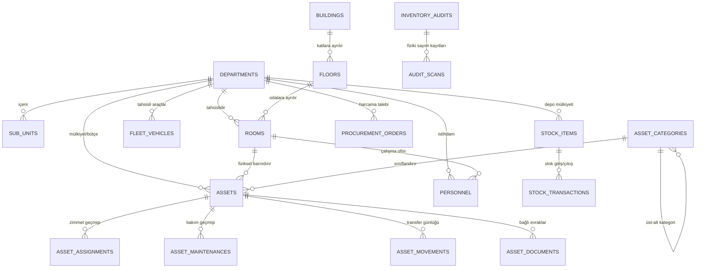

# Gebze Belediyesi Kurumsal Varlık ve Kaynak Yönetim Sistemi (GEBZE-EKYS)
## Genişletme ve Mimari Yol Haritası Planı (Revizyon 3)

Bu belge, mevcut Gebze Belediyesi Varlık Yönetimi uygulamasının (Java 25 LTS, Spring Boot 4.1.2, Oracle Database 23ai, Flyway, Vanilla HTML5/CSS3/ES6) veri bütünlüğünü ve çalışan özelliklerini koruyarak tam ölçekli bir **Belediye Kurumsal Kaynak & Varlık Yönetim Sistemi (ERP / Enterprise Asset Management)** düzeyine taşınması için hazırlanan revize edilmiş mimari analiz, karar matrisi ve fazlama planıdır.

---

## BÖLÜM 1: Mevcut Durum Analizi (Gerçek Flyway V1–V8 Veritabanı Şeması)

### 1.1 Gerçek Tablo Envanteri ve Sütun Listeleri (V1–V8 DDL Analizi)

Flyway migrasyon dosyaları (`V1` – `V8`) taranarak elde edilen 20 adet gerçek tablonun şeması ve kısıtları aşağıdadır:



#### Gerçek Tablo Listesi ve Tam Sütun Tanımları:

1. **`departments`** *(V3)*:
   - `id`: NUMBER(19) PK (Identity)
   - `code`: VARCHAR2(32 CHAR) NOT NULL UNIQUE (`uk_departments_code`)
   - `name`: VARCHAR2(180 CHAR) NOT NULL UNIQUE (`uk_departments_name`)
   - `manager_name`: VARCHAR2(180 CHAR)
   - `phone`: VARCHAR2(64 CHAR)
   - `email`: VARCHAR2(120 CHAR)
   - `display_order`: NUMBER(5) DEFAULT 0 NOT NULL
   - `is_active`: NUMBER(1) DEFAULT 1 NOT NULL
   - `created_at`: TIMESTAMP WITH TIME ZONE DEFAULT CURRENT_TIMESTAMP NOT NULL

2. **`sub_units`** *(V3)*:
   - `id`: NUMBER(19) PK (Identity)
   - `department_id`: NUMBER(19) NOT NULL FK ➔ `departments(id)` ON DELETE CASCADE
   - `parent_unit_id`: NUMBER(19) FK ➔ `sub_units(id)` ON DELETE SET NULL
   - `code`: VARCHAR2(48 CHAR) NOT NULL UNIQUE (`uk_subunits_code`)
   - `name`: VARCHAR2(180 CHAR) NOT NULL
   - `unit_type`: VARCHAR2(64 CHAR) DEFAULT 'Birim' NOT NULL
   - `manager_name`: VARCHAR2(180 CHAR)
   - `phone`: VARCHAR2(64 CHAR)
   - `description`: VARCHAR2(500 CHAR)
   - `is_active`: NUMBER(1) DEFAULT 1 NOT NULL
   - `created_at`: TIMESTAMP WITH TIME ZONE DEFAULT CURRENT_TIMESTAMP NOT NULL

3. **`buildings`** *(V3)*:
   - `id`: NUMBER(19) PK (Identity)
   - `code`: VARCHAR2(32 CHAR) NOT NULL UNIQUE (`uk_buildings_code`)
   - `name`: VARCHAR2(180 CHAR) NOT NULL UNIQUE (`uk_buildings_name`)
   - `building_type`: VARCHAR2(64 CHAR) DEFAULT 'Hizmet Binası' NOT NULL
   - `address`: VARCHAR2(255 CHAR)
   - `phone`: VARCHAR2(64 CHAR)
   - `total_floors`: NUMBER(3) DEFAULT 1 NOT NULL
   - `description`: VARCHAR2(500 CHAR)
   - `is_active`: NUMBER(1) DEFAULT 1 NOT NULL
   - `created_at`: TIMESTAMP WITH TIME ZONE DEFAULT CURRENT_TIMESTAMP NOT NULL

4. **`floors`** *(V3)*:
   - `id`: NUMBER(19) PK (Identity)
   - `building_id`: NUMBER(19) NOT NULL FK ➔ `buildings(id)` ON DELETE CASCADE
   - `floor_code`: VARCHAR2(32 CHAR) NOT NULL
   - `floor_name`: VARCHAR2(120 CHAR) NOT NULL
   - `floor_order`: NUMBER(3) DEFAULT 0 NOT NULL
   - `description`: VARCHAR2(500 CHAR)
   - `is_active`: NUMBER(1) DEFAULT 1 NOT NULL
   - *Constraint:* UNIQUE (`building_id`, `floor_code`) (`uk_floors_bld_code`)

5. **`rooms`** *(V3)*:
   - `id`: NUMBER(19) PK (Identity)
   - `building_id`: NUMBER(19) NOT NULL FK ➔ `buildings(id)` ON DELETE CASCADE
   - `floor_id`: NUMBER(19) NOT NULL FK ➔ `floors(id)` ON DELETE CASCADE
   - `room_number`: VARCHAR2(32 CHAR) NOT NULL
   - `name`: VARCHAR2(180 CHAR) NOT NULL
   - `room_type`: VARCHAR2(64 CHAR) DEFAULT 'Personel Ofisi' NOT NULL
   - `department_id`: NUMBER(19) FK ➔ `departments(id)` ON DELETE SET NULL
   - `sub_unit_id`: NUMBER(19) FK ➔ `sub_units(id)` ON DELETE SET NULL
   - `responsible_person`: VARCHAR2(180 CHAR)
   - `capacity`: NUMBER(5) DEFAULT 4 NOT NULL
   - `qr_code`: VARCHAR2(120 CHAR) NOT NULL UNIQUE (`uk_rooms_qr`)
   - `description`: VARCHAR2(500 CHAR)
   - `is_active`: NUMBER(1) DEFAULT 1 NOT NULL
   - `created_at`: TIMESTAMP WITH TIME ZONE DEFAULT CURRENT_TIMESTAMP NOT NULL

6. **`asset_categories`** *(V3 & V4)*:
   - `id`: NUMBER(19) PK (Identity)
   - `parent_id`: NUMBER(19) FK ➔ `asset_categories(id)` ON DELETE CASCADE
   - `code`: VARCHAR2(32 CHAR) NOT NULL UNIQUE (`uk_categories_code`)
   - `name`: VARCHAR2(120 CHAR) NOT NULL UNIQUE (`uk_categories_name`)
   - `icon`: VARCHAR2(64 CHAR)
   - `description`: VARCHAR2(500 CHAR)
   - `is_active`: NUMBER(1) DEFAULT 1 NOT NULL

7. **`personnel`** *(V7)*:
   - `id`: NUMBER(19) PK (Identity)
   - `registration_number`: VARCHAR2(32 CHAR) NOT NULL UNIQUE (`uk_personnel_reg`)
   - `first_name`: VARCHAR2(80 CHAR) NOT NULL
   - `last_name`: VARCHAR2(80 CHAR) NOT NULL
   - `full_name`: VARCHAR2(160 CHAR) NOT NULL
   - `title`: VARCHAR2(100 CHAR) NOT NULL
   - `department_id`: NUMBER(19) FK ➔ `departments(id)` ON DELETE SET NULL
   - `sub_unit_id`: NUMBER(19) FK ➔ `sub_units(id)` ON DELETE SET NULL
   - `room_id`: NUMBER(19) FK ➔ `rooms(id)` ON DELETE SET NULL
   - `phone`: VARCHAR2(64 CHAR)
   - `email`: VARCHAR2(120 CHAR)
   - `is_active`: NUMBER(1) DEFAULT 1 NOT NULL
   - `created_at`: TIMESTAMP WITH TIME ZONE DEFAULT CURRENT_TIMESTAMP NOT NULL

8. **`assets`** *(V1 & V3)*:
   - `id`: NUMBER(19) PK (Identity)
   - `code`: VARCHAR2(64 CHAR) NOT NULL UNIQUE (`uk_assets_code`)
   - `tif_code`: VARCHAR2(64 CHAR)
   - `barcode`: VARCHAR2(64 CHAR)
   - `name`: VARCHAR2(255 CHAR) NOT NULL
   - `category`: VARCHAR2(120 CHAR) NOT NULL
   - `brand_model`: VARCHAR2(180 CHAR)
   - `serial_number`: VARCHAR2(120 CHAR)
   - `unit_name`: VARCHAR2(180 CHAR) NOT NULL
   - `location_info`: VARCHAR2(255 CHAR) NOT NULL
   - `assignee_name`: VARCHAR2(180 CHAR)
   - `status`: VARCHAR2(40 CHAR) NOT NULL
   - `condition_status`: VARCHAR2(40 CHAR) DEFAULT 'Çok İyi' NOT NULL
   - `acquisition_date`: DATE
   - `warranty_end_date`: DATE
   - `estimated_value`: NUMBER(15, 2) DEFAULT 0
   - `supplier`: VARCHAR2(180 CHAR)
   - `notes`: VARCHAR2(1000 CHAR)
   - `updated_at`: TIMESTAMP WITH TIME ZONE DEFAULT CURRENT_TIMESTAMP NOT NULL
   - *(V3 ekleri):*
     - `department_id`: NUMBER(19) FK ➔ `departments(id)` ON DELETE SET NULL
     - `sub_unit_id`: NUMBER(19) FK ➔ `sub_units(id)` ON DELETE SET NULL
     - `building_id`: NUMBER(19) FK ➔ `buildings(id)` ON DELETE SET NULL
     - `floor_id`: NUMBER(19) FK ➔ `floors(id)` ON DELETE SET NULL
     - `room_id`: NUMBER(19) FK ➔ `rooms(id)` ON DELETE SET NULL
     - `category_id`: NUMBER(19) FK ➔ `asset_categories(id)` ON DELETE SET NULL
     - `is_active`: NUMBER(1) DEFAULT 1 NOT NULL

9. **`asset_assignments`** *(V1)*:
   - `id`: NUMBER(19) PK (Identity)
   - `document_no`: VARCHAR2(64 CHAR) NOT NULL UNIQUE (`uk_assignments_doc`)
   - `asset_id`: NUMBER(19) NOT NULL FK ➔ `assets(id)`
   - `assignee_name`: VARCHAR2(180 CHAR) NOT NULL
   - `assignee_title`: VARCHAR2(180 CHAR)
   - `unit_name`: VARCHAR2(180 CHAR) NOT NULL
   - `location_info`: VARCHAR2(255 CHAR) NOT NULL
   - `status`: VARCHAR2(32 CHAR) NOT NULL
   - `assigned_by`: VARCHAR2(180 CHAR) NOT NULL
   - `assigned_at`: TIMESTAMP WITH TIME ZONE DEFAULT CURRENT_TIMESTAMP NOT NULL
   - `returned_at`: TIMESTAMP WITH TIME ZONE
   - `return_note`: VARCHAR2(500 CHAR)
   - `note`: VARCHAR2(500 CHAR)

10. **`asset_maintenances`** *(V1)*:
    - `id`: NUMBER(19) PK (Identity)
    - `order_no`: VARCHAR2(64 CHAR) NOT NULL UNIQUE (`uk_maintenances_order`)
    - `asset_id`: NUMBER(19) NOT NULL FK ➔ `assets(id)`
    - `maintenance_type`: VARCHAR2(120 CHAR) NOT NULL
    - `priority`: VARCHAR2(32 CHAR) NOT NULL
    - `vendor_or_technician`: VARCHAR2(180 CHAR)
    - `issue_description`: VARCHAR2(500 CHAR) NOT NULL
    - `resolution_note`: VARCHAR2(500 CHAR)
    - `cost`: NUMBER(15, 2) DEFAULT 0
    - `status`: VARCHAR2(32 CHAR) NOT NULL
    - `started_at`: TIMESTAMP WITH TIME ZONE DEFAULT CURRENT_TIMESTAMP NOT NULL
    - `completed_at`: TIMESTAMP WITH TIME ZONE
    - `created_by`: VARCHAR2(180 CHAR) NOT NULL

11. **`asset_movements`** *(V1 & V3)*:
    - `id`: NUMBER(19) PK (Identity)
    - `asset_id`: NUMBER(19) NOT NULL
    - `asset_code`: VARCHAR2(64 CHAR) NOT NULL
    - `asset_name`: VARCHAR2(255 CHAR) NOT NULL
    - `movement_type`: VARCHAR2(48 CHAR) NOT NULL
    - `type_label`: VARCHAR2(120 CHAR) NOT NULL
    - `from_unit`: VARCHAR2(180 CHAR)
    - `from_location`: VARCHAR2(255 CHAR)
    - `to_unit`: VARCHAR2(180 CHAR)
    - `to_location`: VARCHAR2(255 CHAR)
    - `performed_by`: VARCHAR2(180 CHAR) NOT NULL
    - `note`: VARCHAR2(500 CHAR)
    - `created_at`: TIMESTAMP WITH TIME ZONE DEFAULT CURRENT_TIMESTAMP NOT NULL
    - `from_building_id`: NUMBER(19), `from_floor_id`: NUMBER(19), `from_room_id`: NUMBER(19)
    - `to_building_id`: NUMBER(19), `to_floor_id`: NUMBER(19), `to_room_id`: NUMBER(19)

12. **`stock_items`** *(V8)*:
    - `id`: NUMBER(19) PK (Identity)
    - `item_code`: VARCHAR2(64 CHAR) NOT NULL UNIQUE (`uk_stock_items_code`)
    - `item_name`: VARCHAR2(255 CHAR) NOT NULL
    - `category`: VARCHAR2(100 CHAR) NOT NULL
    - `warehouse_name`: VARCHAR2(180 CHAR) NOT NULL
    - `building_id`: NUMBER(19) FK ➔ `buildings(id)`
    - `department_id`: NUMBER(19) FK ➔ `departments(id)`
    - `current_quantity`: NUMBER(12, 2) DEFAULT 0 NOT NULL
    - `min_threshold`: NUMBER(12, 2) DEFAULT 10 NOT NULL
    - `unit`: VARCHAR2(32 CHAR) DEFAULT 'Adet' NOT NULL
    - `unit_price`: NUMBER(15, 2) DEFAULT 0 NOT NULL
    - `status`: VARCHAR2(32 CHAR) DEFAULT 'NORMAL' NOT NULL
    - `last_restocked_at`: TIMESTAMP WITH TIME ZONE DEFAULT CURRENT_TIMESTAMP NOT NULL

13. **`stock_transactions`** *(V8)*:
    - `id`: NUMBER(19) PK (Identity)
    - `transaction_code`: VARCHAR2(64 CHAR) NOT NULL UNIQUE (`uk_stock_tx_code`)
    - `stock_item_id`: NUMBER(19) NOT NULL FK ➔ `stock_items(id)` ON DELETE CASCADE
    - `tx_type`: VARCHAR2(32 CHAR) NOT NULL ('GIRIS', 'CIKIS', 'SAYIM_DUZELTME')
    - `quantity`: NUMBER(12, 2) NOT NULL
    - `department_id`: NUMBER(19) FK ➔ `departments(id)`
    - `department_name`: VARCHAR2(180 CHAR)
    - `recipient_name`: VARCHAR2(180 CHAR)
    - `performed_by`: VARCHAR2(180 CHAR) NOT NULL
    - `notes`: VARCHAR2(500 CHAR)
    - `tx_date`: TIMESTAMP WITH TIME ZONE DEFAULT CURRENT_TIMESTAMP NOT NULL

14. **`fleet_vehicles`** *(V8)*:
    - `id`: NUMBER(19) PK (Identity)
    - `plate_number`: VARCHAR2(32 CHAR) NOT NULL UNIQUE (`uk_fleet_plate`)
    - `vehicle_code`: VARCHAR2(48 CHAR) NOT NULL UNIQUE (`uk_fleet_code`)
    - `vehicle_type`: VARCHAR2(64 CHAR) NOT NULL
    - `brand_model`: VARCHAR2(180 CHAR) NOT NULL
    - `model_year`: NUMBER(4) NOT NULL
    - `department_id`: NUMBER(19) FK ➔ `departments(id)`
    - `department_name`: VARCHAR2(180 CHAR) NOT NULL
    - `assigned_driver`: VARCHAR2(180 CHAR)
    - `current_km`: NUMBER(10) DEFAULT 0 NOT NULL
    - `fuel_type`: VARCHAR2(32 CHAR) DEFAULT 'Dizel' NOT NULL
    - `inspection_date`: DATE, `insurance_date`: DATE, `kasko_date`: DATE
    - `status`: VARCHAR2(40 CHAR) DEFAULT 'Görevde' NOT NULL
    - `notes`: VARCHAR2(500 CHAR)
    - `updated_at`: TIMESTAMP WITH TIME ZONE DEFAULT CURRENT_TIMESTAMP NOT NULL

15. **`procurement_orders`** *(V8)*:
    - `id`: NUMBER(19) PK (Identity)
    - `order_no`: VARCHAR2(64 CHAR) NOT NULL UNIQUE (`uk_proc_order_no`)
    - `title`: VARCHAR2(255 CHAR) NOT NULL
    - `department_id`: NUMBER(19) FK ➔ `departments(id)`
    - `department_name`: VARCHAR2(180 CHAR) NOT NULL
    - `procurement_type`: VARCHAR2(64 CHAR) NOT NULL
    - `supplier_name`: VARCHAR2(180 CHAR) NOT NULL
    - `estimated_budget`: NUMBER(15, 2) DEFAULT 0 NOT NULL
    - `final_amount`: NUMBER(15, 2)
    - `status`: VARCHAR2(40 CHAR) DEFAULT 'ONAYLANDI' NOT NULL
    - `requested_by`: VARCHAR2(180 CHAR) NOT NULL
    - `order_date`: DATE DEFAULT SYSDATE NOT NULL
    - `delivery_date`: DATE
    - `description`: VARCHAR2(1000 CHAR)

16. **`inventory_audits`** *(V8)*:
    - `id`: NUMBER(19) PK (Identity)
    - `audit_code`: VARCHAR2(64 CHAR) NOT NULL UNIQUE (`uk_audit_code`)
    - `title`: VARCHAR2(255 CHAR) NOT NULL
    - `building_id`: NUMBER(19) FK ➔ `buildings(id)`
    - `department_id`: NUMBER(19) FK ➔ `departments(id)`
    - `scope_description`: VARCHAR2(255 CHAR) NOT NULL
    - `total_expected`: NUMBER(8) DEFAULT 0 NOT NULL
    - `total_scanned`: NUMBER(8) DEFAULT 0 NOT NULL
    - `total_missing`: NUMBER(8) DEFAULT 0 NOT NULL
    - `total_excess`: NUMBER(8) DEFAULT 0 NOT NULL
    - `status`: VARCHAR2(32 CHAR) DEFAULT 'DEVAM_EDIYOR' NOT NULL
    - `started_at`: TIMESTAMP WITH TIME ZONE DEFAULT CURRENT_TIMESTAMP NOT NULL
    - `completed_at`: TIMESTAMP WITH TIME ZONE
    - `lead_auditor`: VARCHAR2(180 CHAR) NOT NULL
    - `notes`: VARCHAR2(500 CHAR)

17. **`audit_scans`** *(V8)*:
    - `id`: NUMBER(19) PK (Identity)
    - `audit_id`: NUMBER(19) NOT NULL FK ➔ `inventory_audits(id)` ON DELETE CASCADE
    - `asset_id`: NUMBER(19) FK ➔ `assets(id)`
    - `asset_code`: VARCHAR2(64 CHAR) NOT NULL
    - `asset_name`: VARCHAR2(255 CHAR) NOT NULL
    - `expected_location`: VARCHAR2(255 CHAR)
    - `scanned_location`: VARCHAR2(255 CHAR) NOT NULL
    - `match_status`: VARCHAR2(32 CHAR) DEFAULT 'DOGRU_KONUM' NOT NULL
    - `scanned_at`: TIMESTAMP WITH TIME ZONE DEFAULT CURRENT_TIMESTAMP NOT NULL
    - `scanned_by`: VARCHAR2(180 CHAR) NOT NULL
    - `notes`: VARCHAR2(255 CHAR)

18. **`asset_documents`** *(V8)*:
    - `id`: NUMBER(19) PK (Identity)
    - `doc_code`: VARCHAR2(64 CHAR) NOT NULL UNIQUE (`uk_docs_code`)
    - `asset_id`: NUMBER(19) FK ➔ `assets(id)`
    - `asset_name`: VARCHAR2(255 CHAR)
    - `document_type`: VARCHAR2(64 CHAR) NOT NULL
    - `title`: VARCHAR2(255 CHAR) NOT NULL
    - `document_no`: VARCHAR2(120 CHAR)
    - `file_name`: VARCHAR2(180 CHAR) NOT NULL
    - `file_size_kb`: NUMBER(8) DEFAULT 120 NOT NULL
    - `issued_by`: VARCHAR2(180 CHAR)
    - `valid_until`: DATE
    - `notes`: VARCHAR2(500 CHAR)
    - `created_at`: TIMESTAMP WITH TIME ZONE DEFAULT CURRENT_TIMESTAMP NOT NULL

19. **`system_audit_logs`** *(V8)*:
    - `id`: NUMBER(19) PK (Identity)
    - `action_type`: VARCHAR2(64 CHAR) NOT NULL
    - `entity_type`: VARCHAR2(64 CHAR) NOT NULL
    - `entity_id`: VARCHAR2(64 CHAR)
    - `actor_username`: VARCHAR2(80 CHAR) NOT NULL
    - `actor_name`: VARCHAR2(180 CHAR) NOT NULL
    - `ip_address`: VARCHAR2(64 CHAR) DEFAULT '127.0.0.1' NOT NULL
    - `description`: VARCHAR2(1000 CHAR) NOT NULL
    - `created_at`: TIMESTAMP WITH TIME ZONE DEFAULT CURRENT_TIMESTAMP NOT NULL

20. **`system_settings`** *(V8)*:
    - `param_key`: VARCHAR2(80 CHAR) PK
    - `param_value`: VARCHAR2(500 CHAR) NOT NULL
    - `param_group`: VARCHAR2(64 CHAR) NOT NULL
    - `description`: VARCHAR2(255 CHAR)
    - `updated_at`: TIMESTAMP WITH TIME ZONE DEFAULT CURRENT_TIMESTAMP NOT NULL

---

## BÖLÜM 2: Mimari Kararlar ve Teknik Uygulama Kuralları

### 2.1 V9 Veritabanı Migrasyonu ve Mevcut 74 Varlığın Veri Eşlemesi

Veritabanındaki mevcut 74 varlığın güncel `status` dağılımı sorgulanmıştır:
- `Aktif`: 63 adet
- `Zimmetli`: 9 adet
- `Depoda`: 1 adet
- `Bakımda`: 1 adet
*(Farklı veya eşleşmeyen yabancı bir durum değeri bulunmamaktadır; toplam 74 varlık eksiksiz eşleşir).*

#### V9 Migrasyonu İçinde Çalıştırılacak SQL UPDATE Komutu:
```sql
ALTER TABLE assets ADD (
    is_deleted        NUMBER(1) DEFAULT 0 NOT NULL,
    deleted_at        TIMESTAMP WITH TIME ZONE,
    deleted_by        VARCHAR2(80 CHAR),
    lifecycle_status  VARCHAR2(40 CHAR) DEFAULT 'KULLANIMDA' NOT NULL,
    specifications    JSON
);

-- Mevcut 74 varlığın status değerinden lifecycle_status'u doldurma:
UPDATE assets
SET lifecycle_status = CASE 
    WHEN status IN ('Depoda', 'depoda') THEN 'KAYDEDILDI'
    WHEN status IN ('Zimmetli', 'zimmetli') THEN 'ZIMMETLENDI'
    WHEN status IN ('Aktif', 'aktif') THEN 'KULLANIMDA'
    WHEN status IN ('Bakımda', 'Bakimda', 'bakımda') THEN 'BAKIMDA'
    WHEN status IN ('Hurda', 'hurda') THEN 'HURDAYA_AYRILDI'
    WHEN status IN ('Pasif', 'pasif') THEN 'PASIF_ASKIDA'
    ELSE 'KULLANIMDA'
END;
```

---

### 2.2 `assets.status` Doğrudan Yazan Kod Yolları ve Lifecycle Servisine Yönlendirme Planı

Mevcut Java kodunda `assets.status` alanına doğrudan yazan noktalar tespit edilmiştir:
1. `AssetRepository.java`:
   - `save(Asset a)`: `status` sütununa yazıyor.
   - `update(Asset a)`: `SET status = :status` yazıyor.
   - `updateOperationalState(Long id, ... String status)`: `SET status = :status` yazıyor.
2. `AssetService.java`:
   - `create(AssetRequest req)`: `req.status()` yazıyor.
   - `update(Long id, AssetRequest req)`: `req.status()` yazıyor.
3. `AssignmentService.java`:
   - `create(...)`: `updateOperationalState` üzerinden `'Zimmetli'` yazıyor.
   - `returnAssignment(...)`: `updateOperationalState` üzerinden `'Depoda'` yazıyor.
4. `MaintenanceService.java`:
   - `create(...)`: `updateOperationalState` üzerinden `'Bakımda'` yazıyor.
   - `complete(...)`: `updateOperationalState` üzerinden `'Aktif'` veya `'Depoda'` yazıyor.
5. `MovementService.java`:
   - `create(...)`: Hareket türüne göre `'Bakımda'`, `'Depoda'`, `'Aktif'` yazıyor.

#### Yönlendirme Planı:
- Tüm bu doğrudan yazımlar **`AssetLifecycleService.transitionState(assetId, targetLifecycleStatus, actionReason, userSession)`** metoduna yönlendirilecektir.
- Bu merkezi servis:
  1. `AssetLifecycleValidator` ile geçişin geçerli olup olmadığını doğrular (örn. Satın alındı ➔ Hurda geçişini engeller).
  2. `lifecycle_status` sütununu günceller.
  3. Eşleme kurallarına göre `status` sütununu otomatik türetir (`KAYDEDILDI` ➔ `Depoda`, `ZIMMETLENDI` ➔ `Zimmetli`, `KULLANIMDA` ➔ `Aktif`, `BAKIMDA` ➔ `Bakımda`, `HURDAYA_AYRILDI` ➔ `Hurda`).
  4. Değişikliği `system_audit_logs` tablosuna eski-yeni JSON diff olarak kaydeder.

---

### 2.3 Soft Delete ile UNIQUE Kısıt Çakışmasının Çözümü

Oracle B-Tree indekslerinin tamamen `NULL` olan ifadeleri indekslememe kuralından faydalanılır:

```sql
-- assets tablosundaki UNIQUE kısıtları koşullu indekse çevirme:
ALTER TABLE assets DROP CONSTRAINT uk_assets_code;

CREATE UNIQUE INDEX uk_assets_active_code ON assets (
    CASE WHEN is_deleted = 0 THEN code ELSE NULL END
);

CREATE UNIQUE INDEX uk_assets_active_barcode ON assets (
    CASE WHEN is_deleted = 0 AND barcode IS NOT NULL THEN barcode ELSE NULL END
);

-- personnel tablosundaki sicil no kısıtı:
ALTER TABLE personnel DROP CONSTRAINT uk_personnel_reg;
CREATE UNIQUE INDEX uk_personnel_active_reg ON personnel (
    CASE WHEN is_deleted = 0 THEN registration_number ELSE NULL END
);

-- fleet_vehicles tablosundaki plaka kısıtı:
ALTER TABLE fleet_vehicles DROP CONSTRAINT uk_fleet_plate;
CREATE UNIQUE INDEX uk_fleet_active_plate ON fleet_vehicles (
    CASE WHEN is_deleted = 0 THEN plate_number ELSE NULL END
);
```

---

### 2.4 Kimlik Doğrulama, CSRF, Şifre Değişimi ve Bağlı Tablolarda Müdürlük İzolasyonu

#### 1. Veritabanı Şeması (`system_users`):
```sql
CREATE TABLE system_users (
    id                   NUMBER(19) GENERATED BY DEFAULT AS IDENTITY PRIMARY KEY,
    username             VARCHAR2(64 CHAR)  NOT NULL CONSTRAINT uk_users_username UNIQUE,
    password_hash        VARCHAR2(255 CHAR) NOT NULL,
    full_name            VARCHAR2(160 CHAR) NOT NULL,
    email                VARCHAR2(120 CHAR),
    role                 VARCHAR2(32 CHAR)  NOT NULL,
    department_id        NUMBER(19)         CONSTRAINT fk_users_dept REFERENCES departments(id) ON DELETE SET NULL,
    personnel_id         NUMBER(19)         CONSTRAINT fk_users_personnel REFERENCES personnel(id) ON DELETE SET NULL,
    must_change_password NUMBER(1)          DEFAULT 0 NOT NULL,
    is_active            NUMBER(1)          DEFAULT 1 NOT NULL,
    created_at           TIMESTAMP WITH TIME ZONE DEFAULT CURRENT_TIMESTAMP NOT NULL
);
```

#### 2. CSRF Koruması:
- Spring Security:
  ```java
  http.csrf(csrf -> csrf
      .csrfTokenRepository(CookieCsrfTokenRepository.withHttpOnlyFalse())
      .ignoringRequestMatchers("/api/auth/login")
  );
  ```
- Frontend `app.js` içindeki `apiRequest` fonksiyonu:
  - `document.cookie` üzerinden `XSRF-TOKEN` çerezini okur.
  - POST, PUT, DELETE, PATCH isteklerinde `X-XSRF-TOKEN` başlığını otomatik ekler.

#### 3. Bağlı Tablolarda Müdürlük İzolasyonunun `JOIN assets` Üzerinden Uygulanması:
`asset_assignments`, `asset_maintenances`, `asset_movements`, `asset_documents` tablolarının kendi üzerinde doğrudan `department_id` bulunmadığında (veya varlığın idari sahibini esas aldığımızda), filtreleme `JOIN assets a ON table.asset_id = a.id` üzerinden zorunlu kılınacaktır:
```sql
-- Örnek: Zimmetler listelenirken müdürlük filtresi:
SELECT m.* FROM asset_assignments m
JOIN assets a ON m.asset_id = a.id
WHERE a.is_deleted = 0
  AND (:isGlobal = 1 OR a.department_id = :userDeptId);
```

---

### 2.5 Audit Log Transaction Stratejisi

- **Varsayılan Davranış:** `AuditService.logChange(...)` metodu `@Transactional` olarak çağrılır ve ana iş akışının transaction'ı içinde yer alır. Eğer iş akışı (örneğin zimmet atama) herhangi bir sebeple hata alır ve rollback olursa, denetim kaydı da geri alınır; böylece veritabanında hayalet/yetim log oluşmaz.
- **`REQUIRES_NEW` Özel İstisnası:** Yalnızca güvenlik olayları (başarısız giriş denemeleri `FAILED_LOGIN_ATTEMPT`, yetkisiz erişim teşebbüsleri `ACCESS_DENIED`, şifre kilitlenmesi) ana transaction'dan izole edilerek `@Transactional(propagation = Propagation.REQUIRES_NEW)` ile yazılır; böylece ana işlem hata alıp düşse bile güvenlik kaydı veritabanında kalıcı olur.

---

## BÖLÜM 3: Faz 1 Alt Adımları ve Faz 0 (Sidebar)

### FAZ 0: UI Hazırlığı — Kurumsal Sol Menü (Sidebar) Dönüşümü
*(Faz 1 öncesinde bağımsız tamamlanacak UI adımı)*
- Üst bardaki 19 sekmeli kalabalık yatay menünün kaldırılması.
- Sol tarafta modern, gruplanmış, akordiyon tipi **Kurumsal Sol Menü (Sidebar)** yapısının kurulması:
  - 📌 **Genel Bakış:** 📊 Ana Ekran, 🌳 Kurumsal & Fiziksel Ağaç
  - 🏛️ **Kurumsal Yapı:** 🏢 Binalar & Odalar, 🏛️ 30 Müdürlük, 👥 Personel Yönetimi
  - 📦 **Demirbaş & Varlık:** 📦 Varlıklar, 🏷️ 16 Kategori, 🤝 Zimmet, 🔧 Bakım & Onarım, 📜 Hareketler & Transfer
  - 🏬 **Lojistik & Filo:** 🏬 Depo & Stok, 🚘 Araç & Filo (İş Makineleri Dahil), 🛒 Satın Alma & Tedarik
  - 📋 **Denetim & Kontrol:** 📋 Sayım & Kontrol, 🏷️ QR Kod & Etiketler, 📁 Belge Yönetimi, 📈 Raporlama & Amortisman, 🛡️ Denetim Günlüğü, ⚙️ Sistem Yönetimi
- Ekran içeriklerinin geniş masaüstü alanında eşit yükseklikte kartlarla ferah şekilde yerleşmesi.

### FAZ 1A: Veritabanı Migrasyonu (V9)
- `assets`, `personnel`, `fleet_vehicles`, `stock_items` tablolarına `is_deleted`, `deleted_at`, `deleted_by` eklenmesi.
- `assets` tablosuna `lifecycle_status` ve `specifications JSON` eklenmesi; mevcut 74 varlığın `status` üzerinden doldurulması.
- `system_audit_logs` tablosuna `old_value_json JSON`, `new_value_json JSON` eklenmesi.
- `system_users` tablosunun oluşturulması (`personnel_id FK`, `must_change_password` dahil).
- Conditional Unique Indekslerin oluşturulması.
- **1A Test Kriteri:** Uygulama hatasız başlar, `flyway_schema_history` tablosunda V9 kaydı `success = 1` olarak görünür, doğrulama sorgularının öncesi ve sonrası çıktıları birebir aynıdır.

### FAZ 1B: Kimlik Doğrulama, CSRF, Roller ve Müdürlük İzolasyonu
- Spring Security + Session login + Cookie CSRF entegrasyonu.
- `system_users` tablosu üzerinden BCrypt şifreli giriş (`/api/auth/login`).
- `must_change_password` durumunda şifre yenileme zorunluluğu.
- `SecurityScopeProvider`, `TenantQueryScope` ve `SecurityGuard` ile hem `assets` hem de bağlı tablolarda (`JOIN assets`) merkezi müdürlük filtresi.
- **1B Test Kriteri:** Fen İşleri Müdürü girişi ile sadece Fen İşleri varlık/zimmet/bakım kayıtları görünür; URL manipülasyonunda `403 Forbidden` döner; CSRF token olmadan yapılan POST istekleri engellenir.

### FAZ 1C: Varlık Yaşam Döngüsü Servisi ve Doğrulayıcı
- `AssetLifecycleStatus` enum ve `AssetLifecycleValidator` sınıfı.
- Durum makinesi geçiş matrisi (`ZAYIAT_CALINMA` dahil).
- Durum değiştiğinde `assets.status` senkronizasyonu ve `system_audit_logs` tablosuna varsayılan transaction ile JSON diff yazılması.
- **1C Test Kriteri:** `SATIN_ALINDI` varlığının doğrudan `HURDAYA_AYRILDI` yapılması engellenir; geçerli geçişlerde audit logda eski ve yeni durum JSON formatında doğrulanır.

### FAZ 1D: Excel ile Toplu Varlık İçe Aktarımı (Bulk Import Engine)
- Apache POI ile dinamik şablon üretimi (`/api/assets/export-template`).
- Dry-run önizleme servisi (`/api/assets/import/dry-run`): Hatalı satırları, geçersiz oda veya mükerrer barkodları veritabanına yazmadan listeleme.
- Kesin aktarım servisi (`/api/assets/import/commit`): Doğrulanmış satırların tek transaction ile aktarımı ve audit kaydı.
- **1D Test Kriteri:** Hatalı satır içeren Excel dosyasında sadece geçerli kayıtlar aktarılır; hatalar kullanıcıya satır numarası ve sebebiyle bildirilir.

---

## BÖLÜM 4: Öncesi / Sonrası Karşılaştırmalı Bütünlük Doğrulama Yöntemi

"Hiçbir müdürlük 0 olmamalı" veya "Oda NULL olamaz" gibi hatalı varsayımlar yerine; **V9 migrasyonu öncesi veritabanı anlık görüntüsünü (snapshot) JSON/CSV olarak kaydetme ve V9 sonrasında birebir eşleştiğini kanıtlama yöntemi** uygulanacaktır:

```sql
-- SORGUSAL KARŞILAŞTIRMA SETİ (PRE-MIGRATION SNAPSHOT vs. POST-MIGRATION VERIFICATION)

-- Kontrol 1: Toplam Varlık Sayısı ve Finansal Değer Eşitliği
SELECT COUNT(*) AS total_count,
       SUM(estimated_value) AS total_financial_value
FROM assets;
-- Sonuç öncesi ve sonrası birebir eşit olmalıdır (74 adet, 48.298.300 TL).

-- Kontrol 2: 30 Müdürlük Bazında Varlık Sayıları Dağılım Matrisi
SELECT d.id AS dept_id, d.code AS dept_code, COUNT(a.id) AS asset_count, NVL(SUM(a.estimated_value), 0) AS dept_val
FROM departments d
LEFT JOIN assets a ON a.department_id = d.id
GROUP BY d.id, d.code
ORDER BY d.id;
-- V9 öncesi çıktı JSON olarak saklanır; V9 sonrası çalıştırılan sorguyla diff yapılır (0 fark beklenir).

-- Kontrol 3: 16 Kategori Bazında Varlık Dağılım Matrisi
SELECT c.id AS cat_id, c.code AS cat_code, COUNT(a.id) AS asset_count
FROM asset_categories c
LEFT JOIN assets a ON a.category_id = c.id
GROUP BY c.id, c.code
ORDER BY c.id;
-- V9 öncesi çıktı ile V9 sonrası çıktı birebir aynı olmalıdır.

-- Kontrol 4: Varlık Bazlı Temel Alanların Birebir Eşitliği
SELECT id, code, barcode, name, department_id, building_id, floor_id, room_id, status
FROM assets
ORDER BY id;
-- Tüm 74 satırın ID, kod, barkod, müdürlük ve lokasyon değerleri V9 öncesi kaydedilen anlık görüntüyle eşleşmelidir.
```
