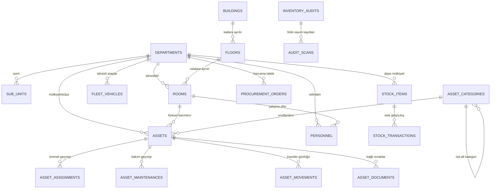
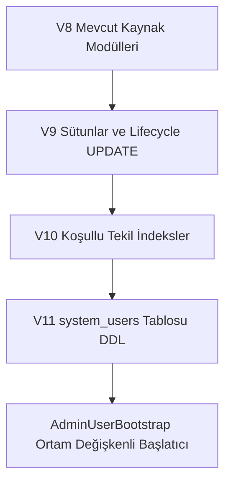
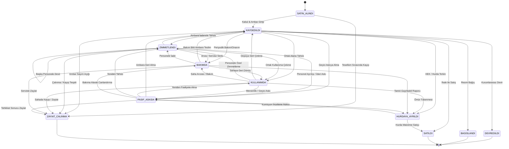

# Gebze Belediyesi Kurumsal Varlık ve Kaynak Yönetim Sistemi (GEBZE-EKYS)
## Genişletme ve Mimari Yol Haritası Planı (Revizyon 4)

Bu belge, mevcut Gebze Belediyesi Varlık Yönetimi uygulamasının (Java 25 LTS, Spring Boot 4.1.2, Oracle Database 23ai, Flyway, Vanilla HTML5/CSS3/ES6) veri bütünlüğünü ve çalışan özelliklerini koruyarak tam ölçekli bir **Belediye Kurumsal Kaynak & Varlık Yönetim Sistemi (ERP / Enterprise Asset Management)** düzeyine taşınması için hazırlanan revize edilmiş mimari analiz, karar matrisi ve fazlama planıdır.

---

## BÖLÜM 1: Mevcut Durum Analizi (Gerçek Flyway V1–V8 Veritabanı Şeması)

### 1.1 Gerçek Tablo Envanteri ve Sütun Listeleri (V1–V8 DDL Analizi)

Flyway migrasyon dosyaları (`V1` – `V8`) taranarak elde edilen 20 adet gerçek tablonun şeması ve kısıtları aşağıdadır:



#### Gerçek Tablo Listesi ve Tam Sütun Tanımları:

1. **`departments`** *(V3)*:
   - `id`: NUMBER(19) PK (Identity)
   - `code`: VARCHAR2(32 CHAR) NOT NULL UNIQUE (`uk_departments_code`)
   - `name`: VARCHAR2(180 CHAR) NOT NULL UNIQUE (`uk_departments_name`)
   - `manager_name`: VARCHAR2(180 CHAR)
   - `phone`: VARCHAR2(64 CHAR)
   - `email`: VARCHAR2(120 CHAR)
   - `display_order`: NUMBER(5) DEFAULT 0 NOT NULL
   - `is_active`: NUMBER(1) DEFAULT 1 NOT NULL
   - `created_at`: TIMESTAMP WITH TIME ZONE DEFAULT CURRENT_TIMESTAMP NOT NULL

2. **`sub_units`** *(V3)*:
   - `id`: NUMBER(19) PK (Identity)
   - `department_id`: NUMBER(19) NOT NULL FK ➔ `departments(id)` ON DELETE CASCADE
   - `parent_unit_id`: NUMBER(19) FK ➔ `sub_units(id)` ON DELETE SET NULL
   - `code`: VARCHAR2(48 CHAR) NOT NULL UNIQUE (`uk_subunits_code`)
   - `name`: VARCHAR2(180 CHAR) NOT NULL
   - `unit_type`: VARCHAR2(64 CHAR) DEFAULT 'Birim' NOT NULL
   - `manager_name`: VARCHAR2(180 CHAR)
   - `phone`: VARCHAR2(64 CHAR)
   - `description`: VARCHAR2(500 CHAR)
   - `is_active`: NUMBER(1) DEFAULT 1 NOT NULL
   - `created_at`: TIMESTAMP WITH TIME ZONE DEFAULT CURRENT_TIMESTAMP NOT NULL

3. **`buildings`** *(V3)*:
   - `id`: NUMBER(19) PK (Identity)
   - `code`: VARCHAR2(32 CHAR) NOT NULL UNIQUE (`uk_buildings_code`)
   - `name`: VARCHAR2(180 CHAR) NOT NULL UNIQUE (`uk_buildings_name`)
   - `building_type`: VARCHAR2(64 CHAR) DEFAULT 'Hizmet Binası' NOT NULL
   - `address`: VARCHAR2(255 CHAR)
   - `phone`: VARCHAR2(64 CHAR)
   - `total_floors`: NUMBER(3) DEFAULT 1 NOT NULL
   - `description`: VARCHAR2(500 CHAR)
   - `is_active`: NUMBER(1) DEFAULT 1 NOT NULL
   - `created_at`: TIMESTAMP WITH TIME ZONE DEFAULT CURRENT_TIMESTAMP NOT NULL

4. **`floors`** *(V3)*:
   - `id`: NUMBER(19) PK (Identity)
   - `building_id`: NUMBER(19) NOT NULL FK ➔ `buildings(id)` ON DELETE CASCADE
   - `floor_code`: VARCHAR2(32 CHAR) NOT NULL
   - `floor_name`: VARCHAR2(120 CHAR) NOT NULL
   - `floor_order`: NUMBER(3) DEFAULT 0 NOT NULL
   - `description`: VARCHAR2(500 CHAR)
   - `is_active`: NUMBER(1) DEFAULT 1 NOT NULL
   - *Constraint:* UNIQUE (`building_id`, `floor_code`) (`uk_floors_bld_code`)

5. **`rooms`** *(V3)*:
   - `id`: NUMBER(19) PK (Identity)
   - `building_id`: NUMBER(19) NOT NULL FK ➔ `buildings(id)` ON DELETE CASCADE
   - `floor_id`: NUMBER(19) NOT NULL FK ➔ `floors(id)` ON DELETE CASCADE
   - `room_number`: VARCHAR2(32 CHAR) NOT NULL
   - `name`: VARCHAR2(180 CHAR) NOT NULL
   - `room_type`: VARCHAR2(64 CHAR) DEFAULT 'Personel Ofisi' NOT NULL
   - `department_id`: NUMBER(19) FK ➔ `departments(id)` ON DELETE SET NULL
   - `sub_unit_id`: NUMBER(19) FK ➔ `sub_units(id)` ON DELETE SET NULL
   - `responsible_person`: VARCHAR2(180 CHAR)
   - `capacity`: NUMBER(5) DEFAULT 4 NOT NULL
   - `qr_code`: VARCHAR2(120 CHAR) NOT NULL UNIQUE (`uk_rooms_qr`)
   - `description`: VARCHAR2(500 CHAR)
   - `is_active`: NUMBER(1) DEFAULT 1 NOT NULL
   - `created_at`: TIMESTAMP WITH TIME ZONE DEFAULT CURRENT_TIMESTAMP NOT NULL

6. **`asset_categories`** *(V3 & V4)*:
   - `id`: NUMBER(19) PK (Identity)
   - `parent_id`: NUMBER(19) FK ➔ `asset_categories(id)` ON DELETE CASCADE
   - `code`: VARCHAR2(32 CHAR) NOT NULL UNIQUE (`uk_categories_code`)
   - `name`: VARCHAR2(120 CHAR) NOT NULL UNIQUE (`uk_categories_name`)
   - `icon`: VARCHAR2(64 CHAR)
   - `description`: VARCHAR2(500 CHAR)
   - `is_active`: NUMBER(1) DEFAULT 1 NOT NULL

7. **`personnel`** *(V7)*:
   - `id`: NUMBER(19) PK (Identity)
   - `registration_number`: VARCHAR2(32 CHAR) NOT NULL UNIQUE (`uk_personnel_reg`)
   - `first_name`: VARCHAR2(80 CHAR) NOT NULL
   - `last_name`: VARCHAR2(80 CHAR) NOT NULL
   - `full_name`: VARCHAR2(160 CHAR) NOT NULL
   - `title`: VARCHAR2(100 CHAR) NOT NULL
   - `department_id`: NUMBER(19) FK ➔ `departments(id)` ON DELETE SET NULL
   - `sub_unit_id`: NUMBER(19) FK ➔ `sub_units(id)` ON DELETE SET NULL
   - `room_id`: NUMBER(19) FK ➔ `rooms(id)` ON DELETE SET NULL
   - `phone`: VARCHAR2(64 CHAR)
   - `email`: VARCHAR2(120 CHAR)
   - `is_active`: NUMBER(1) DEFAULT 1 NOT NULL
   - `created_at`: TIMESTAMP WITH TIME ZONE DEFAULT CURRENT_TIMESTAMP NOT NULL

8. **`assets`** *(V1 & V3)*:
   - `id`: NUMBER(19) PK (Identity)
   - `code`: VARCHAR2(64 CHAR) NOT NULL UNIQUE (`uk_assets_code`)
   - `tif_code`: VARCHAR2(64 CHAR)
   - `barcode`: VARCHAR2(64 CHAR)
   - `name`: VARCHAR2(255 CHAR) NOT NULL
   - `category`: VARCHAR2(120 CHAR) NOT NULL
   - `brand_model`: VARCHAR2(180 CHAR)
   - `serial_number`: VARCHAR2(120 CHAR)
   - `unit_name`: VARCHAR2(180 CHAR) NOT NULL
   - `location_info`: VARCHAR2(255 CHAR) NOT NULL
   - `assignee_name`: VARCHAR2(180 CHAR)
   - `status`: VARCHAR2(40 CHAR) NOT NULL
   - `condition_status`: VARCHAR2(40 CHAR) DEFAULT 'Çok İyi' NOT NULL
   - `acquisition_date`: DATE
   - `warranty_end_date`: DATE
   - `estimated_value`: NUMBER(15, 2) DEFAULT 0
   - `supplier`: VARCHAR2(180 CHAR)
   - `notes`: VARCHAR2(1000 CHAR)
   - `updated_at`: TIMESTAMP WITH TIME ZONE DEFAULT CURRENT_TIMESTAMP NOT NULL
   - *(V3 ekleri):*
     - `department_id`: NUMBER(19) FK ➔ `departments(id)` ON DELETE SET NULL
     - `sub_unit_id`: NUMBER(19) FK ➔ `sub_units(id)` ON DELETE SET NULL
     - `building_id`: NUMBER(19) FK ➔ `buildings(id)` ON DELETE SET NULL
     - `floor_id`: NUMBER(19) FK ➔ `floors(id)` ON DELETE SET NULL
     - `room_id`: NUMBER(19) FK ➔ `rooms(id)` ON DELETE SET NULL
     - `category_id`: NUMBER(19) FK ➔ `asset_categories(id)` ON DELETE SET NULL
     - `is_active`: NUMBER(1) DEFAULT 1 NOT NULL

9. **`asset_assignments`** *(V1)*:
   - `id`: NUMBER(19) PK (Identity)
   - `document_no`: VARCHAR2(64 CHAR) NOT NULL UNIQUE (`uk_assignments_doc`)
   - `asset_id`: NUMBER(19) NOT NULL FK ➔ `assets(id)`
   - `assignee_name`: VARCHAR2(180 CHAR) NOT NULL
   - `assignee_title`: VARCHAR2(180 CHAR)
   - `unit_name`: VARCHAR2(180 CHAR) NOT NULL
   - `location_info`: VARCHAR2(255 CHAR) NOT NULL
   - `status`: VARCHAR2(32 CHAR) NOT NULL
   - `assigned_by`: VARCHAR2(180 CHAR) NOT NULL
   - `assigned_at`: TIMESTAMP WITH TIME ZONE DEFAULT CURRENT_TIMESTAMP NOT NULL
   - `returned_at`: TIMESTAMP WITH TIME ZONE
   - `return_note`: VARCHAR2(500 CHAR)
   - `note`: VARCHAR2(500 CHAR)

10. **`asset_maintenances`** *(V1)*:
    - `id`: NUMBER(19) PK (Identity)
    - `order_no`: VARCHAR2(64 CHAR) NOT NULL UNIQUE (`uk_maintenances_order`)
    - `asset_id`: NUMBER(19) NOT NULL FK ➔ `assets(id)`
    - `maintenance_type`: VARCHAR2(120 CHAR) NOT NULL
    - `priority`: VARCHAR2(32 CHAR) NOT NULL
    - `vendor_or_technician`: VARCHAR2(180 CHAR)
    - `issue_description`: VARCHAR2(500 CHAR) NOT NULL
    - `resolution_note`: VARCHAR2(500 CHAR)
    - `cost`: NUMBER(15, 2) DEFAULT 0
    - `status`: VARCHAR2(32 CHAR) NOT NULL
    - `started_at`: TIMESTAMP WITH TIME ZONE DEFAULT CURRENT_TIMESTAMP NOT NULL
    - `completed_at`: TIMESTAMP WITH TIME ZONE
    - `created_by`: VARCHAR2(180 CHAR) NOT NULL

11. **`asset_movements`** *(V1 & V3)*:
    - `id`: NUMBER(19) PK (Identity)
    - `asset_id`: NUMBER(19) NOT NULL
    - `asset_code`: VARCHAR2(64 CHAR) NOT NULL
    - `asset_name`: VARCHAR2(255 CHAR) NOT NULL
    - `movement_type`: VARCHAR2(48 CHAR) NOT NULL
    - `type_label`: VARCHAR2(120 CHAR) NOT NULL
    - `from_unit`: VARCHAR2(180 CHAR)
    - `from_location`: VARCHAR2(255 CHAR)
    - `to_unit`: VARCHAR2(180 CHAR)
    - `to_location`: VARCHAR2(255 CHAR)
    - `performed_by`: VARCHAR2(180 CHAR) NOT NULL
    - `note`: VARCHAR2(500 CHAR)
    - `created_at`: TIMESTAMP WITH TIME ZONE DEFAULT CURRENT_TIMESTAMP NOT NULL
    - `from_building_id`: NUMBER(19), `from_floor_id`: NUMBER(19), `from_room_id`: NUMBER(19)
    - `to_building_id`: NUMBER(19), `to_floor_id`: NUMBER(19), `to_room_id`: NUMBER(19)

12. **`stock_items`** *(V8)*:
    - `id`: NUMBER(19) PK (Identity)
    - `item_code`: VARCHAR2(64 CHAR) NOT NULL UNIQUE (`uk_stock_items_code`)
    - `item_name`: VARCHAR2(255 CHAR) NOT NULL
    - `category`: VARCHAR2(100 CHAR) NOT NULL
    - `warehouse_name`: VARCHAR2(180 CHAR) NOT NULL
    - `building_id`: NUMBER(19) FK ➔ `buildings(id)`
    - `department_id`: NUMBER(19) FK ➔ `departments(id)`
    - `current_quantity`: NUMBER(12, 2) DEFAULT 0 NOT NULL
    - `min_threshold`: NUMBER(12, 2) DEFAULT 10 NOT NULL
    - `unit`: VARCHAR2(32 CHAR) DEFAULT 'Adet' NOT NULL
    - `unit_price`: NUMBER(15, 2) DEFAULT 0 NOT NULL
    - `status`: VARCHAR2(32 CHAR) DEFAULT 'NORMAL' NOT NULL
    - `last_restocked_at`: TIMESTAMP WITH TIME ZONE DEFAULT CURRENT_TIMESTAMP NOT NULL

13. **`stock_transactions`** *(V8)*:
    - `id`: NUMBER(19) PK (Identity)
    - `transaction_code`: VARCHAR2(64 CHAR) NOT NULL UNIQUE (`uk_stock_tx_code`)
    - `stock_item_id`: NUMBER(19) NOT NULL FK ➔ `stock_items(id)` ON DELETE CASCADE
    - `tx_type`: VARCHAR2(32 CHAR) NOT NULL ('GIRIS', 'CIKIS', 'SAYIM_DUZELTME')
    - `quantity`: NUMBER(12, 2) NOT NULL
    - `department_id`: NUMBER(19) FK ➔ `departments(id)`
    - `department_name`: VARCHAR2(180 CHAR)
    - `recipient_name`: VARCHAR2(180 CHAR)
    - `performed_by`: VARCHAR2(180 CHAR) NOT NULL
    - `notes`: VARCHAR2(500 CHAR)
    - `tx_date`: TIMESTAMP WITH TIME ZONE DEFAULT CURRENT_TIMESTAMP NOT NULL

14. **`fleet_vehicles`** *(V8)*:
    - `id`: NUMBER(19) PK (Identity)
    - `plate_number`: VARCHAR2(32 CHAR) NOT NULL UNIQUE (`uk_fleet_plate`)
    - `vehicle_code`: VARCHAR2(48 CHAR) NOT NULL UNIQUE (`uk_fleet_code`)
    - `vehicle_type`: VARCHAR2(64 CHAR) NOT NULL
    - `brand_model`: VARCHAR2(180 CHAR) NOT NULL
    - `model_year`: NUMBER(4) NOT NULL
    - `department_id`: NUMBER(19) FK ➔ `departments(id)`
    - `department_name`: VARCHAR2(180 CHAR) NOT NULL
    - `assigned_driver`: VARCHAR2(180 CHAR)
    - `current_km`: NUMBER(10) DEFAULT 0 NOT NULL
    - `fuel_type`: VARCHAR2(32 CHAR) DEFAULT 'Dizel' NOT NULL
    - `inspection_date`: DATE, `insurance_date`: DATE, `kasko_date`: DATE
    - `status`: VARCHAR2(40 CHAR) DEFAULT 'Görevde' NOT NULL
    - `notes`: VARCHAR2(500 CHAR)
    - `updated_at`: TIMESTAMP WITH TIME ZONE DEFAULT CURRENT_TIMESTAMP NOT NULL

15. **`procurement_orders`** *(V8)*:
    - `id`: NUMBER(19) PK (Identity)
    - `order_no`: VARCHAR2(64 CHAR) NOT NULL UNIQUE (`uk_proc_order_no`)
    - `title`: VARCHAR2(255 CHAR) NOT NULL
    - `department_id`: NUMBER(19) FK ➔ `departments(id)`
    - `department_name`: VARCHAR2(180 CHAR) NOT NULL
    - `procurement_type`: VARCHAR2(64 CHAR) NOT NULL
    - `supplier_name`: VARCHAR2(180 CHAR) NOT NULL
    - `estimated_budget`: NUMBER(15, 2) DEFAULT 0 NOT NULL
    - `final_amount`: NUMBER(15, 2)
    - `status`: VARCHAR2(40 CHAR) DEFAULT 'ONAYLANDI' NOT NULL
    - `requested_by`: VARCHAR2(180 CHAR) NOT NULL
    - `order_date`: DATE DEFAULT SYSDATE NOT NULL
    - `delivery_date`: DATE
    - `description`: VARCHAR2(1000 CHAR)

16. **`inventory_audits`** *(V8)*:
    - `id`: NUMBER(19) PK (Identity)
    - `audit_code`: VARCHAR2(64 CHAR) NOT NULL UNIQUE (`uk_audit_code`)
    - `title`: VARCHAR2(255 CHAR) NOT NULL
    - `building_id`: NUMBER(19) FK ➔ `buildings(id)`
    - `department_id`: NUMBER(19) FK ➔ `departments(id)`
    - `scope_description`: VARCHAR2(255 CHAR) NOT NULL
    - `total_expected`: NUMBER(8) DEFAULT 0 NOT NULL
    - `total_scanned`: NUMBER(8) DEFAULT 0 NOT NULL
    - `total_missing`: NUMBER(8) DEFAULT 0 NOT NULL
    - `total_excess`: NUMBER(8) DEFAULT 0 NOT NULL
    - `status`: VARCHAR2(32 CHAR) DEFAULT 'DEVAM_EDIYOR' NOT NULL
    - `started_at`: TIMESTAMP WITH TIME ZONE DEFAULT CURRENT_TIMESTAMP NOT NULL
    - `completed_at`: TIMESTAMP WITH TIME ZONE
    - `lead_auditor`: VARCHAR2(180 CHAR) NOT NULL
    - `notes`: VARCHAR2(500 CHAR)

17. **`audit_scans`** *(V8)*:
    - `id`: NUMBER(19) PK (Identity)
    - `audit_id`: NUMBER(19) NOT NULL FK ➔ `inventory_audits(id)` ON DELETE CASCADE
    - `asset_id`: NUMBER(19) FK ➔ `assets(id)`
    - `asset_code`: VARCHAR2(64 CHAR) NOT NULL
    - `asset_name`: VARCHAR2(255 CHAR) NOT NULL
    - `expected_location`: VARCHAR2(255 CHAR)
    - `scanned_location`: VARCHAR2(255 CHAR) NOT NULL
    - `match_status`: VARCHAR2(32 CHAR) DEFAULT 'DOGRU_KONUM' NOT NULL
    - `scanned_at`: TIMESTAMP WITH TIME ZONE DEFAULT CURRENT_TIMESTAMP NOT NULL
    - `scanned_by`: VARCHAR2(180 CHAR) NOT NULL
    - `notes`: VARCHAR2(255 CHAR)

18. **`asset_documents`** *(V8)*:
    - `id`: NUMBER(19) PK (Identity)
    - `doc_code`: VARCHAR2(64 CHAR) NOT NULL UNIQUE (`uk_docs_code`)
    - `asset_id`: NUMBER(19) FK ➔ `assets(id)`
    - `asset_name`: VARCHAR2(255 CHAR)
    - `document_type`: VARCHAR2(64 CHAR) NOT NULL
    - `title`: VARCHAR2(255 CHAR) NOT NULL
    - `document_no`: VARCHAR2(120 CHAR)
    - `file_name`: VARCHAR2(180 CHAR) NOT NULL
    - `file_size_kb`: NUMBER(8) DEFAULT 120 NOT NULL
    - `issued_by`: VARCHAR2(180 CHAR)
    - `valid_until`: DATE
    - `notes`: VARCHAR2(500 CHAR)
    - `created_at`: TIMESTAMP WITH TIME ZONE DEFAULT CURRENT_TIMESTAMP NOT NULL

19. **`system_audit_logs`** *(V8)*:
    - `id`: NUMBER(19) PK (Identity)
    - `action_type`: VARCHAR2(64 CHAR) NOT NULL
    - `entity_type`: VARCHAR2(64 CHAR) NOT NULL
    - `entity_id`: VARCHAR2(64 CHAR)
    - `actor_username`: VARCHAR2(80 CHAR) NOT NULL
    - `actor_name`: VARCHAR2(180 CHAR) NOT NULL
    - `ip_address`: VARCHAR2(64 CHAR) DEFAULT '127.0.0.1' NOT NULL
    - `description`: VARCHAR2(1000 CHAR) NOT NULL
    - `created_at`: TIMESTAMP WITH TIME ZONE DEFAULT CURRENT_TIMESTAMP NOT NULL

20. **`system_settings`** *(V8)*:
    - `param_key`: VARCHAR2(80 CHAR) PK
    - `param_value`: VARCHAR2(500 CHAR) NOT NULL
    - `param_group`: VARCHAR2(64 CHAR) NOT NULL
    - `description`: VARCHAR2(255 CHAR)
    - `updated_at`: TIMESTAMP WITH TIME ZONE DEFAULT CURRENT_TIMESTAMP NOT NULL

---

## BÖLÜM 2: Mimari Kararlar ve Teknik Uygulama Kuralları

### 2.1 Veritabanı Migrasyonlarının Bölünmesi (V9, V10, V11) ve Mükerrer Veri Raporu

Önceki monolitik V9 migrasyonu, operasyonel riskleri minimize etmek ve bağımsız test edilebilirliği sağlamak için 3 ayrı aşamalı migrasyona bölünmüştür:



#### 1. `V9__core_schema_and_lifecycle.sql` (Sütunlar ve Veri Dönüşümü):
- `assets` tablosuna `is_deleted`, `deleted_at`, `deleted_by`, `lifecycle_status`, `specifications (JSON)` eklenmesi.
- `personnel`, `fleet_vehicles`, `stock_items` tablolarına `is_deleted`, `deleted_at`, `deleted_by` eklenmesi.
- `system_audit_logs` tablosuna `old_value_json (JSON)` ve `new_value_json (JSON)` eklenmesi.
- **Mevcut 74 Varlığın `status` Alanından `lifecycle_status` Doldurulması:**
  ```sql
  UPDATE assets
  SET lifecycle_status = CASE 
      WHEN status IN ('Depoda', 'depoda') THEN 'KAYDEDILDI'
      WHEN status IN ('Zimmetli', 'zimmetli') THEN 'ZIMMETLENDI'
      WHEN status IN ('Aktif', 'aktif') THEN 'KULLANIMDA'
      WHEN status IN ('Bakımda', 'Bakimda', 'bakımda') THEN 'BAKIMDA'
      WHEN status IN ('Hurda', 'hurda') THEN 'HURDAYA_AYRILDI'
      WHEN status IN ('Pasif', 'pasif') THEN 'PASIF_ASKIDA'
      ELSE 'KULLANIMDA'
  END;
  ```

#### 2. `V10__conditional_unique_indexes.sql` (Koşullu Tekil İndeksler):
- Hard constraint'lerin güvenle kaldırılması (`uk_assets_code`, `uk_personnel_reg`, `uk_fleet_plate`, `uk_fleet_code`, `uk_stock_items_code`).
- Oracle B-Tree `CASE WHEN is_deleted = 0 THEN ... ELSE NULL END` formülüne dayalı indekslerin oluşturulması:
  ```sql
  -- assets tablosu:
  ALTER TABLE assets DROP CONSTRAINT uk_assets_code;
  CREATE UNIQUE INDEX uk_assets_active_code ON assets (
      CASE WHEN is_deleted = 0 THEN code ELSE NULL END
  );
  CREATE UNIQUE INDEX uk_assets_active_barcode ON assets (
      CASE WHEN is_deleted = 0 AND barcode IS NOT NULL THEN barcode ELSE NULL END
  );

  -- personnel tablosu:
  ALTER TABLE personnel DROP CONSTRAINT uk_personnel_reg;
  CREATE UNIQUE INDEX uk_personnel_active_reg ON personnel (
      CASE WHEN is_deleted = 0 THEN registration_number ELSE NULL END
  );

  -- fleet_vehicles tablosu:
  ALTER TABLE fleet_vehicles DROP CONSTRAINT uk_fleet_plate;
  CREATE UNIQUE INDEX uk_fleet_active_plate ON fleet_vehicles (
      CASE WHEN is_deleted = 0 THEN plate_number ELSE NULL END
  );
  ALTER TABLE fleet_vehicles DROP CONSTRAINT uk_fleet_code;
  CREATE UNIQUE INDEX uk_fleet_active_code ON fleet_vehicles (
      CASE WHEN is_deleted = 0 THEN vehicle_code ELSE NULL END
  );

  -- stock_items tablosu:
  ALTER TABLE stock_items DROP CONSTRAINT uk_stock_items_code;
  CREATE UNIQUE INDEX uk_stock_items_active_code ON stock_items (
      CASE WHEN is_deleted = 0 THEN item_code ELSE NULL END
  );
  ```

#### 3. İndeks Öncesi Mükerrer Veri Kontrol Raporu (Empirik Doğrulama):
Oracle 23ai veritabanında çalıştırılan gerçek doğrulama sorgusu çıktısı aşağıdadır:

| Kontrol Edilen Alan | Tablo Adı | Toplam Kayıt | Tekrar Eden Sayı (HAVING COUNT > 1) | Durum |
|---------------------|-----------|--------------|-------------------------------------|-------|
| `code` | `assets` | 74 | **0** | ✅ Mükerrer Yok |
| `barcode` | `assets` | 74 | **0** | ✅ Mükerrer Yok |
| `registration_number` | `personnel` | 50 | **0** | ✅ Mükerrer Yok |
| `plate_number` | `fleet_vehicles` | 8 | **0** | ✅ Mükerrer Yok |
| `vehicle_code` | `fleet_vehicles` | 8 | **0** | ✅ Mükerrer Yok |
| `item_code` | `stock_items` | 12 | **0** | ✅ Mükerrer Yok |

*Rapor Sonucu:* Sistemde hiçbir mükerrer kayıt bulunmamaktadır. `V10` indeksleri veri temizliğine gerek kalmadan doğrudan ve güvenle uygulanabilir.

#### 4. `V11__create_system_users.sql` (Kullanıcı Tablosu DDL):
```sql
CREATE TABLE system_users (
    id                   NUMBER(19) GENERATED BY DEFAULT AS IDENTITY PRIMARY KEY,
    username             VARCHAR2(64 CHAR)  NOT NULL CONSTRAINT uk_users_username UNIQUE,
    password_hash        VARCHAR2(255 CHAR) NOT NULL,
    full_name            VARCHAR2(160 CHAR) NOT NULL,
    email                VARCHAR2(120 CHAR),
    role                 VARCHAR2(32 CHAR)  NOT NULL,
    department_id        NUMBER(19)         CONSTRAINT fk_users_dept REFERENCES departments(id) ON DELETE SET NULL,
    personnel_id         NUMBER(19)         CONSTRAINT fk_users_personnel REFERENCES personnel(id) ON DELETE SET NULL,
    must_change_password NUMBER(1)          DEFAULT 0 NOT NULL,
    is_active            NUMBER(1)          DEFAULT 1 NOT NULL,
    created_at           TIMESTAMP WITH TIME ZONE DEFAULT CURRENT_TIMESTAMP NOT NULL
);
```
> [!IMPORTANT]
> `V11` SQL dosyası içerisine **asla statik admin kullanıcısı `INSERT` edilmeyecektir**. İlk admin kullanıcısı ortam değişkenleri ile tetiklenen güvenli bootstrap servisi tarafından dinamik oluşturulacaktır.

---

### 2.2 İlk Admin Kullanıcısı Bootstrap Mimarisi (`AdminUserBootstrap`)

Uygulamanın ilk kurulumunda veya temiz veri tabanında yönetici hesabı oluşturulması için `CommandLineRunner` / `ApplicationRunner` tabanlı **`AdminUserBootstrap`** servisi devreye alınacaktır:

1. **Konfigürasyon Parametreleri (`application.yml` / Ortam Değişkenleri):**
   - `APP_ADMIN_USERNAME` (varsayılan: `admin`)
   - `APP_ADMIN_PASSWORD` (varsayılan: `GebzeAdmin2026!`, production ortamında zorunlu ortam değişkeni)
   - `APP_ADMIN_EMAIL` (varsayılan: `admin@gebze.bel.tr`)

2. **Çalışma Protokolü:**
   - Spring Boot başlangıcında veritabanı taranır: `systemUserRepository.countByRole("ADMIN") == 0` kontrolü yapılır.
   - Eğer hiç admin yoksa:
     - Girilen şifre `BCryptPasswordEncoder(12)` ile hash'lenir.
     - `role = "ADMIN"`, `department_id = NULL` (Tüm belediye kapsamı), `personnel_id = NULL`.
     - `must_change_password = 1` olarak atanır.
     - `system_users` tablosuna kaydedilir.
     - `system_audit_logs` tablosuna `BOOTSTRAP_ADMIN_CREATED` denetim logu yazılır.
   - Eğer sistemde zaten bir yönetici mevcutsa bootstrap sessizce atlanır (idempotent).
   - **Frontend Etkisi:** `must_change_password = 1` olan kullanıcı giriş yaptığında arayüzde diğer tüm sayfalar kilitlenir; zorunlu şifre değiştirme modalı açılarak kullanıcının yeni bir güçlü şifre belirlemesi zorunlu kılınır.

---

### 2.3 Varlık Yaşam Döngüsü: Koddan Çıkarılan Geçişler ve 11 Durum Makinesi

#### 1. Mevcut Koddan Çıkarılan (Kaynak Durum ➔ Hedef Durum) Çiftleri:

Mevcut servis sınıfları doğrudan incelenerek kodun ürettiği tüm durum geçişleri analiz edilmiştir:

- **`AssignmentService`:**
  - `assignAsset`: Kaynak: `KAYDEDILDI` (Depoda) veya `KULLANIMDA` (Aktif) ➔ Hedef: `ZIMMETLENDI` (Zimmetli/Aktif)
  - Yeniden zimmetleme / devir: Kaynak: `ZIMMETLENDI` ➔ Hedef: `ZIMMETLENDI`
  - `returnAssignment`: Kaynak: `ZIMMETLENDI` ➔ Hedef: `KAYDEDILDI` (Depoda)
- **`MaintenanceService`:**
  - `createMaintenance`: Kaynak: `KULLANIMDA` / `ZIMMETLENDI` / `KAYDEDILDI` ➔ Hedef: `BAKIMDA`
  - `completeMaintenance`:
    - Kaynak: `BAKIMDA` ➔ Hedef: `KAYDEDILDI` (Depoda - atanmış personeli yoksa)
    - Kaynak: `BAKIMDA` ➔ Hedef: `KULLANIMDA` (Aktif - ortak alana dönüş)
    - Kaynak: `BAKIMDA` ➔ Hedef: `ZIMMETLENDI` (Zimmetli personeline iade)
- **`MovementService`:**
  - `TRANSFER`: Kaynak: `KULLANIMDA` / `KAYDEDILDI` / `ZIMMETLENDI` ➔ Hedef: Aynı durum (Lokasyon/Oda transferi)
  - `BAKIMA_GONDERIM`: Kaynak: `KULLANIMDA` / `ZIMMETLENDI` / `KAYDEDILDI` ➔ Hedef: `BAKIMDA`
  - `BAKIMDAN_DONUS`: Kaynak: `BAKIMDA` ➔ Hedef: `KAYDEDILDI` veya `KULLANIMDA` / `ZIMMETLENDI`
  - `DEPOYA_CEKME`: Kaynak: `KULLANIMDA` / `ZIMMETLENDI` / `BAKIMDA` ➔ Hedef: `KAYDEDILDI`
- **`AssetService`:**
  - `create`: Hedef: `SATIN_ALINDI` veya `KAYDEDILDI`
  - `updateOperationalState`: Doğrudan serbest durum yazımı (kaldırılacak, validator'a bağlanacak).
  - `delete`: Soft delete (`is_deleted = 1`, `is_active = 0`, `lifecycle_status = PASIF_ASKIDA`).

#### 2. Tam Durum Makinesi Geçiş Matrisi (State Machine Matrix):

Sistemdeki 11 durum ve aralarındaki eksiksiz geçiş izinleri:



#### 3. 11 Durumun Tamamı İçin `lifecycle_status` ➔ `assets.status` Türetme Tablosu:

Mevcut kullanıcı arayüzünü ve API istemcilerini bozmamak için veritabanında `status` alanı, `lifecycle_status` üzerinden otomatik türetilmeye devam edecektir:

| # | `lifecycle_status` (Yeni Enum) | `status` (Mevcut Alan) | UI Rozet Rengi | Taşınır Mal Yönetmeliği & Operasyonel Açıklama |
|---|--------------------------------|------------------------|----------------|------------------------------------------------|
| 1 | `SATIN_ALINDI` | Depoda | Mavi / Nötr | 4734 sayılı kanunla alımı yapılmış, muayene kabul komisyonunda |
| 2 | `KAYDEDILDI` | Depoda | Mavi (`status-store`) | Taşınır İşlem Fişi (TİF) kesilmiş, ambar stoğunda bekleyen varlık |
| 3 | `ZIMMETLENDI` | Zimmetli | Yeşil (`status-aktif`) | Taşınır teslim belgesi ile personele/yetkiliye zimmetlenmiş |
| 4 | `KULLANIMDA` | Aktif | Yeşil (`status-aktif`) | Ortak kullanım alanında, bina veya tesiste fiilen faal olan varlık |
| 5 | `BAKIMDA` | Bakımda | Sarı (`status-maint`) | Arızalı, teknik servis, kalibrasyon veya garaj kademesinde |
| 6 | `PASIF_ASKIDA` | Pasif | Gri / Nötr | Mevsimlik durdurulmuş, tadilat altındaki veya idari tedbirli varlık |
| 7 | `HURDAYA_AYRILDI` | Hurda | Kırmızı (`status-hurda`) | Kayıttan düşme teklif ve onay tutanağı düzenlenmiş (HEK) varlık |
| 8 | `DEVREDILDI` | Pasif | Koyu Gri | Diğer kamu idarelerine bedelsiz devredilmiş taşınır |
| 9 | `BAGISLANDI` | Pasif | Koyu Gri | Kamu yararına dernek, vakıf veya okul/kurumlara bağışlanmış |
| 10 | `SATILDI` | Pasif | Koyu Gri | 2886 sayılı kanuna göre ihale ile tasfiye/satışı yapılmış varlık |
| 11 | `ZAYIAT_CALINMA` | Pasif | Çizgili Kırmızı | Yangın, deprem, hırsızlık veya sayım açığı sonucu zayi olmuş varlık |

---

### 2.4 Soft Delete (`is_deleted=0`) Okuma Sorguları ve `is_active` Anlamsal İlişkisi

Sistemde iki farklı durum bayrağı bulunmakta olup görevleri net biçimde ayrıştırılmıştır:

```
┌────────────────────────────────────────────────────────────────────────┐
│                          TÜM VERİTABANI KAYITLARI                      │
│                                                                        │
│   ┌──────────────────────────────────────────┐  ┌───────────────────┐  │
│   │           is_deleted = 0                 │  │   is_deleted = 1  │  │
│   │           (Sistemde Yaşayanlar)          │  │   (Silinenler)    │  │
│   │                                          │  │                   │  │
│   │  ┌────────────────────┐ ┌─────────────┐  │  │ Sadece Geri       │  │
│   │  │ is_active = 1      │ │is_active = 0│  │  │ Dönüşüm / Audit   │  │
│   │  │ (Operasyonel Faal) │ │(Askıda/Pasif│  │  │ ekranında görünür │  │
│   │  └────────────────────┘ └─────────────┘  │  └───────────────────┘  │
│   └──────────────────────────────────────────┘                         │
└────────────────────────────────────────────────────────────────────────┘
```

1. **`is_deleted` (Silinme Durumu):**
   - Tüm standart kullanıcı sorguları (`AssetRepository.findAll`, `findById`, `findByCode`, `HierarchyRepository`, `PersonnelRepository`, `EnterpriseRepository`) istisnasız `WHERE is_deleted = 0` filtresi içerecektir.
   - Silinen kayıtlar asla fiziksel olarak silinmez (`DELETE FROM`); soft delete yapılarak `is_deleted = 1`, `deleted_at = CURRENT_TIMESTAMP`, `deleted_by = :currentUser`, `is_active = 0` olarak güncellenir.
   - `uk_assets_active_code` gibi tekil indeksler `is_deleted = 0` şartı içerdiğinden, bir varlık silindikten sonra aynı kod veya barkod yeniden kullanılabilir hale gelir.

2. **`is_active` (Operasyonel Çalışma Durumu):**
   - Varlık silinmemiştir (`is_deleted = 0`), fakat geçici olarak hizmet dışıdır (`is_active = 0`). Bu durum `lifecycle_status = 'PASIF_ASKIDA'` ile birebir eşlenir.
   - Listeleme ekranlarında "Pasifleri Göster" filtresi seçildiğinde `is_deleted = 0 AND is_active = 0` kayıtları filtrelenebilir.

---

### 2.5 Kısıt İhlali Hata Mesajı Eşleme Mimarisi (`GlobalExceptionHandler`)

Mevcut sistemde kısıt ihlalleri yakalanmamakta ve kullanıcıya 500 hatası dönmektedir. Yeni mimaride `GlobalExceptionHandler` sınıfına `DataIntegrityViolationException` ve `DuplicateKeyException` yakalayıcısı eklenecektir:

```java
@ExceptionHandler(DataIntegrityViolationException.class)
public ResponseEntity<Map<String, Object>> handleDataIntegrityViolation(DataIntegrityViolationException ex) {
    String errorMsg = resolveConstraintErrorMessage(ex);
    return ResponseEntity.status(HttpStatus.CONFLICT).body(Map.of(
        "error", errorMsg,
        "status", HttpStatus.CONFLICT.value(),
        "timestamp", Instant.now().toString()
    ));
}
```

#### Kısıt / İndeks Adı Eşleme Matrisi (Constraint Error Mapping Matrix):

| Veritabanı İndeks / Kısıt Adı | Tablo | Kullanıcıya Gösterilecek Türkçe Hata Mesajı |
|--------------------------------|-------|---------------------------------------------|
| `UK_ASSETS_ACTIVE_CODE` | `assets` | "Bu varlık kodu sistemde zaten aktif bir demirbaşta kullanılmaktadır." |
| `UK_ASSETS_ACTIVE_BARCODE` | `assets` | "Bu barkod numarası sistemde kayıtlı başka bir varlığa aittir." |
| `UK_PERSONNEL_ACTIVE_REG` | `personnel` | "Bu personel sicil numarası aktif bir personele aittir." |
| `UK_FLEET_ACTIVE_PLATE` | `fleet_vehicles` | "Bu araç plakası filoda zaten kayıtlıdır." |
| `UK_FLEET_ACTIVE_CODE` | `fleet_vehicles` | "Bu araç envanter kodu sistemde zaten mevcuttur." |
| `UK_STOCK_ITEMS_ACTIVE_CODE` | `stock_items` | "Bu stok malzeme kodu zaten kullanılmaktadır." |
| `UK_USERS_USERNAME` | `system_users` | "Bu kullanıcı adı sistemde zaten kullanılmaktadır." |
| `UK_DEPARTMENTS_CODE` | `departments` | "Bu müdürlük kodu sistemde zaten mevcuttur." |
| `UK_DEPARTMENTS_NAME` | `departments` | "Bu müdürlük adı sistemde zaten mevcuttur." |
| `UK_ROOMS_QR` | `rooms` | "Bu odaya ait QR kod başka bir fiziksel mekanda tanımlıdır." |
| *Varsayılan* | - | "Kayıt sırasında tekil alan kuralı ihlal edildi. Lütfen bilgilerinizi kontrol ediniz." |

---

### 2.6 Kimlik Doğrulama, Roller, Müdürlük ve STAFF İzolasyonu

#### 1. Rol Hiyerarşisi ve Yetki Matrisi:

| Modül / İşlem | `ADMIN` (Merkez Yönetici) | `AUDITOR` (İç Denetçi) | `DEPT_MANAGER` (Müdürlük Yön.) | `STAFF` (Müdürlük Personeli) |
|---------------|---------------------------|------------------------|--------------------------------|------------------------------|
| **Varlık Listesi** | Tüm Belediye (Okuma/Yazma) | Tüm Belediye (Salt Okunur) | Kendi Müdürlüğü (Okuma/Yazma) | Sadece Kendine Zimmetliler |
| **Zimmet İşlemleri** | Tüm Birimler (Tam Yetki) | Tüm Birimler (Salt Okunur) | Kendi Müdürlüğü (Ata/İade Al) | Kendi Zimmet Fişleri |
| **Bakım & Onarım** | Tüm Servisler (Tam Yetki) | Tüm Servisler (Salt Okunur) | Kendi Müdürlüğü Varlıkları | Kendi Zimmetine Talep Açma |
| **Depo & Stok** | Tüm Depolar (Giriş/Çıkış) | Tüm Depolar (Salt Okunur) | Kendi Depoları (Malzeme Çıkış) | Yetkisiz (403) |
| **Araç & Filo** | Tüm Araçlar (Tam Yetki) | Tüm Araçlar (Salt Okunur) | Kendi Müdürlüğünün Taşıtları | Yetkisiz (403) |
| **Satın Alma** | Tüm Dosyalar (Tam Yetki) | Tüm Dosyalar (Salt Okunur) | Kendi Müdürlük Talepleri | Yetkisiz (403) |
| **Sayım & Kontrol** | Tüm Binalar (Tam Yetki) | Tüm Binalar (Oturum Açma) | Kendi Binaları (İzleme) | Yetkisiz (403) |
| **Audit Logları** | Tüm Değişiklikler | Tüm Değişiklikler | Kendi Varlık Logları | Yetkisiz (403) |

#### 2. STAFF Kullanıcıları İçin `personnel_id` Filtreleme Mimarisi:

`STAFF` rolündeki bir kullanıcı sisteme giriş yaptığında, `system_users.personnel_id` değeri session içine yüklenir. SQL seviyesinde bu izolasyon `TenantQueryScope` tarafından otomatik olarak zorunlu kılınır:

```sql
-- Varlık ve Zimmet Sorgularında STAFF Kısıtı:
WHERE (:userRole IN ('ADMIN', 'AUDITOR'))
   OR (:userRole = 'DEPT_MANAGER' AND a.department_id = :userDeptId)
   OR (:userRole = 'STAFF' AND EXISTS (
        SELECT 1 FROM asset_assignments aa
        WHERE aa.asset_id = a.id
          AND aa.status = 'AKTIF'
          AND (aa.assignee_name = :userFullName OR a.department_id = :userDeptId)
      ))
```

#### 3. Bağlı Tablolarda ve Yeni Modüllerde Müdürlük İzolasyonu:
Aşağıdaki modüllerde `department_id` filtrelemesi uç noktalara zorunlu olarak uygulanacaktır:
- `stock_items` & `stock_transactions` (`/api/stock`, `/api/stock/transactions`)
- `fleet_vehicles` (`/api/fleet`, `/api/fleet/status`)
- `procurement_orders` (`/api/procurement`)
- `inventory_audits` & `audit_scans` (`/api/audits`, `/api/audits/scan`)
- `dashboard/summary`, `hierarchy/tree`, `reports/depreciation`, `audit-logs`

---

### 2.7 Spring Security SPA CSRF Yapılandırması

Modern tek sayfa uygulamalarında (Vanilla JS SPA) CSRF token senkronizasyonunun kusursuz çalışması için Spring Security 6+ resmi SPA desenine uygun mimari uygulanacaktır:

1. **Düz Token İşleyici (`CsrfTokenRequestAttributeHandler`):**
   BREACH saldırılarına karşı Spring Security varsayılan olarak XOR maskeli token üretir; ancak SPA arayüzü çerezdeki ham token ile eşleme yaptığı için maskeleme iptal edilir:
   ```java
   CsrfTokenRequestAttributeHandler requestHandler = new CsrfTokenRequestAttributeHandler();
   requestHandler.setCsrfRequestAttributeName(null);
   ```

2. **Çerez Filtresi (`CsrfCookieFilter` - OncePerRequestFilter):**
   İlk GET isteğinde token'ın `DeferredCsrfToken` mekanizması tarafından çözülmesini ve `XSRF-TOKEN` çerezi olarak tarayıcıya yazılmasını sağlayan filtre:
   ```java
   public class CsrfCookieFilter extends OncePerRequestFilter {
       @Override
       protected void doFilterInternal(HttpServletRequest request, HttpServletResponse response, FilterChain filterChain)
               throws ServletException, IOException {
           CsrfToken csrfToken = (CsrfToken) request.getAttribute(CsrfToken.class.getName());
           if (csrfToken != null) {
               csrfToken.getToken(); // Token'ı tetikler ve Cookie'ye yazılmasını sağlar
           }
           filterChain.doFilter(request, response);
       }
   }
   ```

3. **Security Filter Chain Yapılandırması:**
   ```java
   http.csrf(csrf -> csrf
       .csrfTokenRepository(CookieCsrfTokenRepository.withHttpOnlyFalse())
       .csrfTokenRequestHandler(requestHandler)
       .ignoringRequestMatchers("/api/auth/login") // İlk anonim giriş isteği
   ).addFilterAfter(new CsrfCookieFilter(), BasicAuthenticationFilter.class);
   ```

4. **Frontend (`app.js`) Otomatik Başlık Ekleme:**
   `apiRequest` fonksiyonunda çerezden okunan token tüm güvenli olmayan isteklere (POST, PUT, DELETE, PATCH) otomatik iliştirilir:
   ```javascript
   function getCsrfToken() {
       var matches = document.cookie.match(new RegExp('(?:^|; )XSRF-TOKEN=([^;]*)'));
       return matches ? decodeURIComponent(matches[1]) : null;
   }
   // İstek başlıklarına ekleme:
   if (method !== 'GET' && method !== 'HEAD') {
       headers['X-XSRF-TOKEN'] = getCsrfToken();
   }
   ```

---

### 2.8 Audit Log Transaction Stratejisi

- **Varsayılan Davranış:** `AuditService.logChange(...)` metodu `@Transactional` olarak çağrılır ve ana iş akışının transaction'ı içinde yer alır. Eğer iş akışı (örneğin zimmet atama) herhangi bir sebeple hata alır ve rollback olursa, denetim kaydı da geri alınır; veritabanında hayalet/yetim log oluşmaz.
- **`REQUIRES_NEW` Özel İstisnası:** Yalnızca güvenlik olayları (başarısız giriş denemeleri `FAILED_LOGIN_ATTEMPT`, yetkisiz erişim teşebbüsleri `ACCESS_DENIED`, şifre kilitlenmesi) ana transaction'dan izole edilerek `@Transactional(propagation = Propagation.REQUIRES_NEW)` ile yazılır; ana işlem düşse bile güvenlik kaydı veritabanında kalıcı kalır.

---

## BÖLÜM 3: Faz 1 Alt Adımları ve Faz 0 Durumu

### FAZ 0: UI Hazırlığı — Kurumsal Sol Menü (Sidebar) & %100 Tablo Sığdırma
*(TAMAMLANDI)*
- Sol tarafta modern, gruplanmış, akordiyon tipi **Kurumsal Sol Menü (Sidebar)** yapısı kuruldu.
- 10-12 sütunlu tüm kurumsal tablolar (`view-procurement`, `view-documents`, `depreciation-table`, `view-fleet`, `view-stock` vb.) `table-layout: fixed; width: 100%;` düzenine geçirildi.
- Yatay kaydırma çubukları kesin olarak engellendi (`overflow-x: hidden !important`); dikey kaydırma (`overflow-y: auto`) ile %100 ekran uyumu sağlandı.

---

### FAZ 1A: Veritabanı Migrasyonları (V9, V10, V11) & Admin Bootstrap
- **`V9__core_schema_and_lifecycle.sql`:** Sütunların eklenmesi (`is_deleted`, `deleted_at`, `deleted_by`, `lifecycle_status`, `specifications JSON`, `system_audit_logs JSON alanları`) ve 74 varlığın UPDATE ile dönüştürülmesi.
- **`V10__conditional_unique_indexes.sql`:** Eski kısıtların DROP edilip koşullu tekil indekslerin oluşturulması.
- **`V11__create_system_users.sql`:** `system_users` tablosunun DDL olarak oluşturulması (kullanıcı eklenmeden).
- **`AdminUserBootstrap`:** Uygulama açılışında `APP_ADMIN_USERNAME` ve `APP_ADMIN_PASSWORD` ile ilk yöneticinin `must_change_password=1` olarak oluşturulması.
- **1A Test Kriteri:** Uygulama hatasız başlar, Flyway tablosunda V9, V10, V11 kaydı `success = 1` olur; bootstrap admin kullanıcısı veritabanında oluşur; doğrulama sorgularının öncesi ve sonrası çıktıları birebir aynıdır.

---

### FAZ 1B: Kimlik Doğrulama, SPA CSRF, Roller, Yeni Modüller ve STAFF/Müdürlük İzolasyonu
- Spring Security + Session login + SPA Cookie CSRF (`CsrfTokenRequestAttributeHandler` + `CsrfCookieFilter`).
- `system_users` üzerinden BCrypt doğrulaması (`/api/auth/login`).
- `must_change_password` durumunda arayüzde zorunlu şifre değiştirme modalı.
- `SecurityScopeProvider`, `TenantQueryScope` ile:
  - `assets` ve bağlı tablolarda (`assignments`, `maintenances`, `movements`, `documents`) müdürlük izolasyonu.
  - `stock_items`, `stock_transactions`, `fleet_vehicles`, `procurement_orders`, `inventory_audits` uç noktalarında müdürlük filtrelemesi.
  - `STAFF` kullanıcıları için `personnel_id` üzerinden sadece kendi zimmetli varlıklarını filtreleme.
  - Dashboard, hiyerarşi ağacı, rapor ve denetim günlüğü uç noktalarında rol/müdürlük kapsamı.
- `GlobalExceptionHandler` içine `DataIntegrityViolationException` kısıt hata eşlemesinin eklenmesi.
- **1B Test Kriteri:**
  1. Fen İşleri Müdürü girişi ile sadece Fen İşleri varlık/stok/filo/zimmet kayıtları görünür.
  2. Bir personel (`STAFF`) girişi yaptığında sadece kendine zimmetli demirbaşları listeler.
  3. URL manipülasyonunda veya yetkisiz erişimde `403 Forbidden` döner.
  4. Mükerrer barkod veya sicil no girildiğinde 500 yerine anlaşılır Türkçe hata mesajı döner.
  5. CSRF token olmadan yapılan POST istekleri engellenir.

---

### FAZ 1C: Varlık Yaşam Döngüsü Servisi, 11 Durum Makinesi ve Doğrulayıcı
- `AssetLifecycleStatus` 11'li enum ve `AssetLifecycleValidator` sınıfı.
- Tüm servislerdeki (`AssignmentService`, `MaintenanceService`, `MovementService`, `AssetService`) doğrudan durum güncellemelerinin `AssetLifecycleService.transitionState` metoduna yönlendirilmesi.
- Durum makinesi geçiş matrisinin zorlanması (`ZIMMETLENDI -> KAYDEDILDI`, `ZIMMETLENDI -> BAKIMDA`, `BAKIMDA -> KAYDEDILDI`, `PASIF_ASKIDA`, `ZAYIAT_CALINMA`).
- Durum değiştiğinde `assets.status` alanının otomatik senkronizasyonu ve `system_audit_logs` tablosuna varsayılan transaction ile JSON diff yazılması.
- **1C Test Kriteri:** Geçersiz durum geçişleri (örn. `SATIN_ALINDI` ➔ `HURDAYA_AYRILDI`) engellenir; geçerli geçişlerde audit logda eski ve yeni durum JSON formatında doğrulanır.

---

### FAZ 1D: Excel ile Toplu Varlık İçe Aktarımı (Bulk Import Engine)
- Apache POI ile dinamik şablon üretimi (`/api/assets/export-template`).
- Dry-run önizleme servisi (`/api/assets/import/dry-run`): Hatalı satırları, geçersiz oda veya mükerrer barkodları veritabanına yazmadan raporlama.
- Kesin aktarım servisi (`/api/assets/import/commit`): Doğrulanmış satırların tek transaction ile aktarımı ve audit kaydı.
- **1D Test Kriteri:** Hatalı satır içeren Excel dosyasında sadece geçerli kayıtlar aktarılır; hatalar kullanıcıya satır numarası ve sebebiyle bildirilir.

---

## BÖLÜM 4: Öncesi / Sonrası Karşılaştırmalı Bütünlük Doğrulama Yöntemi

Migrasyonlar öncesinde veritabanı anlık görüntüsü (snapshot) alınacak ve migrasyonlar sonrasında aşağıdaki sorgular çalıştırılarak 0 fark olduğu kanıtlanacaktır:

```sql
-- SORGUSAL KARŞILAŞTIRMA SETİ (PRE-MIGRATION SNAPSHOT vs. POST-MIGRATION VERIFICATION)

-- Kontrol 1: Toplam Varlık Sayısı ve Finansal Değer Eşitliği
SELECT COUNT(*) AS total_count,
       SUM(estimated_value) AS total_financial_value
FROM assets
WHERE is_deleted = 0;
-- Sonuç öncesi ve sonrası birebir eşit olmalıdır (74 adet, 48.298.300 TL).

-- Kontrol 2: 30 Müdürlük Bazında Varlık Sayıları Dağılım Matrisi
SELECT d.id AS dept_id, d.code AS dept_code, COUNT(a.id) AS asset_count, NVL(SUM(a.estimated_value), 0) AS dept_val
FROM departments d
LEFT JOIN assets a ON a.department_id = d.id AND a.is_deleted = 0
GROUP BY d.id, d.code
ORDER BY d.id;
-- V9-V11 öncesi çıktı ile sonrası çıktı diff yapılır (0 fark beklenir).

-- Kontrol 3: 16 Kategori Bazında Varlık Dağılım Matrisi
SELECT c.id AS cat_id, c.code AS cat_code, COUNT(a.id) AS asset_count
FROM asset_categories c
LEFT JOIN assets a ON a.category_id = c.id AND a.is_deleted = 0
GROUP BY c.id, c.code
ORDER BY c.id;
-- V9-V11 öncesi ve sonrası çıktısı birebir aynı olmalıdır.

-- Kontrol 4: Varlık Bazlı Temel Alanların Birebir Eşitliği
SELECT id, code, barcode, name, department_id, building_id, floor_id, room_id, status, lifecycle_status
FROM assets
WHERE is_deleted = 0
ORDER BY id;
-- Tüm 74 satırın ID, kod, barkod, müdürlük, lokasyon ve türetilen lifecycle_status değerleri doğrulanır.
```
